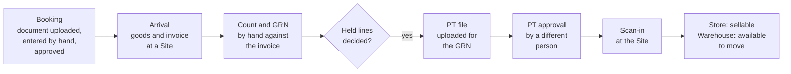

# Goods-in, first version

> **Rank 3 of 4: design.** Must not contradict the PRD or the KDPS policies. See [README.md](../../README.md).

Status: **Current**, approved as a whole by the product owner on 21 Oct 2026: sections 1 to 10 section by section with their design choices, then sections 11 and 12 with the whole. If this document disagrees with [prd.md](../../prd.md) or [kdps-policies.md](../../kdps-policies.md), they win. Raise the clash; do not guess.

Implements, for the first version of stage 2 ([phases.md](../../phases.md) stage 2): from Booking and buying, recording and approving bookings; from Receiving and price tickets, the Arrival, the count, the GRN, the PT made by uploading the fixed PT template, its approval and the scan-in at the Site; from Damage, quarantine and disposal, damage reported at or after receipt; from Stock and warehouse control, stock search. It details the stage 2 modules `booking`, `receiving` and `merchandise` · PT, and the damage reports of `stock` · documents, of [module-map.md](../architecture/module-map.md) section 5. Its open questions are GI-n.

- PRD IDs: `PRD-BKG-001`–`PRD-BKG-011`, `PRD-BKG-013`, `PRD-BKG-014`, `PRD-BKG-015` (manual entry; its AI reading later); `PRD-REC-001`–`PRD-REC-009`, `PRD-REC-012`, `PRD-REC-013`, `PRD-REC-016`–`PRD-REC-018`, `PRD-REC-019` (reversal before scan-in), `PRD-REC-021`, `PRD-REC-022`; `PRD-PTW-008`–`PRD-PTW-012` (the meaning of the template's columns); `PRD-MER-005`–`PRD-MER-007`, `PRD-MER-009`, `PRD-MER-013`, `PRD-MER-014`; `PRD-IMP-002`, `PRD-IMP-006`, `PRD-IMP-008`, `PRD-IMP-011`, `PRD-IMP-012`; `PRD-STK-001`, `PRD-STK-003`, `PRD-STK-006`, `PRD-STK-017`; `PRD-DMG-001`–`PRD-DMG-006`, `PRD-DMG-010`; `PRD-PRO-001`; `PRD-UXP-005`; `PRD-LIF-001`, `PRD-LIF-002`; `PRD-ACP-001`, `PRD-ACP-003`, `PRD-ACP-005`.
- Policies: 1 (`POL-01.02`–`POL-01.05`, `POL-01.08`, `POL-01.14`), 2 (`POL-02.07`, `POL-02.09`, `POL-02.12`), 3 (`POL-03.02`–`POL-03.04`), 5 (`POL-05.01`–`POL-05.10`), 10 (`POL-10.08`), 17 (`POL-17.02`, `POL-17.03`, `POL-17.11`).
- Decisions: DEC-105, DEC-128 to DEC-139, DEC-141.

Depends on: [module-map.md](../architecture/module-map.md) (section 5: the stage 2 modules; 6.2 flows A, B, C and E), [domain-model.md](../architecture/domain-model.md) (section 2: the stage 2 records; section 5: approval boundaries), [stock-ledger.md](../stock/stock-ledger.md) (2.3 movement kinds, 6 holds and sellable stock, 13 the interface), [books-and-posting.md](../finance/books-and-posting.md) (posting a valued movement), [structure-and-masters.md](../masters/structure-and-masters.md) (products, external codes, vocabularies, agreements), [access-and-approvals.md](../access/access-and-approvals.md) (approvals, My work, exceptions), [numbering-and-audit.md](../platform/numbering-and-audit.md) (document numbers), [imports-and-opening-data.md](../platform/imports-and-opening-data.md) (stored files and the import pipeline).

Inputs, not ranked: the grill notes [stage-2-grill-notes.md](../../plan/stage-2-grill-notes.md); [pt-file-layouts.md](../../data-notes/pt-file-layouts.md) section 1 (KDPS's PT template) and [item-master-vocabulary.md](../../data-notes/item-master-vocabulary.md) (its master sheet); [grn-standard-fields.md](../../research/grn-standard-fields.md); the earlier RetailsOps system document [system-dumb.md](../../history/system-dumb.md) (sections 4 to 6, 13 to 15, 17.5, 18.3 to 18.6, 20.4, 20.5) and the earlier RetailsOps goods plan (`change-prd-goods-to-store-acceptance.md`, kept outside this repository).

---

## 1. What this document fixes

The first version of goods-in is the operational path from a booking to stock that can be sold at a Store, all entered by hand (`DEC-134`, `DEC-136`):

1. **Booking.** The booking document is uploaded and the booking is entered by hand. It is approved against open-to-buy (section 3).
2. **Arrival.** Goods reach a Store or a warehouse with their supplier invoice (section 4).
3. **Count and GRN.** The goods are counted by hand against the invoice; documents and photos are uploaded; the GRN is issued (section 4).
4. **PT file.** Whoever is assigned makes the PT file by hand in the Organisation's fixed PT template and uploads it for the GRN (section 5).
5. **PT approval.** A different person approves it; the stock becomes official and valued (section 6).
6. **Scan-in.** The goods are scanned in at the Site; at a Store they become sellable (section 7).

Damage reported at or after receipt (section 8) and stock search with the stage 2 reports (section 9) complete it.

**After the first version**, still to be placed (RR-546): the PT workbench and costing profiles per brand; readers for vendor PT files in XLS, XLSB and CSV and their layouts; all AI reading, of booking documents and PT files; barcodes and labels for goods that arrive without a brand barcode; piece-tracked products and piece IDs; supplemental PTs and clean lines going ahead while others are disputed; PT corrections after scan-in; inbound ownership, goods owned before they arrive (`DEC-139`). Each keeps its PRD ID; nothing here removes it.

**Moved out of stage 2:** supplier invoice matching goes to stage 5, with supplier payments (`DEC-137`). The side-by-side test imports of the earlier POS stay parked.

**Not in stage 2:** transfers between Sites, supplier returns, write-off, disposal and counts (stage 3); payment runs (stage 5); buying suggestions (stage 6).

**Already built in stage 1 and used here, not redesigned:** Sites, Stores, business units and locations; products, external codes, vocabularies, brands, suppliers and agreements; roles, approvals, My work and exceptions; number series; stored files; the stock ledger's movements, holds, coverage, acceptance and valuation; books, posting maps and journals; Site readiness per activity.

**What every section keeps:**

- Only the count creates custody. A booking, an invoice or a PT never creates stock (`PRD-REC-008`, `PRD-ACP-001`).
- The GRN holds quantities, never values (grill round 1).
- Every approval is by a different authorised person from the preparer, and binds to the exact version approved (`POL-02.07`, `PRD-ACS-007`).
- An unknown value stays Unknown, never zero (`PRD-MOD-015`).
- An approved record is never edited; a correction is a linked record (`PRD-REC-019`).
- Receiving is available at a Site or business unit only after its receiving readiness is approved (`PRD-LIF-001`, `PRD-LIF-002`).

## 2. The flow end to end

| Step | Who (persona) | What happens | Record | Stock and money effect |
| --- | --- | --- | --- | --- |
| 1. Booking entered | Booking (P-BKG) | Uploads the booking document (photo or PDF); enters supplier, brand, season and destination, and lines of style code and quantity, with colour and size where given and an indicative cost and MRP each (`DEC-130`, `DEC-136`) | Booking, Draft (`booking`) | None |
| 2. Booking approved | An approver with the booking limit, not the preparer | Checks the booking against the open-to-buy budget of its brand and season, on its value at cost; the booking takes its brand's Agreement version in force at that moment (`PRD-BKG-004`, `DEC-132`) | Booking, Approved; then Issued and Confirmed as the supplier is told and accepts (`POL-05.01`) | None. Open-to-buy is reserved (`POL-05.02`) |
| 3. Arrival recorded | Whoever receives at the Site: Warehouse (P-WHS) or the Store's staff (P-STM) | Records the supplier, the brand and each invoice's number and date, and uploads the invoice; the invoice comes first (`DEC-133`) | Arrival (`receiving`) | None |
| 4. Count and GRN | The receiver | Counts by hand against the invoice, by style, colour as the invoice names it, and size (`DEC-138`); records shortage, excess, wrong, unidentified and damage apart; uploads the other documents and photos; issues the GRN, with no approval. Each GRN line links to its booking line or goes to Booking for review (`DEC-130`) | GRN (`receiving`) | Custody at the Site from the count, cost Unknown, not accepted (stock ledger: receipt count). Damage at once under a damage hold; wrong and unidentified goods in quarantine; excess under an excess hold (stock ledger 6.1) |
| 5. Held lines decided | Damage: a different person, followed up by Operations (P-OPS). Excess, wrong, unidentified: a Booking approver | Confirms or rejects each damage report; takes each excess, wrong or unidentified line in, or records it as not received (grill round 1) | Damage report (`stock` · documents); the discrepancy's decision (`receiving`) | Rejection clears only that damage hold (`PRD-DMG-003`); confirmed damage stays held (`PRD-DMG-006`) |
| 6. PT file uploaded | Whoever is assigned to make PTs | Uploads one PT file for the GRN, in the fixed template, once every held line is decided (`DEC-137`). The upload is refused whole when a value is off its list or the rows do not match the GRN per style and size with the same quantity (`DEC-134`, `DEC-135`, `DEC-138`) | PT, a draft revision (`merchandise` · PT) | None |
| 7. PT approved | A different person with PT approval authority | Approves the PT on its total proposed acquisition cost (P RATE times quantity) and confirms any new products the upload proposed (`DEC-135`; module-map 6.2 flow C) | PT, official and frozen | Coverage recorded; cost established; the stock value and its balanced journal, including what is owed to the supplier, posted under the posting map (grill round 1, `PRD-STG-002`) |
| 8. Scan-in | At a Store, its staff; at a warehouse, Warehouse | Scans each item's barcode against the approved PT and puts it on the floor or in the backstore, or in a warehouse bin; a repeated brand barcode asks which product it is (`DEC-135`) | Acceptance (`receiving`) | Acceptance and a location move (stock ledger). At a Store the goods become sellable (stock ledger 6.3); at a warehouse, available to move |

- **Before the scan-in**, a wrong PT is reversed and a corrected file uploaded and approved again by a different person (`DEC-137`).
- **Confirmed-damaged pieces** take no PT and stay held (`DEC-137`).
- **Follow-up owners:** Booking for shortage, excess, wrong and unidentified goods and for GRN lines that do not match a booking; Operations for damage (grill notes, 19 Oct 2026). Each reaches its owner in My work as an exception or a task.
- **Nothing is sent** to suppliers or anyone else from the app before stage 5 (`DEC-099`): a booking is marked Issued and Confirmed by the person who did it outside the app.

## 3. Booking

A booking records what has been ordered from a supplier for a brand and a season, to arrive at one destination. It is intent only: it creates no stock and no money effect (`PRD-REC-008`, `PRD-BKG-003`). It lives in `booking` (module-map section 5).

### 3.1 Recording a booking

- **The document first.** Booking (P-BKG) uploads the booking document the brand gave, as a photo or PDF, one file or more, kept as a stored file attached to the booking (`PRD-IMP-002`; the stage 1 stored-file rules: PDF, JPEG or PNG). At least one document is attached before the booking is submitted for approval. **Design choice.**
- **Then the entry, by hand** (`DEC-136`). Nothing is read from the document in the first version; its AI reading follows later (`PRD-BKG-015`, RR-546).
- **Header** (`PRD-BKG-001`, `PRD-BKG-014`):

| Field | Rule |
| --- | --- |
| Supplier | A party holding the supplier role, linked to the brand by a brand–supplier link in force on the booking's date (`PRD-MER-021`); otherwise the booking is refused, naming the missing link |
| Brand | A brand in force |
| Season | A value of the attribute the Organisation marks as its season (structure-and-masters 4.2 "As built"; RR-550) |
| Destination | One Site, a Store or a warehouse. Different destinations are different bookings. The business unit is chosen when the goods arrive (section 4) |
| Delivery window | A start and an end date (`POL-05.05`) |
| Booking document | The stored files above |
| Terms | Shown from the brand's Agreement, read-only (3.2) |

- **Lines** (`DEC-130`):

| Field | Rule |
| --- | --- |
| Style code | Required. As the document writes it; it need not be a style already set up |
| Colour | Optional. As the document writes it |
| Size | Optional, for an order placed at style level. A missing size stays missing; it is never Free Size (`PRD-MER-005`) |
| Quantity | Required. Whole pieces, more than zero |
| Indicative cost | Required. Integer paise, per piece. Used only for the booking's totals and the open-to-buy check; it never becomes the receipt cost (`PRD-BKG-003`) |
| MRP | Required. Integer paise, per piece |
| Delivery date | Optional, for a line arriving apart from the rest (`POL-05.05`) |

- **The size-colour grid** enters one style's lines at once: colours down, sizes across, quantities in the cells, one indicative cost and MRP for the style that each line can then change (`PRD-BKG-001`). A line without colour or size is entered on its own.
- **Totals** shown: pieces, indicative cost and MRP value, for the booking and per style (`PRD-BKG-003`).
- **Number.** A draft carries an internal reference. Approval gives the booking its number from its own number series (numbering-and-audit); with no series set up, approval is refused, naming the missing series. **Design choice.**

### 3.2 Terms

- A booking takes its terms from its brand's Agreement: commercial model, ownership-transfer event, return rights and conditions, payment and money terms (`PRD-BKG-002`, `POL-01.02`, `POL-01.08`, `POL-01.14`, `DEC-129`). It records none of its own and cannot change them.
- The terms are fixed at approval: the booking keeps the Agreement version in force at that moment, and takes a later version only when it is approved again (`POL-01.04`, `DEC-132`).
- A brand with no Agreement in force cannot have a booking approved; the refusal names the brand. A term the Agreement holds as Unknown stays Unknown on the booking (`POL-01.11`). **Design choice.**

### 3.3 Open-to-buy

- An open-to-buy budget is an amount in paise for one brand and one season (`PRD-BKG-004`). Booking prepares it, Accounts records its check, and the Owner approves it; it is used only once approved (`POL-05.09`). They are three different people for each version, and the approval has no value limit (`DEC-142`). A change is a new version through the same three steps. Every amount is OPEN until the product owner sets it (V-17, RR-080).
- **Remaining** open-to-buy is the approved budget less the value reserved by approved bookings of that brand and season.
- A booking's value is the sum of its lines' quantity times indicative cost (domain-model section 5, DM-8).
- Approving a booking needs its value within the remaining open-to-buy; otherwise approval is refused with the shortfall shown, and the budget must be raised first. With no approved budget for the brand and season, approval is refused (`PRD-SEC-017`). **Design choice.**
- Approval reserves the booking's value (`POL-05.02`). Cancelling a balance, or an approved change that lowers the value, releases the difference; received goods keep their share reserved.
- **As built** (`S2-F01-T02`; migration `0086`). **Design choice** throughout; no amount is chosen.
  - **The budget.** One per brand and season, each pair once (`booking.budget-exists`); a change is its next version. The brand must be in force today and not retired (`booking.brand-not-in-force`). The season is named by its value alone, an approved value in force today of the attribute marked as the Organisation's season at the command's start (`booking.season-not-in-vocabulary`, naming that attribute and the value; structure-and-masters 4.2 "As built"; RR-550, GI-2). While no attribute is marked as the season, preparing a budget is refused, `merchandise.attribute-not-marked`, naming the setting `merchandise.season-attribute`, before its brand is checked; nothing falls back to another attribute (code-house-rules 12.14). The budget keeps the attribute its season was a value of when it was prepared and the version of the marking it read (code-house-rules 7.3), so a later change of the marking leaves it as it was; its read answers that version beside the season. The amount is whole paise, never below zero, with its origin (code-house-rules 12.14); on `dev` and in tests it is synthetic.
  - **Scope.** A budget carries its brand as its one scope fact (`booking.open_to_buy_budget`, view, create, edit, approve; access-and-approvals 5.3), so a person's brand scope decides whose budgets they prepare, read, check or approve; every route authorises in its command with the brand, and the list leaves out the budgets the reader's scope does not cover. The tables are unscoped, as the masters of `organisation` are (structure-and-masters 6.1).
  - **Accounts' check is a decision of `access`** under its own action type, `booking.open_to_buy_budget.check`, decided under approve on `booking.open_to_buy_check`, a record type no permission on the budget gives, so the check and the approval are held apart (`POL-05.09`). It therefore reaches Accounts in My work with the approval panel, the reason list, evidence and audit of every decision, and `access` refuses the version's preparer (access-and-approvals 9.3; `POL-02.07`). Preparing a version requests the check. Its effect records the check, an append-only row of `booking`, one per version, naming who checked it and the decision (`open_to_buy_budget_check`, whose trigger also refuses the preparer), and in the same transaction requests the version's approval, `booking.open_to_buy_budget.change`, under approve on the budget (access-and-approvals 9.8b "As built for a document decided in two steps"). So the Owner, or whoever holds the approval, finds the approval in My work only once the check is recorded, and the approval's effect refuses a version with no check (`booking.budget-not-checked`). A check rejected, or an approval rejected, leaves the version Rejected, back with Booking. The preparer of both requests is the version's preparer. **Three different people** (`DEC-142`; RR-548): whoever recorded the check may not decide the approval of the same version either. The approval's effect names the checker to `access` as the person who decided its earlier step, and `access` refuses them as it refuses a preparer, `access.earlier-step-decider`, naming them as `earlier-step-decider`, and does not offer them the approval in My work (access-and-approvals 9.3, 9.8b). A person holding both permissions may check one version and approve another.
  - **No value basis.** No source names one for a budget, which is not a document of value (DM-8; domain-model section 5), so either decision needs only approve on its record type, and no approval limit applies (access-and-approvals 9.3). The approval has no value limit (`DEC-142`; RR-548).
  - **Versions** are frozen when prepared and dated by instants, as user versions are (access-and-approvals 9.5): Awaiting approval through both steps, with no dates; the approval starts it at the decision's instant and ends the version in force there; approved versions never overlap (code-house-rules 7.3). A version prepared while another waits, at either step, supersedes it: its open request is Superseded and can no longer be decided (access-and-approvals 9.6), and its row keeps Awaiting approval. A new version names the newest one's identifier as its version token (code-house-rules 12.7; `kernel.stale-version`). The version in force stays in force until the new one is approved, and every version keeps its history.
  - **Remaining** is read at the instant asked: the approved version in force, less what approved bookings of the brand and season reserve, the sum of the budget's reservations, each written by a booking's approval (3.9; `S2-F01-T03`); with no approved version it is not approved, never zero (`PRD-MOD-015`). `booking`'s interface answers it for a brand and season (`remainingOpenToBuy`), for the booking's approval to check and reserve.
  - **The policy gate.** A budget is no value of policy 5 (`DEC-142`; RR-549): its own check and approval are its control, so `booking` registers no validity check for budgets, and approving a new version leaves policy 5's validation as it is. Preparing, checking and approving a budget are not policy-gated (DEC-116; 10.5). As built in `S2-F01-T02` the budgets were reported as policy 5's values (`booking.open-to-buy-budgets`); that check is removed. No other module reports a value of policy 5 yet, so policy 5 cannot be validated (`configuration.no-values-to-validate`; RR-480) until a module reports its values; which of policy 5's values the gate covers is settled with a booking's approval (`S2-F01-T03`; 10.5).
  - **Screen.** Booking › Open-to-buy (section 11) lists each budget the reader may see, with its brand and season, the approved amount, what is reserved and what remains, and its newest version's state and step. The list is read a page at a time by a cursor, in the order the budgets were prepared, at most `OPEN_TO_BUY_PAGE_CAP` (100, a technical cap) to a page, and Load more reads the next; budgets outside the reader's scope are left out after a page is read, so a page may hold fewer, and its cursor still moves past them (code-house-rules 12.1 "Reads"; as the stage 1 master lists). **Design choice.** A budget's drawer holds every version, its step (waiting for the check, checked and waiting for the approval), when it was checked and when it was in force, the approval panel of a version still waiting, a new version, and the budget's history. The check and the approval are decided from My work.

### 3.4 Lifecycle and approval

- States, from `POL-05.01`: **Draft** (editable), **Approved** (internal authorisation), **Issued** (sent to the supplier), **Confirmed** (the supplier accepted that version).
- **Submit and approve.** Booking submits the Draft; an approval request binds to that exact version (module-map 6.2 flow A). An approver, a different person from the preparer, whose booking limit covers the booking's value, approves or rejects with a reason (`POL-02.07`, `POL-02.09`). In one transaction the approval checks open-to-buy and reserves it, fixes the Agreement version, gives the number and makes the booking Approved. A rejection returns it to Draft.
- **Issued and Confirmed** are recorded by Booking, with the date, because nothing is sent from the app before stage 5 (`DEC-099`). Confirmed attaches the supplier's confirmation as a stored file. **First version, for the product owner's approval:** the line-by-line comparison of the supplier's confirmation with the booking (`PRD-BKG-010`) needs the confirmation's lines, which the first version does not capture; it follows with the AI reading of documents (RR-546). Until then a difference the supplier states is entered as a change to the booking (3.5).
- A booking is **received against** only once it is Approved, Issued or Confirmed.

### 3.5 Changes and cancellation

- A Draft is edited freely.
- After approval, any change is a new version that needs approval again before it takes effect, and it takes the Agreement version then in force (`POL-05.03`, `POL-05.10`, `PRD-ACS-007`, `DEC-132`). After issue, record the supplier's communication with the change (`POL-05.04`).
- Cancelling the undelivered balance of a line or of the whole booking is proposed by Booking and approved by a different authorised person (`POL-05.07`, `POL-05.10`). Cancellation never erases quantities already received (`PRD-BKG-013`, `POL-05.04`).
- Extending the delivery window follows the same approval (`POL-05.07`).

### 3.6 Quantities

For each line, kept apart from the invoice discrepancies of section 4 (`PRD-BKG-005`):

- **Ordered:** the quantity of the approved version.
- **Delivered:** the counted quantity of the GRN lines linked to it, in any condition, taken from those links and never typed (`PRD-BKG-006`). Excess or wrong goods recorded as not received are not delivered.
- **Cancelled:** the approved cancellations.
- **Outstanding:** ordered less delivered less cancelled, never below zero. Delivered beyond ordered is shown as over-delivered.

Example (`PRD-BKG-005`): sizes S, M and L booked at 10 each; deliveries of 5, 3 and 2 a size leave 15, 6 and 0 outstanding.

### 3.7 Receiving against a booking

- The Arrival names a booking when the goods come against one ("Receive against booking"), or none ("Goods arrived"), in the same guided workflow (`PRD-REC-002`, section 4).
- **At GRN issue** each counted GRN line links to the one line of that booking whose style code matches, and whose colour and size match where the booking line gives them. Text is compared ignoring case and spaces at the ends. Any other line goes to Booking for review (`PRD-BKG-007`, `DEC-130`). **Design choice** for the comparison.
- A GRN at a Site that is not the booking's destination goes to Booking for review. **Design choice.**
- A GRN whose Arrival's supplier is not the supplier of the booking's version in force goes to Booking for review whole (`other-supplier`): its goods are not that supplier's. The Arrival names only a booking of its own supplier (4.10), so this happens only when a change of the booking naming another supplier is approved before the GRN is issued. **Design choice** (code review 6 of stage 2).
- **Later linking.** Booking may link a GRN line received without a booking, or one sent for review, to a booking line afterwards (`PRD-BKG-008`). The link is a dated record with who made it; it never changes the GRN.
- One booking can be delivered over several Arrivals; each partial delivery lowers outstanding, and a shortage stays visible (`POL-05.05`).
- **Late or excess goods** (`POL-05.08`; **Decided** by the product owner, 22 Oct 2026, RR-577's `POL-05.08` half). A GRN line that arrives after the booking's delivery window, as extended, or whose pieces exceed the booking line's outstanding, does not link at GRN issue: it goes to Booking for review. Booking proposes the link, and a different authorised person approves it, gated like the other booking approvals, through `access`'s approval route, as a cancellation and an extension are (3.10). On approval the link is made, and the late or excess pieces then count as delivered, or over-delivered, on the booking. The goods are recorded into physical custody all the same: the GRN is issued as counted.
- **An excess line goes to review whole.** A GRN line whose pieces exceed the outstanding is not split: none of it links at issue, and its approval links all of it, part delivered and the rest over-delivered. **Design choice**, the simpler rule that honours "require approval before acceptance into the booking": a GRN line links once (3.10), so it is never partly linked and partly waiting. An arrival on the window's last day is within it; one before the window's start is not late. A line both late and excess goes to review as late.
- As built: 4.10.

### 3.8 Late deliveries

- When a line's delivery date or the booking's window passes with quantity outstanding, the balance is marked overdue and a follow-up exception reaches Booking in My work (`PRD-BKG-009`, `POL-05.06`, `DEC-099`). Expiry never cancels the balance.
- Booking then extends the window or cancels the balance, each with its approval (3.5).
- The transporter and lorry receipt are recorded on the Arrival (section 4), not on the booking.

### 3.9 As built for recording and approving a booking (`S2-F01-T03`)

**Design choice** throughout; none sets a business value. Tested in `apps/server/test/bookings.int.test.ts` (the parts of test 4 of section 12 that this piece reaches: approval reserves, open-to-buy short or missing refused, the Agreement version fixed, no Agreement refused; with two approvals at once, the number series, the preparer and the approver's limit), the form's pure rules in `apps/web/src/booking/lines.test.ts`, and Booking's journey in `apps/web/e2e/booking.spec.ts`.

- **Records** (`booking`, migration `booking__bookings`; 10.1). A booking is a document (code-house-rules 7.2): a header, `booking.booking`, naming its brand and its destination, fixed when it is created, and versions holding its payload. Every save of a Draft writes the booking's next version, `booking_version`, with its lines, `booking_line`, each frozen when written, so no version ever changes; the newest is the Draft, and submitting binds the approval request to it. Each change, a version saved, documents attached, a submission, an approval or a rejection, writes the booking's next change row, `booking_change`, numbered under the booking's lock; its newest row is the booking's version token (code-house-rules 12.7), and its kind gives the state: Draft after a save, documents or a rejection, Awaiting approval after a submission, Approved after an approval. Nothing stores the state. The approval of a version is a row of its own, `booking_approval`, with the Agreement version it fixed and the value it reserved; the number is `booking_number`, given once; the reservation is `open_to_buy_reservation`. Every row is append-only. Every reference inside the schema has a foreign key, and every foreign key and scope column an index (code-house-rules 3.2, 3.3).
- **Destination and scope.** The destination is one Site, a Store's or a warehouse's: several Stores may trade at one Site (`PRD-ORG-021`) and the business unit is chosen when the goods arrive (3.1), so a booking names no Store, no unit and no legal entity. Its rows are scoped by the Site and the brand under `booking.booking` (view, create, edit, approve; place and brand; access-and-approvals 5.3), so a person whose place scope covers the Site and whose brand scope covers the brand sees it; a person scoped to a Store or a unit alone does not (structure-and-masters 3.9). A booking the reader may not see is not found, `booking.record-not-found`, never refused as not authorised, and so is a replay of a request on it: a replay keeps the kind of the access check that refuses it now (code-house-rules 12.3, 12.4; `access`'s `replayRefusal`; code review 5 of stage 2). The reservations belong to the budget, unscoped as the budgets are (3.3 "As built"), so whoever reads a budget's remaining amount reads every reservation of it. Create records a booking; edit saves its next Draft, attaches its documents and submits it; approve decides it.
- **Brand and destination stay** for the booking's life: a Draft for another brand or destination is another booking. The supplier, the season, the window and the lines change by the next Draft.
- **The Draft's content** (3.1), checked at each save on its date, today: the brand in force (`booking.brand-not-in-force`); the destination a Site in force, when the booking is recorded (`booking.site-not-in-force`); the season an approved value in force today of the attribute marked as the season at the command's start, kept with that marking's version (`booking.season-not-in-vocabulary`; with none marked, `merchandise.attribute-not-marked`, naming the setting; RR-550); the supplier linked to the brand today (`booking.supplier-not-linked`; `PRD-MER-021`, through `merchandise` · parties' `brandSupplierLinkedOn`); a window ending on or after its start. A line keeps its style code, and its colour and size where given, each as written, so a GRN line is matched against them, ignoring case and spaces at the ends (3.7); the size is text as the document writes it, not a value of the size list, and a missing one stays missing (`PRD-MER-005`). A Draft may hold no line yet.
- **The totals** (`PRD-BKG-003`) are the pieces, the indicative cost value and the MRP value of the booking and of each style, a style being its style code compared ignoring case and spaces at the ends, named as first written; exact, whole paise times whole pieces (`bookingTotals`, the booking entry point `@apparel-os/calculations/booking` of `packages/calculations`, shared by the server and the screen; shared-calculations 2.1, 2.2). The booking's value at cost is its cost total (DM-8).
- **Documents.** Each booking document, a photo or PDF stored first through `files-imports`, is attached to the booking, apart from its versions, as the evidence kind `booking.booking-document`, each stored file once; documents are attached only to a Draft. Attaching is a change of the booking: it names the version token read and is refused `kernel.stale-version` on another (code-house-rules 12.7).
- **Submit** (3.4) locks the booking, rechecks its token, and is refused while the booking is not a Draft (`booking.not-draft`), has no document (`booking.no-document`) or its newest version no line (`booking.no-lines`). It requests the approval, `booking.booking.approve`, bound to the newest version, on its value at cost, with the booking's Site and brand as its facts. Its preparers are everyone who saved a version, attached documents or submitted since the booking's last approval: the content is theirs, so whoever made a rejected version stays a preparer of the next one built on it (access-and-approvals 9.1; GC3-1). A version rejected may be submitted again unchanged, as a new request.
- **The approval** is a decision effect of `access` (access-and-approvals 9.8b), which has already refused the preparers and checked the approver's booking limit on the value at cost (9.3; `access.above-approval-limit`, `access.no-approval-limit`). Decide takes, with the request at step 1, the booking's identity row and the budget of its brand and season (code-house-rules 8.2), so two approvals never reserve the same remainder; a budget made after Decide chose its locks makes the decision stale, tried again. Under the locks, in this order: the version still the one submitted (`booking.version-not-awaiting`); the policy gate (10.5 "As built"); the supplier still linked to the brand on the approval's date, the booking's date (`booking.supplier-not-linked`); an approved budget for the brand and season (`booking.open-to-buy-missing`) whose remainder covers the value at cost (`booking.open-to-buy-short`, naming the brand and season by identifier, as a refusal names only identifiers and codes, code-house-rules 12.3: the screen shows the amounts from its reads, the booking's value at cost from the booking and what is left from the open-to-buy read with it, and by how much it is short); the brand's Agreement version in force on the approval's date (`booking.no-agreement-in-force`, naming the brand); at the booking's first approval, an Open booking series (`booking.no-booking-series`, `booking.booking-series-paused`), locked at step 8. Then the number, the approval row with the Agreement version, the reservation of the value at cost, the change row, the audit record and `booking.booking-approved` are written in the decision's transaction, or none of them is.
- **A rejection** writes the change row and its audit record: the booking is a Draft again; the version rejected stays as it was, its request Rejected.
- **The terms** shown are the brand's Agreement version in force today while the booking is not approved, or none, and once approved the version its approval fixed (3.2; `termsOfVersion` of `merchandise` · parties). Margins are not shown on a booking: they stay behind their field class on the Agreement itself (access-and-approvals 6).
- **The booking number** comes from one series for the Organisation, not restarted each financial year, whose years are not set (GC5-1), as the GRN's (4.8); its format is the Organisation's, set by an operator until a screen exists (RR-449). The tests and the server of the browser journeys define the series with a format labelled SYNTHETIC, `SYN-BKG-` and five digits (`DEC-118`). The local seed, which sets up `dev`'s Organisations, defines it too, for each of its Organisations that has none, a finished one included (`DEC-144`, RR-564); a booking's approval on `dev` still waits on policies 5 and 1 (10.5). A Draft's internal reference is its identifier, shown as `Draft` and the identifier's last eight characters in capitals (the catalogue's `booking.reference.draft`), which are random in a UUIDv7, as an error's reference is (code-house-rules 12.3).
- **The list** (section 11) reads the bookings the reader may see, newest first, a page of at most 100 at a time by a cursor (`BOOKING_PAGE_CAP`, a technical cap; code-house-rules 12.1), filtered by state, brand, season, supplier and destination, each with its newest version's header and totals.
- **Input caps.** Technical caps, the builders' choice and no business limit, named `BOOKING_CAPS` in `packages/schemas`: at most 10,000 lines a version, the scale of a PT file (12 test 21), so a booking by style, colour and size fits; 1,000,000 pieces a line; and 60 characters for a style code, a colour or a size; totals at cost and at MRP must fit whole paise a safe integer holds. The lines of a version are written 1,000 to a statement, within the parameters PostgreSQL binds to one. A route that saves a Draft takes a body of at most 8 MiB (`BOOKING_DRAFT_BODY_LIMIT_BYTES`), so a Draft at every cap fits, its texts in a script of up to three bytes a character. Past one, the request is refused as invalid (code-house-rules 12.2).
- **Screens** (section 11): Booking › Bookings, for whoever holds view on `booking.booking`; a booking opens in the screen with its documents, the terms read-only, the remaining open-to-buy of its brand and season, its lines and totals, its versions and, while it awaits approval, its approval panel. The booking form enters the header, one style's lines at once through the size-colour grid (colours and sizes as the document writes them, separated by commas; one cost and MRP for the style, which each line then changes), and lines one by one, with the totals shown as typed. Saving, attaching a document and submitting name the version the screen shows, so each waits, disabled with its reason, while the booking is read again after a change. The approval panel in My work shows the booking's header, its totals by style, its documents count, the remaining open-to-buy with the booking's value at cost beside it and any shortfall, and the terms. Booking (P-BKG) has Booking › Bookings in the menu.

### 3.10 As built for Issued, Confirmed, changes, cancellation and overdue (`S2-F01-T04`)

**Design choice** throughout; none sets a business value. Tested in `apps/server/test/booking-lifecycle.int.test.ts` (tests 4, 5 and 7 of section 12: Issued and Confirmed; a change approved again reserving and releasing the difference and, on a later day, taking the Agreement version then in force; a cancellation releasing its value and keeping what was received; delivered quantities from receipt links made through the receipt link operation by a test caller; an extension; a second cancellation or extension refused while one of its kind waits; a later link refused for goods not of its line; the window deciding overdue, whatever a line's own date; the overdue balance raised by the job, nothing cancelled, and the job's selection agreeing with the booking status; a booking hidden from its reader, and a replay on it, not found), the pure rules in `apps/server/src/modules/booking/domain/lifecycle.test.ts`, the form's line keys in `apps/web/src/booking/lines.test.ts`, and Booking's journey in `apps/web/e2e/booking.spec.ts`.

- **Records** (`booking`, migration `booking__lifecycle`; 10.1). Every row is append-only and scoped as the booking's (3.9): `booking_issue` and `booking_confirmation`, one each per version; `booking_amendment`, a cancellation or an extension of the version in force, with its lines (`booking_amendment_line`) and its one decision (`booking_amendment_decision`); `booking_supplier_file`, a file from the supplier, the confirmation of a version or the communication with a change or an amendment, attached through `files-imports` to the booking at what it belongs to; `booking_receipt_link`; `booking_overdue`; and `open_to_buy_release`, what a cancellation or a lowering change releases, unscoped as the reservations are (3.3 "As built"). The change kinds of `booking_change` are widened by `issue`, `confirmation`, `amendment` and `amendment-decision`, so each is the booking's next change and moves its version token (code-house-rules 12.7).
- **A line's key.** A line keeps one identity across versions: a line written in a version may continue a line of an earlier version of the same booking, and then names that line as first written (`booking_line.first_line_id`); its key is that line's identifier, otherwise its own. A Draft's line names the line it continues by its key (`lineKey`); one that names none is new. Receipt links, cancellations and overdue marks name the key, so they follow the line into each later version. A key not of the booking is refused, `booking.line-not-found`, and one named twice in a version `booking.line-repeated`; a new booking's line continues none.
- **The state** (3.4; `POL-05.01`). Before the first approval it is read from the newest change of the booking's content, as before: Awaiting approval after a submission, a Draft otherwise. Once approved, the version in force is the approved version of the highest number, and the state is its own: Confirmed once its confirmation is recorded, Issued once its issue is, Approved before. A change after approval, a newer version, is shown apart as a Draft or Awaiting approval; the version in force stays in force until it is approved. Issued and Confirmed bind to a version, as `POL-05.01` says the supplier accepts "the agreed version", so a change approved after issue is Approved until Booking records it Issued and Confirmed again (**Decided** by the product owner, 22 Oct 2026, as built: RR-575). The list filters on the same state, read in SQL.
- **Issued and Confirmed** (3.4; `DEC-099`). Recorded by Booking under edit on the booking, naming its version token, of the version in force, each once (`booking.already-issued`, `booking.already-confirmed`), with its date: never later than today (`booking.date-in-future`), an issue not before the approval's date and a confirmation not before the issue's (`booking.date-too-early`); a confirmation only once the version is Issued (`booking.not-issued`), with the supplier's confirmation, one stored file or more, as the evidence kind `booking.supplier-confirmation`. A booking not approved is refused, `booking.not-approved`. Neither is policy-gated: each records what was done outside the app (DEC-116).
- **A change after approval** (3.5; `POL-05.03`, `POL-05.10`, `DEC-132`). An approved booking takes its next Draft while no version of it awaits approval; its booking documents are fixed with the first approval (`booking.not-draft`). A change keeps, of each line of the version in force, at least the pieces delivered and cancelled of it, and leaves out no such line (`booking.line-below-received`; `PRD-BKG-013`), and a line with goods linked to it keeps its style code, colour and size, compared as a GRN line is matched (`booking.line-received`), so a receipt link always names a line its goods match; both are checked when the Draft is saved and again under the lock at its approval, since goods may be linked meanwhile. An approved booking is submitted again only with a newer version (`booking.no-change`); after issue, with the supplier's communication, one stored file or more, as the evidence kind `booking.supplier-communication`, kept with that version (`booking.communication-required`; `POL-05.04`). Its approval is a booking version's (3.9): the same action type and booking limit, on the version's value at cost (domain-model section 5). Under the locks the version commits its lines less what is cancelled of them, at their cost; what that is beyond what the booking reserves already of its brand and season's budget is reserved, within the remainder (`booking.open-to-buy-short`, naming the brand and season, as for a first approval); what is less is released, and so is whatever the booking reserves of another budget, as when the change moves it to another season. Decide therefore takes, with the booking, the version's budget and every budget the booking reserves of. The change takes the brand's Agreement version in force on its approval's date (`DEC-132`); the number stays. A change rejected returns to Draft and the version in force stays.
- **A cancellation** (3.5; `POL-05.07`, `POL-05.10`; `PRD-BKG-013`). Booking proposes it against the version in force, naming its version token: of the whole booking, every line with something outstanding, or of the lines named, each line's whole outstanding balance as of the proposal; a line or a booking with nothing outstanding is refused (`booking.nothing-outstanding`). Part of a balance is cancelled by a change that lowers the line. After issue it carries the supplier's communication (`POL-05.04`). Its approval is requested under the action type `booking.booking.cancel-balance`, under approve on the booking, by a different authorised person from its proposer, with no value basis: domain-model section 5 names none, a cancellation only releases open-to-buy, so no approval limit applies, only a different authorised person (**Decided** by the product owner, 22 Oct 2026, as built: RR-574). Under the locks the decision is refused when a change of the booking was approved since (`booking.version-not-in-force`), and when a balance is no longer the quantity proposed, as when goods were linked since (`booking.balance-changed`): it is rejected and proposed again. Approved, the cancelled pieces at each line's cost are released from the budget of the version in force, which reserves at least that much; received goods keep their share, being no part of the balance. Rejected, nothing changes. **One at a time of each kind**: a cancellation proposed while another of the booking waits for its decision is refused, `booking.amendment-pending`, naming the one waiting by its identifier, since requesting a second under the same action type would supersede the first's request (access-and-approvals 9.6) and drop it unseen, whatever lines either names; the one waiting is approved or rejected first. An extension likewise waits for one waiting extension; a cancellation and an extension may wait side by side, their action types being apart. So no amendment is Superseded; the state stays in the schema for a request superseded otherwise. Checked under the booking's lock, under which every amendment and its decision are written.
- **An extension** (3.5, 3.8; `POL-05.07`). Proposed as a cancellation is, under the action type `booking.booking.extend-window` with the same rule: the window's new end, no earlier than its end now, and new delivery dates for the lines named, each later than the line's own delivery date now or, where it has none, the window's end now; something must be later (`booking.not-an-extension`), rechecked at the decision. The latest approved extension of the version in force gives the window's end and the dates of the lines it names; a change approved later carries its own, and the booking form starts a change from the extended dates.
- **Quantities and the booking status** (3.6, 3.8, 9.3; `PRD-BKG-005`, `PRD-BKG-006`). For each line of the version in force: ordered, its pieces; delivered, the pieces of its receipt links; cancelled, those of its approved cancellations; outstanding, ordered less delivered less cancelled, never below zero; over-delivered, delivered beyond ordered. Its due date is the window's end as extended, and it is overdue once that has passed with something outstanding: "When the delivery window expires, mark the remaining balance overdue" (`POL-05.06`). A line's own delivery date, as the latest approved extension naming it left it, is shown beside it (the booking's status table) and decides nothing (**Decided** by the product owner, 22 Oct 2026: the due date follows `POL-05.06`, the delivery window as extended; RR-576). The booking's read gives this as `status` with its totals, and `booking`'s interface answers it for a booking (`bookingStatus`), the read model of the booking status report (`S2-F11-T02`).
- **The receipt link** (3.7, 10.2; `PRD-BKG-007`, `PRD-BKG-008`). `booking`'s interface offers `linkReceiptAtIssue`, which `receiving` calls at a GRN's issue for each counted line of an Arrival that names the booking, and `linkReceiptLater`, for Booking's later link, with `bookingLockTarget` (as built in `S2-F01-T04`; `S2-F02-T04` replaced the two with operations on a GRN's lines at once and added the approval of late or excess goods, 4.10): the caller takes the booking's identity row at step 1 in the same call as its own records (code-house-rules 8.2), so links and the booking's decisions never interleave, and a call without it is a defect. The caller has authorised the person; the link rows are scoped as the booking's, so whoever links holds a grant on `booking.booking` at its Site and brand. The caller gives the pieces delivered, those counted on the line in any condition, never those recorded as not received. At issue the line links to the one line of the version in force it matches (3.7), or goes to Booking for review with why: it matches none or more than one (`no-match`, `ambiguous`), it was counted at a Site that is not the destination (`other-site`), or the booking is not approved (`not-approved`); nothing is written for a review. A later link names the line by its key, at any Site, with the goods the GRN line counted, which must be that line's by the comparison at issue, checked under the booking's lock (`booking.goods-not-of-line`, naming the line), so a receipt link always names a line its goods match, as a change keeps (above). The comparison is one function, `textKey` of the shared calculations' booking entry point (`@apparel-os/calculations/booking`; shared-calculations 2.1), which `receiving` applies to the same text, so the two modules never disagree on which goods are the same. A GRN line links once (`booking.receipt-already-linked`). Each link is dated, names who made it and has its audit record; it is no change of the booking, so its version token stays. `S2-F02-T04` wires `receiving` to it, with real GRNs in place of the test caller that proved it here (4.10).
- **Overdue** (3.8; `PRD-BKG-009`, `POL-05.06`). The job kind `booking.mark-overdue`, under the service identity `booking` with edit on `booking.booking`, which also lets it read every booking (code-house-rules 6.2), runs at the interval of its worker setting (code-house-rules 12.9; CH-10). A run takes at most `OVERDUE_RUN_CAP` bookings (100, a technical cap), in identifier order, of those whose version in force has a line overdue and not yet marked for its due date, locks them at step 1 and the exception-code series at step 8, and reads each again under its lock. The booking status is the one rule of what is overdue: the selection, a query of `queries/overdue.ts`, only finds the bookings to read again, and a test proves it takes exactly those the status shows overdue, unmarked. For each booking and due date, the window's end, it raises one exception of the type `booking.overdue-balance`, of the category shortage (**Decided** by the product owner, 22 Oct 2026: RR-576), its raising event naming the booking and the date, so a run that repeats raises none twice; its facts are the Site and brand, its link the booking at the version in force, its exposure the outstanding pieces at their indicative cost; the routing in force for the type at the Site names its owner, Booking (`POL-02.16`). Then each line is marked with it (`booking_overdue`, once per line and due date) with an audit record. A booking whose exception cannot be raised, as with no routing at its Site, is left unmarked, named in the run's answer and taken again by the next; with no Open exception-code series nothing is marked. Nothing is cancelled, and the job is not policy-gated: it follows up approved bookings. The exception closes once each balance it marked is no longer overdue, delivered, cancelled or the window extended to today or later (`PRD-EXC-002`); a closer who cannot see the booking cannot verify it.
- **The policy gate** (10.5). A cancellation's and an extension's approval ask it as a version's approval does; Issued, Confirmed and the proposals do not (DEC-116).
- **Events** (10.4): `booking.booking-amended`, carrying the booking and the amendment approved; no consumer takes it yet.
- **Input caps.** A cancellation or an extension names at most `BOOKING_CAPS.lines` lines (3.9).
- **Not applied yet, for the product owner.** `POL-05.10` (change and cancellation rights and time windows from each agreement, which the Agreement does not hold): RR-577. `POL-05.08` (late or excess goods approved before acceptance into the booking) is applied by `S2-F02-T04` as the product owner decided on 22 Oct 2026 (3.7, 4.10). A booking whose every balance is cancelled keeps its state, its lines showing what is cancelled: `POL-05.01` names Draft, Approved, Issued and Confirmed only (**Decided** by the product owner, 22 Oct 2026, as built: RR-578; design-language 7 lists no Cancelled booking).
- **Screens** (section 11). Once approved, the booking shows its version in force with each line's quantities, its own delivery date, its due date and Overdue, its issue and confirmation; Booking records Issued, then Confirmed with the supplier's confirmation; changes the booking, a Draft started from the version in force and submitted with the supplier's communication after issue; proposes a cancellation of chosen lines or of the whole booking, and an extension; and sees each amendment, told apart by its kind, with its state and, while it waits, its approval panel. Each action names the version token shown, so it waits while the booking is read again (code-house-rules 12.7). The approval panel in My work shows a cancellation's or an extension's lines, as the booking's screen shows them, through one component, and the version in force's quantities.

## 4. Arrival, count and GRN

The Arrival, the count and the GRN live in `receiving` (module-map section 5). Everything here is entered by hand (`DEC-136`). The GRN records what was physically counted at the Site where the goods are; it holds quantities, never values (`PRD-REC-008`, grill round 1).

### 4.1 The Receive Goods inbox

- One inbox per Site, with Pending and History views (`PRD-REC-001`). In the first version it holds supplier deliveries; incoming transfers join it in stage 3.
- "Goods arrived" and "Receive against booking" open the same guided workflow: Arrival, count, GRN (`PRD-REC-002`). Against a booking, the booking's open lines are shown as the expected goods.
- Pending shows Arrivals not yet issued as a GRN, GRNs with held lines not yet decided, and GRNs waiting for their PT or its scan-in. History shows the rest.
- Receiving is available at a business unit only after its receiving readiness is approved (`PRD-LIF-001`, `PRD-LIF-002`), with its mapping to a tax registration verified (`POL-10.08`); otherwise the inbox names what is missing.

### 4.2 Recording the Arrival

The receiver, Warehouse (P-WHS) at a warehouse or the Store's staff (P-STM) at a Store, records:

| Field | Rule |
| --- | --- |
| Site and business unit | Where the goods physically are, even when another Site later prepares the PT (`PRD-REC-004`) |
| Booking | Optional; one booking of the same supplier and brand (section 3.7) |
| Supplier and brand | Required; the supplier linked to the brand (`PRD-MER-021`) |
| Invoices | At least one before the count starts, each with its number and date and the uploaded file (`DEC-133`). Several invoices may come on one delivery; they still make one Arrival and one GRN. An invoice number the same supplier already used on another Arrival is shown as a possible duplicate, which the receiver confirms or corrects. **Design choice** |
| Transporter; lorry receipt number and date | Required |
| Vehicle number; e-way bill number | Optional (grill round 7) |
| Number of cartons | Required |
| Photos | Cartons, seals and any damage, as stored files (`PRD-REC-007`) |
| Arrival time | When the goods arrived; the recording time is kept apart (`PRD-MOD-009`) |

### 4.3 The count

- By hand, against the invoice (grill notes, 19 Oct 2026). Several people may count; the process is the same whatever the size of the delivery. The GRN names who counted and who entered it, from their sign-ins.
- The count is saved as it goes and can be resumed; nothing reaches stock until the GRN is issued.
- **One line per style, colour and size**, as the invoice lists the goods:

| Field | Rule |
| --- | --- |
| Style code | As the invoice writes it |
| Colour | As the invoice names it; none when it names none (`DEC-138`). ECONOMY, MEDIUM and PREMIUM are never used on the GRN |
| Size | A value of the attribute the Organisation marks as its size list, the one matching the invoice's size, so that the PT file can be matched (section 5; structure-and-masters 4.2 "As built"; RR-556). **Design choice.** A line may be saved without its size as the count goes, but goods on the invoice, and wrong goods named by their product, have their size recorded before the GRN is issued: a line without one stops the GRN, the refusal naming the line (**Decided** by the product owner, 22 Oct 2026, RR-586; 5.4). Unidentified goods are described, not sized (4.4). A missing size is never taken for Free Size (`PRD-MER-005`) |
| Product | The SKU when the style, colour and size name a product already set up; otherwise left empty, and the PT approval sets it up (section 6) |
| Invoice quantity | As the invoice states it |
| Counted quantity | Whole pieces, as counted |
| Batch and expiry | Only for a product whose tracking profile requires them; missing values block the GRN (`PRD-MER-011`) |

- Every product is tracked by quantity in the first version (`DEC-137`).

### 4.4 What the count finds

Kept apart on each line; they can coexist (`PRD-REC-006`):

| Finding | Meaning | At the count |
| --- | --- | --- |
| Shortage | Counted less than the invoice quantity | The missing quantity is recorded; nothing is held, since absent goods are not in custody |
| Excess | Counted more than the invoice quantity | The receiver records the extra pieces as received, kept under an excess hold, or as not received |
| Wrong | A known product that is not on the invoice | Received, kept in quarantine as wrong, or not received |
| Unidentified | Goods not on the invoice that match no product | Received, kept in quarantine with their identity Unknown, or not received |
| Damage | Damaged pieces, whatever else the line shows | A damage report at once, with photos; the pieces go under a damage hold before anyone confirms it (`PRD-DMG-001`, section 8). Any piece received may be damaged, excess, wrong or unidentified goods too, beside their excess hold or quarantine (RR-571, decided by the product owner on 22 Oct 2026; 4.9) |

- "Not received" means the goods are not kept at the Site: no custody is created, and the finding stays on the GRN as a record (grill notes, 19 Oct 2026).
- Damage never lowers the counted quantity. A missing PT alone never makes goods wrong (`PRD-REC-012`).
- A line for a product not yet set up, but on the invoice, is an ordinary line, not unidentified.

### 4.5 Issuing the GRN

- The receiver issues the GRN once every line has its counted quantity. No approval is needed (grill round 7). The GRN takes its number from its own number series.
- **In one transaction** (module-map 6.1), or nothing:
  - `receiving` freezes the GRN with its lines, findings, documents and photos;
  - `stock` · ledger records a receipt count for each line's received pieces, into a location of the unit chosen for receiving (for example a receiving zone the Site sets up; structure-and-masters 3.5), in good condition, cost Unknown and not accepted; the owner on each receipt origin follows the brand's Agreement version (the booking's when the line is linked, otherwise the one in force on the arrival date; `PRD-ORG-014`), by its ownership-transfer event (`DEC-141`, `POL-01.05`): at the supplier's dispatch, the Organisation, as the receiving unit's legal entity; at the sale to the customer, the brand; at receipt and acceptance, the brand at the count, ownership passing to the Organisation at the scan-in at the receiving Site, which is the acceptance (section 7; `S2-F07-T01` records that change); another event described in words, or none recorded, Unknown until recorded;
  - the excess hold, the quarantine and the damage holds are placed on the pieces they cover (stock-ledger 6.1), in the same ledger request as the receipt counts, on the origins they make (stock-ledger 13.16);
  - `stock` · documents records the damage report of each damaged line on its hold (8.5; as built in 4.9);
  - `access` asks a Booking approver for the decision of each held line (4.6);
  - `booking` links each matched line (section 3.7);
  - `exceptions` raises the follow-ups: shortage, excess, wrong and unidentified goods, unmatched lines and a GRN received without a booking (4.10) to Booking; damage to Operations (grill notes, 19 Oct 2026);
  - `audit` and the outbox record it.
- **Goods of a product not yet set up** are counted with their identity as described (style code, colour, size) and their SKU Unknown (stock-ledger 2.2, `PRD-DMG-005`); unlike unidentified goods they are not quarantined, and PT approval gives them their SKU. Until then they take the Arrival's brand, so a person scoped to that brand sees them and may issue their GRN (RR-555, decided by the product owner on 21 Oct 2026; stock-ledger 13.14, 14.1). The stage 1 receipt count needed a known SKU (stock-ledger 13.9); the ledger is extended for this (GI-1, built in `S2-F02-T01`: stock-ledger 13.14, for the product owner's review).
- The printed GRN follows common practice ([grn-standard-fields.md](../../research/grn-standard-fields.md)): the header of 4.2 with the GRN number and date; per line the style code, colour, size, invoice and counted quantities and each finding; who counted and who entered it, with the time. It carries no price, tax or value.

### 4.6 Deciding the held lines

Every held line is decided before the PT file is uploaded (`DEC-137`):

| Held line | Decided by | Take it in | Do not take it in |
| --- | --- | --- | --- |
| Excess | A Booking approver, a different person from the receiver (`PRD-REC-013`) | The pieces join the good pieces the PT covers; the excess hold is released through the PT route | They stay under the excess hold until a supplier return (stage 3) |
| Wrong | A Booking approver named for the Site and brand (`POL-17.02`, `POL-17.11`) | The product is confirmed; the pieces return to good condition through the identity route and join the PT | They stay in quarantine until a supplier return (stage 3) |
| Unidentified | As wrong goods | Booking names the product first; then as wrong goods | As wrong goods |
| Damage | A different authorised person (section 8) | Rejected report: the pieces are good and join the PT | Confirmed: the pieces stay held and take no PT |

- Each decision keeps the original finding (`PRD-REC-013`) and is recorded with who decided, when and why.
- Accepting goods that are also damaged never clears their damage hold (`PRD-DMG-010`).

### 4.7 Correcting a GRN

- A GRN is never edited. A miscount is corrected by a linked recount of the lines concerned, which a different person approves (grill notes, 19 Oct 2026; `PRD-REC-019`). It adds or reverses receipt counts for the difference and keeps the original count.
- A recount is possible until the GRN's PT is uploaded. After that, the PT is reversed first (section 6), which is possible only before the scan-in (`DEC-137`). **Design choice.**
- **What a recount changes** (`S2-F02-T05`; as built in 4.11): the pieces counted of goods on the invoice, with everything else the count recorded kept (the invoice quantity, what happens to extra pieces, the damage); the findings are worked out again from the count as recounted, and the GRN keeps its own. It does not change, and refuses: a line with a held line, decided or not, whose extra pieces are under an excess hold or quarantine that only the PT route or the held line's decision ends (4.6; stock-ledger 6.1), so a recount never changes what Booking decides or decided; wrong or unidentified goods, which are either a held line or not received; pieces beyond the invoice on a line whose count recorded none, since what happens to them was never recorded; fewer pieces than the count found damaged; and a line that delivers its pieces to a booking, linked or waiting in a proposal (3.7, 4.10), so a recount never changes a booking's delivered quantities. Extra pieces recorded as not received are recounted with no custody effect. **Design choice**, the safest that changes nothing already decided, for the product owner (RR-587, RR-588).
- **Its stock effects.** Approved, a line that now receives more pieces gets a receipt count of the difference, owned as the GRN's receipt counts are; one that receives fewer has the difference reversed, newest pieces first, the pieces a recount found before the GRN's own, on which the count's damage and holds fall (4.9). The reversal takes free pieces only, so pieces under a damage hold, or damaged since, are never taken. **Design choice.**
- **Its findings.** A recount that makes a line's shortage larger raises a shortage follow-up to Booking of its own, linking to the GRN, as the GRN's own count does (2, 4.9); one that makes it smaller changes no follow-up, which Booking resolves by hand (RR-572). **Design choice**, for the product owner (RR-589).
- **Its order.** One recount of a GRN waits at a time; a PT file is not uploaded while one waits (5.1), as for a held line; Booking's later link of a line takes its pieces as recounted (4.10). **Design choice**, for the product owner (RR-590).

### 4.8 As built for the inbox, the Arrival, the count and a clean GRN (`S2-F02-T02`)

**Design choice** throughout; none sets a business value. Tested in `apps/server/test/receiving.int.test.ts` (tests 3, 18 and 19 of section 12, the custody of a clean GRN equal to its count in test 1, the Store-scoped reader of test 20, and the size each line of goods on the invoice needs before the GRN, RR-586), the pure rules in `apps/server/src/modules/receiving/domain/*.test.ts`, and the receiver's journey in `apps/web/e2e/receive-goods.spec.ts`.

- **Records** (`receiving`, migration `receiving__arrivals_counts_and_grns`; 10.1). Every table is scoped by the place, the legal entity of the unit's mapping and the Arrival's brand (code-house-rules 6.1), each under `receiving.arrival`: the GRN and its lines are read with the Arrival they were issued from. Every row is append-only. Every reference inside the schema has a foreign key, a count line's to its first entry and a GRN's to the Arrival version it froze included, and every foreign key and scope column an index (code-house-rules 3.2, 3.3). The Arrival keeps the mapping version in force when it was recorded (`PRD-MOD-010`) and its arrival date, the business date of its arrival time, on which the brand's Agreement and the supplier link are read. `receiving` reads the masters of `organisation` and `merchandise` through their read functions, as `site-lifecycle` does, and is handed only the services it acts through.
- **Permissions.** Create on `receiving.arrival` records an Arrival; edit records its invoices and photos and saves its count; view reads it with its GRN; create on `receiving.grn` issues the GRN, and view on it reads the GRN's history. Both carry every scope fact, so each route authorises in its command with the record's facts, and a reader scoped to one Store sees only that Store's receipts (test 20). Writing the receipt counts needs view on the stock record types too, since the ledger's rows are scoped (stock-ledger 14.3).
- **The gate** (4.1, 10.5). Recording an Arrival and issuing its GRN are refused, `configuration.operation-unavailable`, naming every thing missing, unless Available answers yes at the unit for both receiving operations (10.5 "As built") and the unit's mapping in force today is verified (`POL-10.08`). The inbox shows the same answer for each unit of the Site. Recording invoices, photos and count lines is not gated: it records no business effect (DEC-116).
- **The Arrival** (4.2) is recorded at a unit in force at its Site, into a location of that unit in force and not retired, which the receiver chooses as the receiving location; the brand in force and the supplier linked to it on the arrival date (`PRD-MER-021`, read through `merchandise` · parties' `brandSupplierLinkedOn`), and an arrival time no later than now. Its details are fixed when recorded.
- **Invoices first** (`DEC-133`). The count is refused, `receiving.invoice-required`, while the Arrival holds no invoice, and so is the GRN. Each invoice keeps its number, date and file, attached to the Arrival through `files-imports`. A number is compared ignoring case and spaces at the ends: the same number twice on one Arrival is refused; one the same supplier used on another Arrival is refused as a possible duplicate, naming the other Arrivals the receiver may see and saying only that others exist when some are hidden from them (a narrowly authorised function, `receiving.invoice_number_used`, as code-house-rules 6.2 allows), until the receiver confirms it; the invoice then keeps the Arrivals it was confirmed against.
- **The size at the count** (4.3; RR-586). Issuing the GRN is refused, `receiving.size-required`, naming each line of goods on the invoice or of wrong goods with no size, after the invoice, the lines and the extra pieces are checked and before the batches; the Arrival's read lists those lines among what blocks its GRN. Saving a line without its size is not refused: the count is saved as it goes.
- **The count** (4.3). A line is the chain of its saved entries; each save names the newest entry it replaces, once, so two people saving over one version never both succeed (`kernel.stale-version`); a removal is an entry too. The size is named by its value alone, an approved value in force today of the attribute marked as the Organisation's size list at the command's start (`receiving.size-not-on-list`, naming that attribute and the value; structure-and-masters 4.2 "As built"; RR-556, GI-3), and kept with its attribute, the version of the marking it was read under (code-house-rules 7.3) and its code, the text the PT file is matched on (5.4). While no attribute is marked as the size list, every count line is refused, a line without a size too, `merchandise.attribute-not-marked`, naming the setting `merchandise.size-attribute` (code-house-rules 12.14); a change of the marking leaves the lines already saved as they were. **One line per style, colour and size**: a line for a style code, colour and size another line of the Arrival counts already is refused, `receiving.line-repeated`, naming that line, the one to change; style codes and colours compare ignoring case and spaces at the ends, and a missing colour or size matches only another missing one (`PRD-MER-005`). A product named for a line must be in force at the Site, of the Arrival's brand and of the line's style code; batch and expiry are checked against its tracking profile when the GRN is issued: missing where the profile requires them, `receiving.batch-required`; given for a product whose profile does not track them, or for a line with no product, `receiving.batch-not-tracked`. **Who counted** a line is everyone who saved an entry of it, and **who entered** the GRN the person who issued it, each from their sign-in; the Arrival's read gives their names.
- **The version token** of an Arrival is its newest change, numbered under its lock (`receiving.arrival_change`), which issuing the GRN names (code-house-rules 12.7).
- **Issuing the GRN** (4.5, 10.3) locks the Arrival at step 1, rechecks its token, the gate and the count under the lock, then posts one receipt count per line, by its SKU or with its identity as described (stock-ledger 13.14), into the receiving location in good condition, through `receiving`'s registration as a stock caller (stock-ledger 13.2 "As built"); locks the GRN series at step 8 and takes its number; writes the GRN with its lines as the count stood, the audit record and `receiving.grn-issued` (identifiers only; 10.4). The findings of 4.4, their holds and the held lines are as built in 4.9 (`S2-F02-T03`); the refusal of this first piece, a line whose counted quantity differs from its invoice quantity (`receiving.line-differs-from-invoice`), is removed. A line of a product not yet set up is counted under the Arrival's brand (stock-ledger 13.14), so its receipt origin, balances and movement are of that brand and a person scoped to the brand alone issues the GRN and sees its goods, as for a line of a known product (RR-555).
- **The owner** each receipt origin records (`PRD-ORG-014`, `POL-01.05`, `DEC-141`): from the brand's Agreement version in force on the arrival date, by its ownership-transfer event (`receiving` `domain/owner.ts`). Ownership passed at the supplier's dispatch: the Organisation, as the receiving unit's legal entity; passing at the sale to the customer: the brand the Agreement is with; passing at receipt and acceptance: the brand the Agreement is with, at the count, since the acceptance is the scan-in at the receiving Site (section 7), which records the change to the Organisation (`S2-F07-T01`). With no Agreement in force, no event recorded, or another event described in words, the owner is Unknown until recorded, never guessed (`PRD-MOD-015`). The GRN keeps the owner and the Agreement version.
- **The inbox** (4.1). Pending lists every Arrival of the Site the reader may see, newest recorded first, a page of at most 100 at a time by a cursor (code-house-rules 12.1), with what it waits for: its invoice, its count, its GRN, or, once issued, the decisions of its held lines and of the damage reported on its lines (4.9), then its PT file, and, once a PT file is submitted for it and its GRN marked "PT attached" (5.8), "PT waiting for approval" (**Decided** by the product owner, 22 Oct 2026, RR-584). Once its PT is approved, a delivery waits for its scan-in while any piece the PT covers waits at its receiving location, and moves to History once none does (7.5; RR-606, closed with `S2-F07-T01`).
- **The GRN number** comes from one series for the Organisation, not restarted each financial year, whose years are not set (GC5-1); its format is the Organisation's, set by an operator until a screen exists (RR-449). The tests, the server of the browser journeys and the local seed, which sets up `dev`'s Organisations, define the series with a format labelled SYNTHETIC, `SYN-GRN-` and five digits (`DEC-118`); the seed defines it for each of its Organisations that has none, a finished one included, so a GRN can be numbered on `dev` once receiving is available there (RR-558). **Design choice.**
- **Input caps.** What a receiver enters is bounded by technical caps, the builders' choice and no business limit (no rule of the PRD or the policies sets one), named `RECEIVING_CAPS` in `packages/schemas`: at most 1,000,000 pieces on a line, invoiced or counted, so a quantity fits the whole-number column with room to add lines up; at most 100,000 cartons on an Arrival; text of at most 30 characters for a vehicle or e-way bill number, 60 for a lorry receipt or invoice number, a style code, a colour or a batch code, and 200 for the transporter. Past one, the request is refused as invalid (code-house-rules 12.2). **Design choice.**
- **Times and names on the screens.** The arrival time is typed as the Organisation's wall clock, whatever the device's, and every date and time is shown as design-language 8 sets (code-house-rules 9). A person, unit, location, supplier or brand the reader cannot name is Unknown, a blank cell in a table, never an identifier (`PRD-MOD-015`).
- **Screens** (section 11): Receive Goods › Inbox, for whoever holds view on `receiving.arrival`; the Arrival opens in the screen with its invoices, photos, count and GRN, printed with quantities only. "Receive against booking" joins it with `S2-F02-T04` (4.10). A line names its product from the products of the Arrival's brand with the line's style code, when one is set up, and asks for its batch and expiry where the product's tracking profile at the Site requires them. Issuing the GRN, and changing or removing a line, name the version the screen shows, so each waits, disabled with its reason, while the Arrival is read again after a change saved there, and is never sent with the version that change replaced (code-house-rules 12.7; code review 3 of stage 2). Journeys: Warehouse (P-WHS) and a Store's staff (P-STM), each refused once with the reason shown (code-house-rules 10.1).

### 4.9 As built for the findings at the count and the held lines (`S2-F02-T03`)

**Design choice** throughout; none sets a business value. Tested in `apps/server/test/receiving-findings.int.test.ts` (test 1 of section 12 and the holding part of test 2; the follow-ups, those of goods recorded as not received too, and a held line's staying open while its goods are left held; the held-line decisions; the policy gate; a held line hidden from its reader, and a replay on it, not found; what the PT reads; the receipt problems read model), the ledger's part in `apps/server/test/stock-ledger-held-receipts.int.test.ts` (stock-ledger 13.16), the findings rule and the draft's pairing in `packages/schemas/src/receiving.test.ts`, and the journey in `apps/web/e2e/held-lines.spec.ts`.

- **What a line counts** (4.3, 4.4). A count line says which goods it counts: goods **on the invoice**, of a product set up or not yet set up (a missing PT alone never makes goods wrong, `PRD-REC-012`); **wrong goods**, a product already set up that the invoice does not list, which the line names, of the Arrival's brand and the line's style code as any line's product is (4.8); or **unidentified goods**, not on the invoice and matching no product, which carry no style code, colour, size, product or batch, only what they look like, a text the receiver writes so Booking can name them (at most 200 characters, `RECEIVING_CAPS.longText`). Goods on the invoice have pieces on it; goods not on it have none on it and some counted. One line per style, colour and size (4.8) does not reach unidentified goods, which have none, so each such line stands on its own.
- **The findings** (4.4; `PRD-REC-006`), worked out by `lineFindings` in `packages/schemas`, shared by the server and the count screen, never stored apart from what the line records: the **shortage**, invoice less counted where positive, never held; the **extra pieces**, counted beyond the invoice, or every piece of goods not on it; the pieces **received**, counted less the extra pieces not received; the **held part**, the extra pieces when received, as excess for goods on the invoice, or as wrong or unidentified goods; and the pieces found **damaged**, which never lower the counted quantity. The receiver records the extra pieces as received and held, or not received, exactly when a line has some (`receiving.extra-not-recorded` refuses the GRN for a line saved before this was asked); damage as its pieces, what is wrong (at most 500 characters, `DAMAGE_CAPS`) and at most one photo, stored first and attached to the damage report when the GRN is issued.
- **Damage at the count is of any piece received** (**Decided** by the product owner, 22 Oct 2026, RR-571; `PRD-REC-006`, 4.4): excess, wrong and unidentified goods held too, at most the line's counted pieces less the extra pieces recorded as not received, which are not at the Site (`damageablePiecesOf` in `packages/schemas`; migration 0096's checks). The damage hold falls on the goods in the condition the count receives them in, beside their excess hold or quarantine; the report keeps that condition (`goods_condition`, 8.5); and its confirmation turns them damaged from it, carrying their excess hold or quarantine with them (stock-ledger 13.17), so each hold and the five stock facts stay apart: an excess hold still ends only by the PT route, a wrong or unidentified quarantine only by its approved decision, and the damaged condition's own quarantine only by its own.
- **Records** (migration `receiving__findings_and_held_lines`, 0096). The count's entries and the GRN's lines keep the same content of a line, one type and one mapping in `receiving` (`LineContent`, `contentOf`): what the line counts (`goods`), what unidentified goods look like, what happens to the extra pieces (`extra`) and the damage; a GRN line names the damage report the count raised. A **held line** (`held_line`) is the held part of a GRN line, one a line, with its kind, its pieces, the receipt origin its count made and its hold (the ledger's records, no foreign key); its **versions** (`held_line_version`) are what its decision binds to (`PRD-ACS-007`), the first as issued and each later one naming the product of unidentified goods; its **decision** (`held_line_decision`), taken in or left held, is made once. Every row is append-only, scoped by the Arrival's facts under `receiving.arrival`, so whoever sees an Arrival sees its held lines and how each was decided; the held line's identity row is locked at step 1 by every change of it. Rows written before 0096 are lines of goods on the invoice, which S2-F02-T02 issued only when counted equalled invoiced.
- **Issuing the GRN** (4.5, 10.3), in one transaction, in this order (stock-ledger 10.3): the Arrival at step 1, its version, the gate and the count read again under the lock; before any lock above step 1, damage reports available at the unit and their series, when the count holds damage (`stock` · documents' `countDamageReady`, 8.5), and the exception-code series, when a finding raises a follow-up; **one ledger request** (stock-ledger 13.1) with each line's receipt count of its received pieces, naming the origin it makes, goods on the invoice in good condition, wrong goods in the wrong condition, unidentified goods with no identity in the unidentified condition, all under the Arrival's brand where no SKU names them (RR-555), then on those origins the excess holds, the quarantines and the damage holds (stock-ledger 13.16), each excess hold and quarantine with its reason as a code (`receiving.excess-at-count`, `receiving.wrong-goods-at-count`, `receiving.unidentified-goods-at-count`; code-house-rules 12.13), a damage hold with what the receiver wrote; the GRN, damage-report and exception-code series held at step 8 in one call with the request's periods; the GRN numbered; each damaged line's report recorded on its hold (`recordCountDamage`, 8.5); the GRN's lines; each held line, its first version and its decision's request; the follow-ups; the audit record and `receiving.grn-issued`. Goods not received create no custody and a line with none received makes no receipt count; a GRN with nothing received at all makes no ledger request.
- **Who reports the count's damage.** Whoever issues the GRN reports it, so the route holds create on `stock.damage_report` at step 0 beside create on `receiving.grn` while the count holds damage (8.5 "Permissions"), and the report's decision is made by someone else (`PRD-DMG-002`).
- **The follow-ups** (2, 4.5; access-and-approvals 12.1; `PRD-EXC-001`, `POL-02.16`). Four exception types of `receiving`: `receiving.shortage` (category shortage), one a GRN with any shortage, linking to the GRN; and, for extra pieces, `receiving.excess` (category excess), `receiving.wrong-goods` and `receiving.unidentified-goods` (category mismatch): one a held line, linking to it, and one a GRN for each kind of extra pieces it records as not received, linking to the GRN, so excess, wrong and unidentified goods reach Booking whether received or not, as 4.5 says. Their owner is whoever the routing of the type at the Site names, Booking (P-BKG) by the grill's routing (2), set like any routing (12.2); their exposure is Unknown, the goods' cost before their PT (`PRD-DMG-005`). Their resolution check verifies the linked outcome (`PRD-EXC-002`): a held line's follow-up closes once Booking takes its goods in; goods left held stay held until their supplier return, which comes with stage 3, so their follow-up stays open until then, and so does one not decided yet. A shortage's closes when its owner resolves it, since nothing in the app settles a shortage before supplier invoices are matched in stage 5 (`DEC-137`): **Decided** by the product owner, 22 Oct 2026, as built (GI-6, RR-572). So does the follow-up of goods not received, which are not at the Site and which nothing in the app settles before supplier returns and claims: **Design choice**, for the product owner (GI-7, RR-579). Receiving's gate does not check the routing: a GRN whose findings raise a follow-up, or that goes to Booking for review (4.10), without its routing at the Site is refused, `exceptions.no-routing`, naming the type and the Site. **Decided** by the product owner, 22 Oct 2026: every follow-up needs an owner, so a GRN with findings waits until its follow-up types are routed at its Site.
- **Deciding a held line** (4.6; `PRD-REC-013`, `POL-17.02`, `POL-17.11`). Through `access`'s approval route, as My work makes it (access-and-approvals 9.5, 9.8b): the action type `receiving.held_line.decision` on approve of `receiving.held_line`, whose scope names the Booking approvers by Site and brand (`POL-17.11`); none of its preparers decides it, everyone who counted the GRN line and whoever issued the GRN, and whoever named the product of the version decided (`PRD-ACS-006`, `POL-02.07`); on the goods' cost, Unknown before their PT, so the approver needs explicit authority over Unknown value (`PRD-ACS-016`; DM-8). **Approve takes the goods in; reject leaves them held** until a supplier return (stage 3), each with its listed reason, the decision row, its audit record and `receiving.held-line-decided`; the follow-up closes on the first, and stays open on the second (above). The gate is asked first for either outcome (10.5 "As built"). Either keeps the original finding: the GRN line is never changed. **Taking goods in releases no hold**: wrong and unidentified goods stay held until the PT route is complete (`POL-17.02`, `PRD-REC-012`), so PT approval ends the excess hold by the PT route and the quarantine by the approved decision, with the identity step that returns the goods to good (6.3 steps 4 and 5; stock-ledger 13.14). A decided held line is refused another decision (`receiving.held-line-decided`).
- **Naming the product of unidentified goods** (4.6). Booking names it before they can be taken in: approving a version that names none is refused, `receiving.product-not-named`. Naming needs edit on `receiving.held_line` and the held line's latest version (`kernel.stale-version`), and gives a style code, a colour, a size from the size list (4.8) and the product where one is set up, of the Arrival's brand and that style code (`receiving.sku-not-of-line`); it is refused for a held line decided already or not of unidentified goods (`receiving.not-unidentified`). It writes the held line's next version and asks its decision again, the earlier request Superseded (access-and-approvals 9.6). Whoever names it is a preparer of that version, so a different Booking approver takes the goods in. Naming records no business effect, so asks no gate (DEC-116). **Decided** by the product owner, 22 Oct 2026, as built (RR-573): the PRD and policies name the namer and the approver as Booking and a Booking approver without saying they differ, and the namer is a preparer, so they are different people; the decision is on the goods' cost, so its approvers need authority over Unknown value.
- **Permissions.** `receiving.held_line`: edit names a product, approve decides; it declares no view, since a held line is read with its Arrival, under view on `receiving.arrival`, which a Booking approver holds for the Site and brand too. **Design choice.** A held line or an Arrival the reader may not see is hidden by row-level security, so it is not found, `receiving.record-not-found`, never refused as not authorised, and so is a replay of a request on it: a replay keeps the kind of the access check that refuses it now (code-house-rules 12.3, 12.4; `access`'s `replayRefusal`).
- **What other modules read.** `receiving`'s interface answers, under the reader's actor: `ptBasis`, what `merchandise` · PT reads of a GRN before its PT (5.1, 5.4): the held lines and the damage reports on its lines still waiting for their decision, the reports' states read through `stock` · documents' narrowly authorised `damage_of_grn_lines` (migration `stock.documents__damage_of_grn_lines`, 0097; DEC-117), so the answer does not depend on whether the uploader sees the reports; and the good pieces per style and size, compared ignoring case and spaces at the ends: those received, less pieces under a confirmed damage report, less held pieces not taken in, unidentified goods taken in under the style and size Booking named, each part with the receipt origin it is on, found by the GRN line that made it (`receipt_origin.source_line_id`, indexed by migration `stock.ledger__receipt_origin_source_line`, 0099; code-house-rules 3.3), and the hold the PT route ends; and `receiptProblems`, the receipt problems read model of 9.3: every GRN line with a shortage, extra pieces or damage at the count, newest first, a page of at most 100 (`RECEIPT_PROBLEMS_PAGE_CAP`, a technical cap; code-house-rules 12.1) by a cursor, filtered by Site, supplier, brand and dates, each with its findings, its held part and decision, who decided it and when, and its damage report. Damage reported on a line after its GRN is the damage report's own record (8.5). The report's route and screen come with `S2-F11-T02`.
- **Screens** (section 11). **Receive Goods › an Arrival**: the count form asks what the line counts, then for goods on the invoice their style code, colour, size, product, invoice and counted quantities; for wrong goods their product too; for unidentified goods what they look like and their counted quantity; for every kind the damaged pieces with what is wrong and one photo (RR-571); and, once counted beyond the invoice or not on it, whether the extra pieces are received and held or not received. The count table and the printed GRN show each line's findings as chips (short, excess, wrong, unidentified, damaged, not received; design-language 7 "Rules"), the GRN also the pieces received, its held line's state, Awaiting approval, then Accepted or Held, with the product named, and each count damage report with its decisions. Whoever holds edit on held lines names the product of unidentified goods there, each form naming the version shown, so waiting while the Arrival is read again (code-house-rules 12.7). **My work**: the decision's panel shows the GRN, how the goods are held, the pieces, the line as counted, the product named and who counted it (route `readHeldLine`, under view on the Arrival). Journey: Warehouse (P-WHS) counts excess, refused once with the reason shown until the extra piece is recorded, and a Booking approver (P-BKG) takes it in from My work (code-house-rules 10.1).
- **Not built here**: the booking links of 3.7 (`S2-F02-T04`); a recount (`S2-F02-T05`, 4.11); the PT upload's use of `ptBasis` (`S2-F04-T02`); the PT approval's ending of the holds and its identity step (built in `S2-F06-T01`, 6.6); the receipt problems report (`S2-F11-T02`).

### 4.10 As built for receiving against a booking (`S2-F02-T04`)

**Design choice** throughout, except where a decision is named; none sets a business value. Tested in `apps/server/test/receiving-against-booking.int.test.ts` (tests 5 and 6 of section 12 with real GRNs: deliveries of 5, 3 and 2 a size leaving 15, 6 and 0; lines linking on style code, and colour and size where the booking line gives them, ignoring case and spaces at the ends; an ambiguous line, a line matching none and every line of a GRN at another Site sent for review, which reaches Booking in My work; an unbooked GRN sent to Booking for review in My work and linked later by Booking, dated and signed, the GRN unchanged; the database's check of the review reasons equal to the shared schema's; an excess and a late line sent for review, proposed by Booking and approved, or rejected, by a different person; a second proposal waiting for the first; an Arrival naming only an approved booking of its supplier and brand that the receiver may see; a GRN or a booking hidden from its reader not found), the pure rules in `apps/server/src/modules/booking/domain/receipts.test.ts` and `apps/web/src/receiving/booking-links.test.ts`, the lifecycle of 3.10 with real GRNs in `apps/server/test/booking-lifecycle.int.test.ts`, and the journey in `apps/web/e2e/receive-against-booking.spec.ts`.

- **The Arrival names its booking** (3.7, 4.2; `PRD-REC-002`). "Receive against booking" records the Arrival as "Goods arrived" does, naming one booking, fixed with the Arrival's other details (`receiving.arrival.booking_id`; migration `receiving__receiving_against_a_booking`). The booking must be one the receiver may see (`booking.record-not-found` otherwise, never a refusal of authority: code-house-rules 12.3), Approved, Issued or Confirmed (`booking.not-approved`), of the Arrival's brand and of the supplier of its version in force (`receiving.booking-not-of-arrival`), read through `booking`'s `receivableBooking`. Its destination may be another Site: its lines then go to review at issue (3.7). Recording the Arrival and issuing its GRN need view on `booking.booking` at the booking's Site and brand beside the receiving permissions, since its open lines are the expected goods and its receipt links are scoped as the booking is (3.10); the routes authorise it with the booking's own facts (access-and-approvals 5.3).
- **Expected goods** (4.1). The Arrival's screen reads the booking as the receiver may and shows its lines with pieces outstanding, with the delivery window as extended. Booking › Bookings lists the bookings goods may be received against with the filter `receivable` (the version in force Approved, Issued or Confirmed), which the Arrival form uses for the supplier and brand chosen.
- **At GRN issue** (3.7, 4.5, 10.3; `PRD-BKG-007`, `POL-05.08`). Issuing locks the Arrival and the booking it names at step 1 in one call (code-house-rules 8.2). Each GRN line that received pieces (`lineFindings`' received: counted in any condition, never pieces recorded as not received; 3.6) is matched by `booking`: the whole GRN goes to review when the booking has no approved version (`not-approved`), when the GRN's Site is not its destination (`other-site`), or when the supplier of its version in force is not the Arrival's (`other-supplier`), as when a change approved since names another; otherwise each line links to the one line of the version in force whose goods it is, unless it matches none, unidentified goods included, which carry no identity (`no-match`), or more than one (`ambiguous`), or it arrived after the window's end as extended (`late`), or its pieces exceed the matched line's outstanding less what the GRN's earlier lines link to it (`excess`), the last two naming the matched line. A line that received nothing delivers nothing: it neither links nor goes to review. A GRN's lines are written in its issue's own transaction, so none is linked before it: one found linked is a defect, never a refusal (code review 6 of stage 2). The reasons are one list, `reviewReasonSchema` of `packages/schemas`, which `booking`'s rules and `receiving`'s column take their type from and the check of `receiving.grn_line_booking` lists, a test proving they agree. Since nothing is written before every lock is held (code-house-rules 8.2), `receiving` asks `booking`'s `receiptsAtIssue` for the outcome under the booking's lock before its later locks, to know whether a follow-up is raised and the exception-code series locked, then writes the links with `linkReceiptsAtIssue` once every lock is held; the two answers agree under the same lock, and a difference is a defect. Each line's outcome is kept on the GRN (`receiving.grn_line_booking`: linked, with the link and the booking line, or for review, with why and, for late or excess, the matched line), so the GRN shows it to every reader of the Arrival; the link itself is `booking`'s.
- **The review reaches Booking** (2, 4.5; `PRD-EXC-001`). A GRN with any line sent for review raises one exception, `receiving.booking-review`, of the category mismatch, linking to the GRN, whose owner is whoever the routing of the type at the Site names, Booking by the grill's routing; with no routing at the Site the GRN is refused (`exceptions.no-routing`), as for every follow-up (4.9). It is resolved by hand, as a shortage's (RR-572): Booking links a line later, has a late or excess line approved, or finds it belongs to no booking, which no record says. **Design choice**, for the product owner (RR-581). A GRN received without a booking ("Goods arrived") whose lines received pieces raises it too, one a GRN: its lines are received without a booking, offered to Booking to link later (`PRD-BKG-008`), and the GRN shows them so; a GRN that received nothing delivers nothing to review (**Decided** by the product owner, 22 Oct 2026, following design test 6: RR-580; GI-8 closed). So every Site needs the review routed before a GRN is issued there (4.9).
- **Booking's later link** (3.7; `PRD-BKG-008`, `POL-05.08`). On the GRN, whoever holds edit on `booking.booking` at a booking's Site and brand, and view on the GRN's Arrival, links GRN lines received without a booking, or sent for review, to the lines of one booking: the route `POST /api/receiving/grns/{grnId}/booking-links`, authorised with the booking's facts and with the Arrival's own (access-and-approvals 5.3). It names the booking and, for each GRN line once, the booking line by its key, at most `BOOKING_CAPS.lines` lines (3.9 "Input caps"). `receiving` locks the GRN's Arrival and the booking at step 1 in one call, so two links of one GRN never interleave; checks the booking is one the person may see, approved, of the Arrival's brand and of the supplier of its version in force (`receiving.booking-not-of-arrival`), at any Site; and each line one of the GRN that received pieces (`receiving.nothing-received`), its goods those it counted, or, for unidentified goods, the product Booking named for them (`receiving.product-not-named`; 4.6). `booking`'s `linkReceiptsLater` then refuses a line not of the version in force or not of those goods (`booking.line-not-found`, `booking.goods-not-of-line`), and a GRN line linked already or waiting in a proposal (`booking.receipt-already-linked`, `booking.receipt-link-proposed`), and asks the policy gate as a booking's approval does (10.5). The booking is checked once, as when an Arrival names it (`booking-of-arrival.ts`): not found, not approved, or not of the Arrival's brand and supplier. A line whose goods arrived within the window as extended now, and whose pieces are within the line's outstanding less what the lines before it link now, links at once, dated and signed by Booking. The others, late or excess, make one proposal.
- **The proposal and its approval** (`POL-05.08`; RR-577). A proposal (`booking.booking_receipt_link_proposal`, with its lines and its one decision; migration `booking__receipt_link_proposals`) names the version in force, who proposed it and, for each GRN line, its GRN and number, the booking line, the goods and pieces, the arrival date and why it needs approval, late or excess as when proposed. Its approval is requested through `access` under the action type `booking.booking.link-receipt`, under approve on the booking, from someone other than the proposer (`POL-02.07`), with no value basis, as a cancellation's: no source names one, and a link moves no money and reserves no open-to-buy (RR-574's reasoning; RR-581). Its document is the booking at the proposal, so, as for amendments, a second proposal of the booking is refused while one waits (`booking.link-proposal-pending`, naming it), since a second request would supersede the first's (access-and-approvals 9.6); Booking proposes a GRN's late or excess lines together. Decide takes the booking's lock; under it the decision asks the policy gate, refuses a line no longer of the version in force or of its goods, or a GRN line linked since, and on approval writes each line's receipt link, dated the decision's day, signed by the approver and naming the proposal, so its pieces count as delivered or over-delivered; a rejection writes only its decision, and the lines may be proposed again. Neither changes the booking's version token: a link is no change of the booking (3.10).
- **What the GRN shows** (4.5). The Arrival's read gives the booking it names and, for each GRN line, its outcome at issue and, as far as the reader may see bookings, its receipt link now (at issue, later, or by an approved proposal) and a proposal waiting (`booking`'s `receiptsOfGrnLines`). The GRN never changes: a later link is the booking's record (`PRD-REC-019`).
- **Screens** (section 11). **Receive Goods › Inbox**: "Receive against booking" opens the Arrival form with a Booking field listing, for the supplier and brand chosen, the bookings goods may be received against, by number and window. **Receive Goods › an Arrival**: the booking named among the details; while it is counted, the expected goods, the booking's lines with pieces outstanding; once issued, a Booking column on each GRN line (linked, and to which line; waiting for approval; with Booking for review, with why; received without a booking), and, for whoever holds edit on bookings, "Link to a booking": a booking of the Arrival's supplier and brand, the Arrival's first, then, for each line received without a booking or sent for review, the booking line whose goods it is, offered only among matching lines (the same comparison, `textKey`), preset to the line a late or excess line matched or to a line's only match; the answer says how many lines linked now and how many went for approval. **Booking › a booking**: its proposals of late or excess goods, each with its state, lines and, while it waits, its approval panel. **My work**: the proposal's panel shows the booking's brand, supplier, destination and window as extended, each proposed line with its GRN, goods, pieces, arrival date and why, and the version in force's quantities. A booking the reader may not read is Unknown, blank while it is read.
- **Migration numbers.** The migration runner refuses a gap in the numbers, so this branch numbers its two migrations 0101 (`booking__receipt_link_proposals`) and 0102 (`receiving__receiving_against_a_booking`) after the integration branch's 0100; the merger renumbers them gap-free.

### 4.11 As built for the recount (`S2-F02-T05`)

**Design choice** throughout, except where a decision is named; none sets a business value. Tested in `apps/server/test/receiving-recount.int.test.ts` (pieces found counted in and pieces counted in error reversed, of a product not yet set up and of one set up, once a different person approves, the GRN keeping its count; the proposer refused as the decider; a later recount reversing the newest pieces first and raising the shortage it finds; a rejection changing nothing; one recount waiting at a time; a stale recount version; the approval panel's read; a GRN or recount hidden from its reader not found; each line a recount does not change refused; extra pieces not received recounted with no custody effect), in `apps/server/test/pt-upload.int.test.ts` (refused while the PT is attached and proposed once its draft is withdrawn; the PT upload waiting for a recount, then matching the pieces recounted), in `apps/server/test/receiving-against-booking.int.test.ts` (a line delivering to a booking refused, whatever the proposer sees of bookings; a line recounted, then linked later at its recounted pieces), the rules in `apps/server/src/modules/receiving/domain/recounts.test.ts`, and the journey in `apps/web/e2e/recount.spec.ts`; since code review 7, a recount's refused posting raised once per decision (`receiving-recount.int.test.ts`).

- **Records** (`receiving`, migration `receiving__recounts`, 0107 on this branch; 10.1). A recount (`recount`) names its GRN, why (the proposer's words, at most 500 characters, `RECEIVING_CAPS.reason`, as a damage reversal's reason) and who proposed it when, under which assignment; its lines (`recount_line`), each a GRN line once, with its count when proposed and its count as recounted, which differ; its decision (`recount_decision`), approved or rejected, once; and, once approved, each stock effect (`recount_movement`), whose identifier is its ledger item's line: the receipt count of pieces found, naming the origin it made, or the reversal of pieces of a receipt count, naming the origin they leave and the receipt count reversed, each with its movement and pieces. Every row is append-only and scoped by the GRN's facts under `receiving.arrival`, so whoever sees an Arrival sees its recounts and how each was decided; every reference inside the schema has a foreign key, every foreign key and scope column an index (code-house-rules 3.2, 3.3). A recount names at most 1,000 lines (`RECEIVING_CAPS.recountLines`), a technical cap.
- **The count now.** A GRN line keeps its original count. Its count now is its latest approved recount's (`recounted` on the GRN line's read: the count and the findings worked out from it by `lineFindings`, or none). The pieces of its goods are on the GRN's receipt origin and on each origin a recount found, each holding the pieces it counted less those later recounts took back, worked out from `receiving`'s own records and the receipt count the ledger's `receiptCountOfLine` answers for the GRN line (stock-ledger 13.6, 13.18).
- **Proposing** (route `POST /api/receiving/grns/{grnId}/recounts`; create on `receiving.recount` with the GRN's facts; a GRN the proposer may not see is not found). Locks the GRN's Arrival and the GRN's row at step 1 in one call (code-house-rules 8.2): the Arrival as Booking's later link of its lines does (4.10), the GRN as its "PT attached" mark's changes do (5.8), so a recount never passes either. Under them: the recount version the proposer saw, the GRN's newest recount or the GRN itself while it has none (`kernel.stale-version`; code-house-rules 12.7); no other recount of it waiting (`receiving.recount-pending`, naming it); the mark not set (`receiving.pt-attached`, naming the GRN and the PT revision); each line one of the GRN's, changed (`receiving.recount-unchanged`), and one a recount changes (4.7: `receiving.recount-held-line`, naming the held line too, `receiving.recount-not-on-invoice`, `receiving.recount-adds-extra`, `receiving.recount-below-damage`); and none delivering to a booking (`receiving.recount-linked`), read through `booking`'s narrowly authorised `grn_lines_delivering` (migration `booking__grn_lines_delivering`, 0108 on this branch; DEC-117), so the answer does not depend on whether the proposer may see the booking. Its approval is requested through `access` under the action type `receiving.recount.approval`, on approve of `receiving.recount`, independent, from someone other than the proposer (`POL-02.07`), on the cost of the goods its receipt counts and reversals would move now, read under the ledger's locks as the posting will read it and writing nothing (stock-ledger 13.1): Unknown before their PT, so the approver needs authority over Unknown value (`PRD-ACS-016`; DM-8), as for a held line. A recount that moves nothing, of extra pieces not received, is worth a known zero, never Unknown (`PRD-MOD-015`; code review 7 of stage 2), so its approver needs a limit on known value too (RR-621). So a recount the ledger would refuse, such as one taking back held pieces, is refused when proposed. Proposing records no business effect, so asks no gate (DEC-116).
- **Deciding** (through `access`'s approval route, as My work makes it; access-and-approvals 9.5, 9.8b). Decide locks the GRN's Arrival and row at step 1 with the request; under them a decided recount is refused (`receiving.recount-decided`). **Approve** asks receiving's gate at the unit (10.5 "As built"), checks the mark and every line again as at the proposal, then, in one ledger request whose source is the recount (`receiving`'s record type `recount`, registered with receipt counts and reversals; stock-ledger 13.2, 13.18), counts in the pieces found and reverses those counted in error, the ledger verifying and using the decision under its locks on the goods' cost then (access-and-approvals 9.7), so the decision is written before the effect, under a savepoint (9.8b `before-effect`); writes each stock effect, the decision, the shortage follow-up of a line whose shortage grew (4.7; `exceptions.no-routing` while its type is not routed at the Site), and the audit record `approve-recount`. **Reject** writes only its decision and `reject-recount`, and asks no gate. Neither changes the GRN (`PRD-REC-019`). No event is published: 10.4 names none for a recount. **A posting refused** (`stock.posting-refused`; books-and-posting 10): once the refusal is kept, the effect's follow-up raises the unfinished-operation exception `receiving.recount-posting-refused` in a command of its own (access-and-approvals 9.8b "refused"), to whoever its routing at the Site names (`POL-02.16`), linking the recount, keyed by the decision's command; the recount still waits, so it is approved again once the cause is fixed, and the exception is finished once the recount is decided (code review 7 of stage 2). It cannot be reached through the routes in the first version: a recount is refused while the GRN's PT is attached, and only a PT establishes the cost a reversal posts; it is built for the PT's reversal (`S2-F09-T01`) and tested by calling the follow-up as `access` would. The decision effects and approval rules are registered in `receiving/approvals.ts`, beside the unit's exception types (code-house-rules 2; code review 7).
- **What other modules read.** `ptBasis` (4.9) answers a recount waiting as undecided, so the PT upload waits (`merchandise.pt-held-lines-open`, naming it; 5.1), and the good pieces of a recounted line as recounted, a part for each origin with the pieces it holds, the damage confirmed coming off the GRN's own. Booking's later link (4.10) takes a line's pieces as recounted.
- **Permissions.** `receiving.recount`: create proposes; approve decides; it declares no view, since a recount is read with its Arrival. Who proposes and who approves is set by roles (section 11: the Owner, or whoever holds the limits), never in code. **Design choice.**
- **Screens** (section 11). **Receive Goods › an Arrival › its GRN**: a Recounted column beside the counted pieces of each line; the recounts, each with its state (Awaiting approval, Approved, Rejected), who proposed it when and why, each line counted and recounted, and who decided it when; and, for whoever holds create on recounts while none waits, Propose a recount: each line's recounted pieces, blank to keep its count, and why, naming the recount version shown, so waiting while the Arrival is read again (code-house-rules 12.7). **My work**: the recount's panel shows the GRN, who proposed it and why, and each line with its identity, its count and its count as recounted (route `GET /api/receiving/recounts/{recountId}`, under view on the Arrival). Journey: Warehouse (P-WHS) counts short and issues the GRN, is refused once proposing a line at the pieces it counts already, with the reason shown, then proposes it at the pieces found; the Owner (P-OWN) approves it from My work (code-house-rules 10.1).
- **Migration numbers.** The migration runner refuses a gap in the numbers, so this branch numbers its two migrations 0107 (`receiving__recounts`) and 0108 (`booking__grn_lines_delivering`) after the integration branch's 0106; the merger renumbers them gap-free.

## 5. The PT file upload

In the first version a PT is made only by uploading a PT file for one GRN, in the Organisation's fixed PT template (`DEC-134`). The file is made by hand, outside the app, by whoever is assigned. The upload runs through the stage 1 import pipeline of `files-imports` as a transaction batch whose target is `merchandise` · PT (imports-and-opening-data 3.1, 4.1, 13.2). The PT workbench comes later (RR-546).

### 5.1 When a file can be uploaded

- The GRN is issued, and every held line on it is decided (section 4.6, `DEC-137`), and no recount of it waits for its decision (4.7, 4.11; **Design choice**, RR-590).
- The GRN has no other PT, draft or official, unless that one was reversed (section 6). One PT per GRN (`DEC-137`).
- The uploader holds the permission to prepare PTs for the GRN's Site and business unit. They may work at another Site; the stock stays at the GRN's Site (`PRD-REC-014`).

### 5.2 The template

- The template is a layout version in `files-imports`, proposed and confirmed by a different person, like every layout (imports-and-opening-data 6.4). For KDPS it is its 20-column template plus the two `SUGGESTED` columns ([pt-file-layouts.md](../../data-notes/pt-file-layouts.md) 1.2; `PRD-PTW-008`). Which of its columns are required is stated by the layout version: for KDPS all 20 must be filled and the two `SUGGESTED` columns are optional (`DEC-140`).
- The header is found by its column names, on row 1 or row 2: a work tab has a subtotal row above it, a copy saved as values does not (pt-file-layouts 1.7; imports-and-opening-data 6.5). A layout of the PT template looking for it on any other row is refused when a PT file is started with it (5.8).
- A row may hold one piece or several pieces of one barcode (`QTY`); both occur (pt-file-layouts 1.7).
- XLSX only in the first version (`DEC-134`). Formula cells are read by their saved values and never recalculated; no formula is taken as a rule (imports-and-opening-data 3.1 step 3, 6.7).
- The stage 1 intake checks apply. KDPS's template file links to a copy of another workbook (pt-file-layouts 1.1), which intake refuses, asking for a self-contained copy (imports-and-opening-data 9.3); the person saves the sheet as a copy with values before uploading.
- The values come from the master sheet's lists, set up once as the Organisation's approved vocabularies, each confirmed by a second person (`PRD-IMP-008`, `DEC-134`): seasons, brands, colours (with the tags ECONOMY, MEDIUM and PREMIUM), genders, sub categories, types, items, fits, sizes and GST rates, and the map from item to sub category and type ([item-master-vocabulary.md](../../data-notes/item-master-vocabulary.md)).

### 5.3 Checks on each row

| Column | Check | Kept as |
| --- | --- | --- |
| `SEASON`, `COLOR`, `GENDER`, `SUB CATEGORY`, `TYPE`, `ITEM`, `FIT` | On its list; the cell is named when not | Supplied |
| `BRAND` | On the brand list, and the GRN's brand | Supplied |
| `SIZE` | On the size list | Supplied |
| `DESIGN` | Present; the style code | Supplied |
| `BARCODE` | Present; digits, leading zeros kept (`PRD-MER-007`) | Supplied |
| `HSN` | Six or eight digits | Supplied |
| `QTY` | Whole pieces, more than zero | Supplied |
| `MRP`, `BASIC`, `P RATE` | Present, more than zero, at most two decimals, turned into paise exactly and never rounded; `P RATE` not above `MRP` (system-dumb 18.4 rule 27) | Supplied (`PRD-IMP-006`); the approver checks them (`DEC-135`) |
| `INPUT TAX`, `OUTPUT TAX` | On the GST rate list | Supplied; the approver checks them (`DEC-135`) |
| `ITEM` with `SUB CATEGORY` and `TYPE` | The master sheet's item map (5.2) gives the item that sub category and that type; an item the map does not hold is a problem too, never given one by default (**Decided** by the product owner, 22 Oct 2026, RR-583) | Supplied |
| `NAG` | Equals `QTY` (`PRD-PTW-011`) | Calculated |
| `MARGIN` | Worked out as (`MRP` − `P RATE`) ÷ `MRP` × 100, rounded half-up to two decimals; the file's value, rounded the same way, must agree (`PRD-PTW-011`) | Calculated |
| `SUGGESTED SUB CATEGORY`, `SUGGESTED TYPE` | None; shown beside the row, never applied (`PRD-PTW-012`) | Supplied hint |
| `SUB CATEGORY`, `HSN`, `SEASON`, `GENDER`, `TYPE`, `ITEM`, `FIT` of a new style | Every row proposing a new style gives it the same value; rows that disagree are each named on the column, since the style would take a value no one chose (**Design choice**, code review 7 of stage 2; for the product owner's confirmation, RR-603) | Supplied |

Every problem is listed at once in the validation report, naming the row, the column and the correction (`PRD-IMP-007`).

### 5.4 Matching the GRN

- Rows are grouped by style (`DESIGN`) and size; text is compared ignoring case and spaces at the ends. Colour is not compared (`DEC-138`).
- For each style and size, the file's `QTY` must add up to the GRN's good pieces: those received, less pieces under a confirmed damage report, less excess, wrong or unidentified pieces Booking did not take in (section 4.6).
- No style and size may appear in the file that the GRN does not have, and none of the GRN's may be missing (`PRD-REC-016`, `DEC-135`).
- Every GRN line of goods on the invoice, and of wrong goods, has its size, which the count records before the GRN is issued (4.3; **Decided** by the product owner, 22 Oct 2026, RR-586). A line naming a product takes the product's size when the GRN is issued, and is asked for one only while the product has none (**Design choice**, code review 7 of stage 2, RR-608). Unidentified goods taken in carry the size Booking names for them (4.9).

### 5.5 Products and barcodes

- **A row's product** is found by its barcode's external code mapping, or by brand, style, colour and size. When none exists, the upload proposes a new style and SKU from the row's values, with its barcode as an external code (structure-and-masters 4.2, 4.3); the PT approver confirms the proposal with the PT (`PRD-MER-013`, `DEC-135`).
- **A row that differs from an existing product** in a value the product holds, such as its HSN, is shown to the approver as a difference. The PT keeps the file's value; the product is changed only through its own master change. A row whose barcode names one product of another style or size is a problem naming the row, refusing the file: style and size are the product's identity (code review 7 of stage 2, RR-608). A colour the product holds otherwise stays a difference, since the PT may carry a grade tag for its colour (`DEC-138`); whether a real colour that differs should refuse the file too is for the product owner (RR-620). **Design choice.**
- **A barcode repeated across products** is flagged, never refused, and kept for each product; the scan-in asks which product it is (`PRD-MER-007`, `DEC-135`). The same barcode on several rows of one product is ordinary. Only a barcode recorded under a brand may repeat (RR-554; structure-and-masters 4.3), so the upload records a row's barcode under the brand of its product and resolves it with that brand. A caller that knows no brand, such as the earlier POS's reference handler, still finds it: Resolve asked without a brand reads every brand's mappings (structure-and-masters 4.3 "As built"; code review 3 of stage 2). **Design choice.**

### 5.6 The steps

1. **Upload.** The person picks the GRN and uploads the file. Intake, reading, layout and staging run as in imports-and-opening-data 3.1.
2. **Check.** Every check of 5.3 and 5.4 runs. If any fails, the upload is refused whole: nothing is created, the report lists every problem, and the person uploads a corrected file (`DEC-134`, `PRD-IMP-012`).
3. **Submit for approval.** A file that passes shows its preview: the rows, the totals, the new products, the repeated barcodes and the differences from existing products. The person submits it. In one transaction the handler creates the draft PT revision for the GRN and the approval request bound to it (imports-and-opening-data 3.1 steps 7 to 9; `PRD-REC-017`).
4. A file of 10,000 lines is checked within one minute (`PRD-PRF-001`).

### 5.7 What the draft PT holds

- The GRN it covers, its Site and business unit, the stored file, the layout version, the uploader and the time (`PRD-REC-018`).
- Every row with its supplied values, its calculated `NAG` and `MARGIN`, each value's origin (`PRD-IMP-006`), its product or product proposal, and the GRN lines of its style and size.
- Totals: pieces, the sum of `P RATE` times `QTY` (the total proposed acquisition cost the approval is judged on) and the MRP value.
- A draft is never edited: a wrong file is withdrawn and a new one uploaded. It creates no stock and no money effect.

### 5.8 As built for the PT file upload (`S2-F04-T02`)

**Design choice** throughout; none sets a business value. Tested in `apps/server/test/pt-upload.int.test.ts` (tests 2, 8, 9, the proposal part of 10 and the check of 21 of section 12; the submit and the withdrawal; the header on row 2; masking; a GRN hidden from the reader not found; the template download; a layout proposed and confirmed through the routes, then detected; since code review 6 of stage 2, a layout looking below row 2 refused, a damage report waiting refusing the upload, every decision of a revision refused, the inbox's "PT waiting for approval", `NAG` compared exactly, the item map, every problem at submit and the barcode's product first), the row checks, `MARGIN`, the match and the products in `apps/server/src/modules/merchandise/pt/domain/*.test.ts`, the header rows and the sheet found by its header in `apps/server/src/modules/files-imports/domain/staging.test.ts`, and the journey in `apps/web/e2e/pt-upload.spec.ts`.

- **A batch about the GRN** (5.1, 5.6; imports-and-opening-data 13.1, 13.2 "As built with `S2-F04-T02`"). The file travels through the import routes as a transaction batch of the target `merchandise.pt` whose subject is the GRN. Start an import reads the GRN through the handler and takes the batch's place from it; authorises create on the batch and create on `merchandise.pt`, both with the GRN's facts (5.1); then answers the handler's refusal for the GRN as it stands: `merchandise.pt-held-lines-open`, naming each held line and damage report still waiting for its decision (`DEC-137`; through `receiving`'s `ptBasis`, 4.9), and a recount of the GRN waiting (4.11; `S2-F02-T05`), or `merchandise.pt-already-attached`, naming the revision that stands. A GRN the person may not see is not found. Every data row of the file is in one document whose reference is the batch's own code, so each upload is its own source identity (imports-and-opening-data 7.1), and one PT per GRN is the handler's rule rather than the duplicate control's.
- **The checks** (5.3, 5.4). Validate runs the handler's checks beside the pipeline's own issues, even where a required value is Unknown (the handler's `checksUnknown`), so a file is reported whole at once, each problem by row and by the column's name (`PRD-IMP-007`): a value off its list, another brand than the GRN's, an `ITEM` the item map does not give the row's `SUB CATEGORY` and `TYPE` (`merchandise.pt-item-map-disagrees` on the column that differs) or does not hold (`merchandise.pt-item-not-mapped`; RR-583), a barcode of other than digits, an HSN of other than six or eight digits, `QTY` not whole pieces above zero, an amount not above zero in whole paise, `P RATE` above `MRP`, `NAG` not `QTY`, compared exactly, so that 2.004 is not 2 (code review 6 of stage 2), `MARGIN` disagreeing, and, per style and size, a quantity that differs from the GRN's good pieces, a style and size the GRN does not have, and one of the GRN's the file leaves out, each naming the style, the size and both quantities (codes `merchandise.pt-…`). `MARGIN` is the shared ticket margin (shared-calculations 6), rounded half up to two decimals and compared with the file's value rounded the same way. A required column left empty is the pipeline's `files-imports.required-value-unknown`. A file with any Blocking issue is never submitted (imports-and-opening-data 3.1).
- **The lists** (5.2). Each list is the attribute the Organisation marks for it: season, size, colour, gender, type, item, fit and GST rate, each marked by one person and approved by a second, like the season and the size (structure-and-masters 4.2 "As built"; RR-582); the Sub category list is the Organisation's categories, and the brand list its brands, by code, in force on the business date. While a list is not marked, the check and the template are unavailable, naming each mark missing (`merchandise.attribute-not-marked`; code-house-rules 12.14). **The item map** (5.2, 5.3; RR-583) is kept with the version of the item marking it belongs to (`merchandise.item_map_entry`, migration `merchandise.catalogue__template_list_marks`): each item's value with its sub category, a category, and its type, a value of the type list, each item once, frozen with the version, so a file is checked against the map of the item attribute marked when it is checked, read through the catalogue's `itemMapOf`. An item the map does not hold has none: the map is never a default. In tests and on `dev` the map comes from the SYNTHETIC replica of the master sheet, written with the item marking as a labelled SYNTHETIC setting (structure-and-masters 4.2 "As built"); no route or screen sets it yet, so before the PT upload is used live an Admin must be able to propose the map with the item marking and a second person approve it (RR-592). **Design choice.**
- **Each row's product** (5.5), in 5.5's order (code review 6 of stage 2): the barcode's mapping first, under the GRN's brand, the product's: the one SKU of the brand it names is the row's product, and when it is of another style or size than the row names the row is a problem, `merchandise.pt-barcode-of-other-product` on `BARCODE`, refusing the file (code review 7 of stage 2, RR-608); several SKUs, a barcode the brand repeats, are narrowed by the row's style and size, then, while more than one is left, by its colour, since a PT may carry a grade tag for its colour (`DEC-138`), and the one left is the row's product (**Design choice** of the narrowing). A SKU of another brand, which a mapping for the whole Organisation may name, is never the row's. With no mapping, or none left, the brand's SKU of the row's style code, colour and size. Otherwise the row proposes a new product, of the style when the brand has one of that code, else of a new style; the rows of one style, colour and size propose one SKU. A barcode is flagged as repeated, never refused, when it names another product than the row's under the brand, or when the file gives it to rows of different products. A row whose product holds another value (colour, Sub category, HSN, season, gender, type, item, fit) shows the difference; the PT keeps the file's value. The rows of one new style that disagree on a value the style holds (Sub category, HSN, season, gender, type, item, fit) are each a problem, `merchandise.pt-new-style-disagrees` on the column, refusing the file (5.3; code review 7). A product's problems are found for the rows that pass their own checks, so they are listed with every other at once (`PRD-IMP-007`). Codes compare exactly; style and size are matched to the GRN ignoring case and spaces at the ends (5.4).
- **Submit** (5.6 step 3, 10.3) is the batch's Submit for review and Publish, the review being the preparer's own submission. In the document's transaction, under the GRN's and the PT's row locks, which Publish takes at step 1 with the batch, the handler works the file out again against the GRN as it stands and refuses the whole file with every problem it finds, `merchandise.pt-file-refused`, each named by its code, row and field, a style and size by its codes, never with the file's or the GRN's quantities, which the screen shows from the preview's read (code-house-rules 12.3; code review 6 of stage 2); a refusal of any file for the GRN now, a held line, damage report or recount waiting or a PT standing, answers as it does at the start; writes the PT at its first submit, then the draft revision with its rows, the GRN's styles and sizes it covers with their GRN lines, and the products it proposes; requests the revision's approval, `merchandise.pt.approve`, independent, on its value at cost, the total of `P RATE` × `QTY` (6.1; `PRD-ACS-015`), naming every preparer of the batch; sets the GRN's "PT attached" mark; and writes the audit record `submit-pt`. No event is published: 10.4 names none for a submit. **The decision** is built in `S2-F06-T01` (6.6): approve and reject, under the PT's lock. Until then every decision of a PT revision was refused, `merchandise.pt-decision-not-available`, a code that is now gone. The draft waits for its decision; a wrong one is withdrawn.
- **Withdraw** a draft (5.7): edit on `merchandise.pt`, carrying the PT's version token (code-house-rules 12.7); refused `merchandise.pt-not-a-draft` unless the revision is the newest and Awaiting approval. Under the PT's, the GRN's and the request's locks it writes the withdrawal, withdraws the approval request, clears the mark and writes `withdraw-pt`. The corrected file is then uploaded as the next revision.
- **The "PT attached" mark**, built here for `S2-F02-T05`. `receiving` keeps it as dated, attributable, append-only changes of the GRN (`receiving.grn_pt_mark`, migration `receiving__pt_attached_mark`), each with the PT revision, who made it, the role assignment, the instant, the business date and its reason: set at submit (`pt-submitted`), cleared at withdrawal (`pt-withdrawn`) and at rejection (`pt-rejected`, 6.6); reversal will clear it with `pt-reversed` (`S2-F09-T01`). An approval leaves it set: the GRN has its PT. `merchandise` · PT sets and clears it through `receiving`'s interface (`setPtMark`, `clearPtMark`, refused `receiving.pt-attached` or `receiving.pt-not-attached`) while holding the GRN's row lock (`ptMarkLock`); `ptMark` reads it, for the recount of `S2-F02-T05` among others.
- **Records** (migration `merchandise.pt__draft_pts`; 5.7): `merchandise.pt`, one a GRN, its identity row locked by every submit and withdrawal; `pt_revision`, frozen as submitted, with the batch, document, stored file, layout and mapping versions, uploader, preparers and totals; `pt_revision_withdrawal`; `pt_coverage`, the GRN's styles and sizes covered with their lines; `pt_proposed_sku`; and `pt_row`, each row's supplied values, its calculated `NAG` and `MARGIN` (numeric, two decimals), each value's origin (`PRD-IMP-006`), its product or proposal and its findings. Every row is append-only and scoped under `merchandise.pt` by the GRN's place; a revision's state is worked out from its withdrawal and its approval request, never stored. A submit writes its rows in parts (`insertInParts`).
- **Speed** (5.6 step 4; test 21; `PRD-PRF-001`). Checking runs in the Validate request and submitting in the Publish request: the stage 1 pipeline stages and validates in the request (imports-and-opening-data 3.3), and the queued path of flow E is PT approval's (6.3; `S2-F06`). Measured on a SYNTHETIC 10,000-line file against a local test container, 22 Oct 2026: checked in 7.1 to 12.6 seconds, submitted in 12.7 to 18.0 seconds, over four runs, one of them inside the whole integration suite.
- **Reads and masking** (6.2; access-and-approvals 6). `readGrnPt` (view on `merchandise.pt` with the GRN's facts): whether a file may be uploaded and why not, the mark, and every revision newest first with its state, uploader, totals and counts. `previewPtUpload` (view on the batch and on `merchandise.pt`): the batch's issues and, for a file that passes, the draft: totals, new products, repeated barcodes, differences, and its rows a page of at most 200 by a cursor (`PT_PREVIEW_PAGE_CAP`, a technical cap, also the page when none is asked; code-house-rules 12.1). `BASIC`, `P RATE` and the cost totals are masked for a reader not granted the cost class, `MARGIN` for one not granted the margin class (`PRD-ACS-008`).
- **The template download** (section 11): `downloadPtTemplate` (create on `merchandise.pt` with the GRN's facts) answers the blank workbook of a Confirmed PT layout version with a Confirmed mapping: the layout's columns, and on a second sheet, named in the screen's words, each list's codes in force today under its column's name. Written by `files-imports`' template writer with ExcelJS (imports-and-opening-data 13.1 "As built with `S2-F04-T02`").
- **Screens** (section 11). Receive Goods › an Arrival › its GRN › **PT file**: whether the GRN is marked PT attached; its revisions with their states, and the withdrawal of the newest draft; or why no file can be uploaded; the blank template; the upload, which hands the file in, starts its batch for the GRN and validates it in turn; the problems by row and column, a sheet not imported among them as a Note, or the preview with its totals, new products, repeated barcodes, differences and rows; and Submit for approval, which marks the Warnings seen, then submits and publishes the version shown, waiting while the preview is read again (code-house-rules 12.7). Setup › Files › Saved layouts proposes a layout version of the transaction kind too. Journey: Warehouse (P-WHS), also assigned to make PTs, counts and issues the GRN, is refused a file with a wrong `MARGIN` and one piece short with every problem listed, and submits the corrected file (code-house-rules 10.1).
- **The header rows** (5.2). The PT handler takes only layouts finding the header on row 1 or row 2 (`PT_HEADER_ROWS`): Start an import refuses a layout version of the PT target looking on any other row, `files-imports.header-rows-not-allowed`, naming rows 1 and 2, whatever the generic rule allows (imports-and-opening-data 6.5, 13.2). A GRN the person may no longer see when the file is published is not found, `files-imports.subject-not-found`, never authorised with other facts (code-house-rules 12.3).
- **On `dev`** the eight lists, a few SYNTHETIC values each, the item map of the SYNTHETIC items and the PT template's SYNTHETIC layout and mapping, Confirmed, come from the local seed, where missing (`DEC-144`; structure-and-masters 4.2 "As built"), so a PT file can be uploaded there without first setting up roles.
- **Not built here**: approving and rejecting a PT, its product confirmations, the holds the PT route ends and the PT review in My work (built in `S2-F06-T01`, 6.6; RR-585 decided); reversal (`S2-F09-T01`); the route and screen of the item map (RR-592).

## 6. PT approval

A different person approves the draft PT. The approval makes the PT official and values the stock in one transaction (module-map 6.2 flow C). It does not make the goods sellable; the scan-in does (section 7, `DEC-135`). It lives in `merchandise` · PT, with `access`, `merchandise` · catalogue, `stock` · ledger and `finance` · books.

### 6.1 Who approves

- A person holding PT approval authority for the GRN's Site and business unit, who is not the uploader (`PRD-REC-017`, `POL-02.07`). Which roles hold it, office, warehouse or both, is set in roles, never in code (system-dumb 15, 20.4).
- The approval is judged on the PT's total proposed acquisition cost: `P RATE` times `QTY`, summed over its rows (`PRD-ACS-015`, `POL-02.09`; domain-model section 5). The request goes to approvers whose limit covers it (access-and-approvals; `S1-F05`). Every row has its cost, since all 20 columns are filled (`DEC-140`).
- The request reaches the approver in My work.

### 6.2 What the approver sees

- The rows with their values and origins; the totals of pieces, BASIC, `P RATE` and MRP; the margin of each row (`PRD-PTW-011`).
- BASIC and `P RATE` side by side: BASIC is the basic rate, `P RATE` the actual purchase rate with handling and transportation (`DEC-140`, `POL-03.07`).
- The GRN with its invoices and photos, and the booking where its lines are linked.
- The new products the upload proposes, the repeated barcodes and the differences from existing products (section 5.5).

### 6.3 Approve or reject

- **Reject**, with a reason: the draft ends; the uploader uploads a corrected file (section 5).
- **Approve.** In one transaction, with the locks in the stock ledger's order (stock-ledger 10.3), or nothing (`PRD-INT-004`):
  1. `access` verifies the approval under the lock: the same PT revision, the approver's authority and limit, and that the approver did not upload it (`PRD-ACS-007`).
  2. `merchandise` · catalogue confirms the new products the PT proposed, with their barcodes as external codes (`PRD-MER-013`).
  3. `merchandise` · PT freezes the revision and gives the PT its number from its own number series; a draft carries only an internal reference (`PRD-REC-018`). **Design choice.**
  4. `stock` · ledger gives every receipt origin of the GRN its product: for each style and size, the pieces take the SKUs of the PT's rows, split by their quantities. The PT is the record of identity (system-dumb 13.6); a GRN line that named another SKU is corrected by this linked step, keeping its original (GI-1).
  5. `stock` · ledger records the PT's coverage on those pieces and establishes their cost at `P RATE` (stock-ledger 2.3, 13.4). Coverage never overlaps another approved PT (`PRD-REC-015`, `PRD-INT-005`). The excess holds of excess taken in are released, and wrong or unidentified goods taken in return to good condition through the identity route (section 4.6).
  6. `finance` · books posts the value of owned pieces with its balanced journal, under the posting map of `stock.cost-established` (books-and-posting 7.2). The posting map names both sides: stock value, and the account that holds what is still to be billed for it. Because `P RATE` includes handling and transportation (`DEC-140`), that second account is a receipt account set by Accounts and the CA, not the supplier's payable; what the supplier is owed comes from its invoice when invoices are matched in stage 5 (`DEC-137`). Goods the supplier still owns under the Agreement, such as consignment, record their cost only and post nothing (stock-ledger 13.4).
  7. `audit` records it; the outbox carries the follow-ups.
- Under the locks the approval is refused, naming the reason, when the GRN was recounted or a held line decided after the upload, when coverage would overlap, when a posting map is missing or the period is locked (books-and-posting), or when a number series is missing.
- A PT of many lines posts through a queued job, one at a time per book: the click records the approval and a request to post; a failed job posts nothing and the PT shows the failure (module-map 6.2 flow E; stock-ledger 10.6).
- After approval the GRN's goods are official and valued, still at their receiving location and not accepted (stock-ledger 6.3).

### 6.4 Reversing a PT before the scan-in

- A wrong approved PT is reversed and a corrected file uploaded and approved again, only while none of its pieces is scanned in (`DEC-137`, `PRD-REC-019`).
- Someone with PT authority proposes the reversal with a reason; a different person approves it. **Design choice.** In one transaction the reversal removes the coverage, reverses the established cost and its journal (stock-ledger 2.3 Reversal, 7.5), and keeps the PT and its reversal as linked records. Products it confirmed stay; their identity on the pieces stays until the corrected PT sets it again.
- The GRN then waits for a corrected PT file (section 5).
- Corrections after the scan-in follow later (RR-546).

### 6.5 Downloading a PT

- An approved PT downloads as an XLSX file in the template's columns (`PRD-PTW-008`, `PRD-PTW-009`). Downloading changes nothing of the PT; an export of its cost and margin is recorded as sensitive access (numbering-and-audit 5.1; 6.6). **Design choice.**

### 6.6 As built for PT approval (`S2-F06-T01`)

**Design choice** throughout, each listed for the product owner's confirmation in RR-603; none sets a business value. Tested in `apps/server/test/pt-approval.int.test.ts` (tests 11 and 12 of section 12, the approval part of 13, the refusals under the locks, the series a PT draws from, the quarantine of unidentified goods taken in, a line naming a SKU taking its size, the rejection, the review read with its masking, the download with its access records, and a locked period refused, raised and approved again once reopened), `apps/server/test/pt-approval-large.int.test.ts` (the approval part of test 21 through the worker as the application composes it, and a refused job raised, then posted again), `apps/server/test/receiving-against-booking.int.test.ts` (the review's bookings), `apps/server/src/modules/merchandise/pt/domain/identity.test.ts` (the identity step's split) and the screens in `apps/web/e2e/pt-approval.spec.ts`. Code review 7 of stage 2 changed what is marked so below.

- **Who, and on what** (6.1). The request the submit makes, `merchandise.pt.approve`, is independent and on the PT's value at cost (5.8): Decide refuses every preparer of the revision, its uploader among them (`PRD-ACS-006`, `POL-02.07`), and checks the approver's limit on the total proposed acquisition cost. Under the ledger's locks the decision is verified and used again on the cost the approval establishes, `P RATE` for each piece, the same total (`PRD-ACS-015`; access-and-approvals 9.7).
- **Locks** (6.3, 10.3; stock-ledger 10.3). Decide takes at step 1, with the request, the PT's identity row, the GRN's row (its mark's lock) and the catalogue's rows the approval writes: the styles its new products join and its rows' barcodes. So a decision never passes a withdrawal, a second decision or a mapping of the same barcode (test 12). A recount cannot race it at all: the submit sets the GRN's "PT attached" mark, under which a recount is refused (4.11), and a recount waiting refuses the upload (5.1), so test 12 proves a recount refused before and after the approval, never a race (code review 7). The ledger's steps 2 to 6 follow, the periods at step 7, then at step 8 the journal series with the PT series and the SKU code series in one call.
- **Approve** (6.3 steps 1 to 7) posts in the decision's transaction for a PT of at most 1,000 rows (`PT_POSTED_WITH_DECISION_ROWS`, a technical cap, not a business value), the decision written first under a savepoint so the ledger verifies and uses it (access-and-approvals 9.8b "before-effect"); any refusal rolls both back and nothing is written. Its steps are named functions of `commands/post-pt.ts` in 6.3's order (code review 7): under the locks it asks again the revision still the PT's newest draft (`merchandise.pt-not-a-draft`); the policy gate (10.5); nothing of the GRN waiting for a decision (`merchandise.pt-held-lines-open`); the GRN's good pieces, per style and size, still those the PT covers, which a recount or a decision since the upload would change (`merchandise.pt-grn-changed`, naming the style and size); the PT series, and the SKU code series when the PT proposes products, each Open (`merchandise.no-pt-series`, `merchandise.pt-series-paused`, `merchandise.no-sku-code-series`, `merchandise.sku-code-series-paused`), and, when a number is drawn, the allocator's own refusal as the approval's: missing, paused or used up (`merchandise.pt-series-exhausted`, `merchandise.sku-code-series-exhausted`; code review 7); and its new products (below). Then one ledger request: the end of each hold of goods Booking took in, an excess hold by the PT route (`pt-route`) and a quarantine of wrong or unidentified goods by the approved decision (`approved-decision`) (4.6, 4.9); the identity step (below); the coverage of each new receipt origin (`PRD-REC-015`; an overlap refused, `stock.coverage-overlap`); and its cost at `P RATE` (`stock.cost-established`), which `finance` · books posts under the posting map against the receipt account for goods the Organisation owns, and records only for goods the brand or the supplier still owns (stock-ledger 7.2, 13.4; `DEC-140`, `DEC-141`). **A missing posting map** is refused at the policy gate, asked first under the locks: its policy 9 operation checks the posting configuration of `stock.cost-established` (10.5; books-and-posting 11), so it answers `configuration.operation-unavailable` naming the map, and the ledger's own refusal of a map is not reached in the same transaction. **A locked period** passes the gate, which asks for a period covering today, not its lock, and is refused by the ledger's posting, `stock.posting-refused` naming the period; no cost setting is the ledger's `stock.no-cost-setting` (code review 7). **A posting refused** (`stock.posting-refused`; books-and-posting 10): once the refusal is kept, `access`'s route runs the effect's follow-up in a command of its own (access-and-approvals 9.8b "refused"), which raises the unfinished-operation exception `merchandise.pt-posting-refused` to whoever its routing at the Site names (`POL-02.16`; books-and-posting 10 routes it to Accounts, the real owner OPEN, V-03), linking the revision, its comment the refusal's code and what it named, keyed by the decision's command, so a replay raises none twice (step 3); with no Open exception-code series or no routing, nothing is raised and the approver still sees the refusal (`DEC-116`). The request still waits, so once a map is approved or a reopening names the PT (`merchandise.pt_revision`, the source its postings name), the approver approves again and it posts once (step 5). Its resolution check verifies the revision no longer waits for its posting: Official, rejected or withdrawn. Then the new products are confirmed, the rows' barcodes recorded, the PT numbered from its series (`PRD-REC-018`), its records written, with the audit record `approve-pt` and the event `merchandise.pt-approved`. The goods stay at their receiving location, not accepted and not sellable until the scan-in (stock-ledger 6.3; the approval part of test 13).
- **New products** (6.3 step 2, 5.5; `PRD-MER-013`). **Decided** by the product owner, 22 Oct 2026 (RR-585): every product a PT proposes takes a SKU code the system draws from the SKU code series, stock unit Piece and purpose Merchandise, changed later only through the product master. The approval confirms each: a new style with its brand, Sub category, HSN, season, gender, type, item and fit, which every row of the style gives alike, since the upload refuses rows of one new style that disagree (5.3; code review 7), or a new SKU of an existing style; each SKU with the row's colour as its identity and its size. Checked under the locks before anything is written: the style code free in the Organisation (`merchandise.code-taken`); the brand, the category and the style's values in force and on their lists (`merchandise.reference-not-in-force`, `merchandise.value-not-in-vocabulary`); the size, a value of the marked size list, a member of the category's size set by the value's code (`merchandise.pt-size-not-in-size-set`, naming the row and the size); the colour's list one of the category's identity attributes (`merchandise.pt-colour-not-identity`); the category's tracking profile in force at the Site (`merchandise.pt-tracking-unknown`); and no SKU of the style with the same size and identity (`merchandise.sku-exists`). Each is written Confirmed, as the uploader's proposal the approver confirmed, its versions from the business date, with the audit record `confirm-pt-product`. The check is the catalogue's read (`queries/pt-products.ts`); the confirmation, the barcodes' mapping and their code rows are one command file each (code review 7).
- **Barcodes** (5.5; structure-and-masters 4.3). Each row's barcode not yet mapped to its product is recorded under the PT's brand as a supplier barcode of the row's SKU, a barcode of several products kept for each (`PRD-MER-007`, `DEC-135`), with the audit record `map-pt-barcodes` and the event `merchandise.code-mapping-changed` for each; a barcode the whole Organisation maps to another product refuses the approval, naming the row and that mapping (`merchandise.code-conflict`).
- **The identity step** (6.3 steps 4 and 5; stock-ledger 13.14, 13.19). For each style and size the PT covers, the receipt origins of the GRN's good pieces are split by the PT's rows, first by SKU (the ledger's split of a style and size), then by `P RATE`, so each part is of one origin, one SKU and one `P RATE`. Each part becomes a new receipt origin whose parent is the GRN's, recorded with its coverage, GRN line, SKU, quantity and `P RATE` (`pt_origin`); the coverage and the cost are recorded on the new origins. A part of an origin the step was not given is a defect, never a blank GRN line (code review 7). Pieces confirmed damaged take no PT (8.4; `DEC-137`), so they keep their SKU, Unknown for a product not set up before (RR-600).
- **A large PT** (6.3; module-map 6.2 flow E; stock-ledger 10.6; access-and-approvals 9.8). The application queues an approval above `PT_POSTED_WITH_DECISION_ROWS` rows (`app.module.ts`, `PT_POSTING_QUEUE`; code review 7, RR-602 closed). Above it the approval asks the policy gate, then records the decision and a request to post naming it, its approver and the accounting book of the GRN unit's mapping, with the audit record `request-pt-posting`, and publishes `merchandise.pt-post-requested`; the PT shows Posting, as stock-ledger 10.6 names it (design-language 7, state 65; code review 7), with no stock or money effect. The worker composes the application's own modules (`worker.module.ts`, `ApplicationModulesModule`) and its registry the posting consumers (`jobs/posting.ts`), bound to the application's PT. `merchandise.post-pt-approval` takes the request from the posting queue, one at a time per book, under the internal service identity `merchandise-pt-posting` on behalf of the decision's approver, authorised edit on the PT with its facts; it locks what the decision locked, rechecks that the request is the revision's latest and unanswered, then posts as above, verifying and using the decision under the ledger's locks. A refusal posts nothing: the decision stays Approved and unused, the failure is written with its code and what it names, with the audit record `pt-posting-failed` and the event `merchandise.pt-posting-failed`, and the PT shows Failed with why (access-and-approvals 9.8 step 4). A refusal under the locks is never retried (code-house-rules 12.9), so the job is done; `merchandise.raise-pt-posting-refused`, under the same identity with create on `exceptions.exception`, raises the failure's unfinished-operation exception in a step of its own, keyed by the failure (books-and-posting 10 step 3): every failed queued posting leaves an approved decision unused. **Post again** (route `POST /api/merchandise/pt/revisions/{revisionId}/post-again`; approve on `merchandise.pt` with the revision's facts, held at step 0; 9.8 step 5, books-and-posting 10 step 5): once the cause is fixed, whoever may approve PTs there records a further request naming the same decision and its approver, under the PT's and the decision's locks, refused unless the revision's latest posting failed (`merchandise.pt-not-failed`), the gate asked first, with the audit record `post-pt-again`; it names no version token, since only a Failed revision is posted again and the lock rechecks it. The identity holds, besides the action each consumer declares, view on the PT, the GRN and its Arrival and every stock record type, so row-level security shows it what the posting reads and writes (the consumer's `holds`; code-house-rules 12.9), which the setup step and `add-service-identities` give it. Measured 23 Oct 2026 on a SYNTHETIC 10,000-line PT (100 styles of two sizes, 200 new products) against a local test container, through the worker as the application composes it: the approval answered in 0.6 seconds and the job had posted it 6.9 seconds after the click (`PRD-PRF-001`, test 21).
- **Reject** (6.3) asks no gate: it records no business effect (`DEC-116`). It writes the rejection, clears the GRN's "PT attached" mark (`pt-rejected`, 5.8) and writes the audit record `reject-pt`; the PT shows Rejected and the GRN takes a corrected file.
- **Records** (migration `merchandise.pt__pt_approval`): `pt_approval` (the number and its allocation, the decision and its use, the approver, the request to post and the service identity that posted it where queued, the instant and the business date), `pt_product` (each proposed product and the SKU it became), `pt_origin` (each new receipt origin), `pt_hold_release` (each hold ended and by which event), `pt_rejection`, `pt_post_request` (the decision, its approver, the book, and who asked: the approver at the click or whoever posts it again) and `pt_posting_failure` (the refusal's code and what it named). Each is append-only and scoped as the PT is, under the record type `merchandise.pt`. A revision's state is read from them: Awaiting approval, Withdrawn, Rejected, Posting, Failed or Official (design-language 7), Posting and Failed by its latest request to post.
- **Reads and masking** (6.2; access-and-approvals 6). `readPtRevision` (view on `merchandise.pt` with the revision's facts): the GRN, who uploaded the file and when, the state and the PT's number, a queued posting's failure, the approval request, the bookings the GRN's lines are linked to, each with its GRN lines (style, size, booking line), as far as the reader may see bookings, through `receiving`'s `grnBookingLinks` (code review 7), the totals with BASIC beside `P RATE`, the new products with the SKU code each got once approved, the repeated barcodes, the differences, and the rows a page of at most 200 at a time; cost and margin masked without their field classes. `readGrnPt` gives each revision's PT number.
- **Download** (6.5). `downloadPt` is a command (`POST /api/merchandise/pt/revisions/{revisionId}/download`; view on `merchandise.pt` with the revision's facts, held at step 0; code review 7): an export that includes a restricted field writes one sensitive-access record for each class it carries, in its own transaction before the file is given (numbering-and-audit 5.1, 5.2; `PRD-SEC-007`), as a restricted file's download does, and its answer is never kept under the key. It answers an Official PT as an XLSX file in the columns of the layout version and through the mapping version it was read with, named by the PT's number; BASIC and P RATE only for a reader granted cost, MARGIN only for one granted margin, left out otherwise (access-and-approvals 6), so the records are of the classes the reader holds; each amount the exact text of its paise with two decimals and MARGIN the exact text of its stored value, never through a binary fraction (`PRD-MOD-014`; `@apparel-os/domain`'s `rupeesText` and `decimalText`); the brand's code of the revision's date, a defect if it has none. It asks no fresh authenticator code: cost and margin are restricted, not encrypted, fields, and access-and-approvals 3.3 makes showing or exporting an encrypted field the protected action (RR-603). Another revision is refused, `merchandise.pt-not-official`. Written by `files-imports`' template writer (imports-and-opening-data 13.1 "As built with `S2-F06-T01`").
- **Screens** (section 11). My work › Approvals › **the PT review**, in the approval panel: the GRN's number, who uploaded the file and when, the state and the PT's number once Official, a queued posting's failure, the Arrival's invoices and photos, the bookings its lines are linked to, each by its reference with its lines (style, size, booking line), then the totals, the new products with their SKU codes, the repeated barcodes, the differences and the rows, BASIC beside `P RATE` with the margin, a page at a time; approve or reject with a reason. Receive Goods › a GRN › **PT file** shows each revision's PT number, the download of an Official PT and why a queued posting failed, with **Post again** for whoever may approve PTs there; the preview of an uploaded file shows BASIC beside `P RATE` too; the Arrival's Refresh reads the GRN's PT again. The failure is one banner component of both screens (code review 7).
- **On `dev`** nothing seeds the PT or SKU code series (RR-607), and the gate keeps PT approval unavailable until policies 1, 3, 9 and 10 are Signed and validated; no module reports policy 3's values yet (RR-605).

## 7. Scan-in at the Site

After the PT is approved, the goods are scanned in where they are. The scan-in verifies each piece's barcode against the approved PT and accepts it at a location of the Site; at a Store that makes it sellable (`PRD-REC-021`, `PRD-REC-022`, `PRD-STK-003`, `DEC-135`). It lives in `receiving`, with `stock` · ledger.

### 7.1 Who and when

- At a Store, its staff (P-STM); at a warehouse, Warehouse (P-WHS): people authorised at the GRN's Site, whoever uploaded or approved the PT; the scan-in needs no second person (`PRD-REC-022`).
- Once the GRN's PT is approved, the GRN shows in the Receive Goods inbox as waiting for scan-in (section 4.1).
- Several people may scan the same GRN; the scan-in is saved as it goes and can be resumed.

### 7.2 Scanning

- The person chooses where the goods go: at a Store, the floor or the backstore; at a warehouse, a bin (structure-and-masters 3.5; system-dumb 13.3, 18.6). They can change it between scans.
- Each scan accepts one piece. A barcode is scanned with a keyboard-input scanner or typed from the tag; both go through the same checks (PRD Stack: Hardware). Quantities are not typed, so every piece is verified. **Design choice.**
- The barcode is resolved through its external code mapping to a product the PT covers, with pieces still waiting at the receiving location:
  - one product: accepted;
  - a barcode repeated across products, which only a barcode recorded under the brand can be, so it is resolved with the PT's brand (RR-554): the screen lists the PT's products that carry it, and the person chooses; nothing is chosen silently (`PRD-MER-007`, `DEC-135`);
  - a barcode the PT does not cover, or a product with no pieces left to accept: refused and shown, kept in the scan-in's record, and no stock changes (earlier RetailsOps plan, ruling R3).
- **Each accepted scan**, in one transaction: `stock` · ledger records the acceptance of that piece and its location move from the receiving location to the chosen one (stock-ledger 2.3 Location move; 6.3); `audit` records who scanned, when and where.
- **Damage found while scanning** is reported as in section 8; the piece goes under a damage hold and is not accepted (ruling R4).

### 7.3 Finishing

- The scan-in is complete when every piece the PT covers is accepted or under a damage report.
- The person may stop with pieces left; they stay unaccepted at the receiving location, visible in the inbox, and the scan-in can be resumed later. Nothing is written off (ruling R5).

### 7.4 What the scan-in makes

- **At a Store**, an accepted piece in good condition, covered by the official PT and with no hold or reservation, is sellable (stock-ledger 6.3). Selling at the till comes in stage 4.
- **At a warehouse**, an accepted piece is available to move; transfers come in stage 3.
- Once any piece of a PT is scanned in, the PT can no longer be reversed (`DEC-137`).

### 7.5 As built for the scan-in (`S2-F07-T01`)

**Design choice** throughout, except where a decision is named, each listed for the product owner's confirmation in RR-612; none sets a business value. Tested in `apps/server/test/receiving-scan-in.int.test.ts` (tests 13, 14 and 17 of section 12: after approval nothing sellable, a piece scanned in to the floor sellable there and one into a warehouse bin available to move; a barcode not on the PT refused and kept; a repeated barcode asking which product; damage while scanning holding the piece; stop and resume by another person; the last piece scanned twice at once accepted once; and the replay of a scan, a scan before the PT's approval, a destination not allowed, a GRN hidden from the scanner, the read of a reader who may not see the stock, and the ownership change of `DEC-141` waiting for SL-26), the rules in `apps/server/src/modules/receiving/domain/scan-in.test.ts`, and the journey's last step in `apps/web/e2e/pt-approval.spec.ts`.

- **Records** (`receiving`, migration `receiving__scan_in`, 0110 on this branch; 10.1). Each scan is a row of its own (`receiving.scan`), the scan-in's record: the GRN, the PT revision scanned in, the barcode as scanned or typed, trimmed, at most 60 characters (`RECEIVING_CAPS.codeText`), where the piece goes, the outcome, and who scanned it when, under which assignment, and on which business date; accepted, with the product and the receipt origin its piece was taken from (the ledger's record, no foreign key: code-house-rules 3.2); refused, with why, `not-covered` or `nothing-left`, and the product where the barcode named one of the PT's. Append-only, scoped by the GRN's facts under `receiving.arrival`, so whoever sees an Arrival sees its scans; indexed by its GRN and identifier, newest first, and by every scope column. There is no scan-in record of its own: a GRN's scan-in is its scans and what the ledger holds of its PT's goods, so several people scan one GRN, stop and resume it, with nothing to open or close. Stopping writes nothing and writes nothing off (7.3).
- **The PT scanned in.** The revision the GRN's "PT attached" mark names while set (5.8), once that revision covers goods, which only its approval records (stock-ledger 13.19): a revision waiting for approval, queued for its posting or whose posting failed covers none, so its GRN has no PT to scan in yet (`receiving.pt-not-official`). What it covers is read from the ledger through the narrowly authorised `stock.pt_revision_goods` (stock-ledger 13.20; DEC-117), so the inbox, the GRN and the scan-in's screen say the same to every reader of the Arrival, whether or not they may see the stock rows.
- **What waits** (7.3; `scanInComplete`, `progressOf` in `receiving` `domain/scan-in.ts`). For each product the PT covers: its covered pieces; those accepted; those **waiting**, good, at the receiving location, not accepted and free of holds, holds counted once (stock-ledger 6.2); and those **held**, the rest not accepted, under a damage report or another hold, or damaged. The scan-in is complete once no piece waits, every piece accepted or held (7.3).
- **Where a piece goes** (7.2; `destinationAllowed`). A location of the GRN's unit in force today and not retired: at a Store unit, one of its floors or backstores; at a warehouse, one of its bins (structure-and-masters 3.5); and never the receiving location itself, so a piece scanned in always leaves it and what waits there is exactly what is not scanned in: an accepted piece never shares a balance with those waiting, which quantity arithmetic could not tell apart. A Site that receives into its backstore sets up a receiving zone, or another backstore location, to receive into. **Design choice**, for the product owner (RR-611). Anything else is refused, `receiving.destination-not-allowed`, naming the location. The person chooses it on the screen and changes it between scans.
- **A scan** (route `POST /api/receiving/grns/{grnId}/scans`; create on `receiving.scan` with the GRN's facts; 7.1, 10.3). One piece a scan, with no second person (`PRD-REC-022`); a GRN the scanner may not see is not found. It locks the GRN's row at step 1 (5.8's `ptMarkLock`), which a PT's approval, withdrawal, rejection and reversal lock too, so the scans of one GRN are made one after another and never pass a change of its PT: the last piece scanned twice at once is accepted once, the second scan finding nothing left (test 14). Under the lock it asks receiving's gate at the unit (10.5), reads the PT and the goods it covers, and checks the destination; then resolves the barcode as a supplier barcode under the GRN's brand, the PT's (structure-and-masters 4.7; RR-554), to the PT's products it is on. **None**, a code no mapping names or names ambiguously among them, is refused and kept, `not-covered`. **More than one** answers `receiving.barcode-repeated`, naming each product, and writes nothing: the person chooses which the piece is and scans it again with that product, never chosen for them (`PRD-MER-007`, `DEC-135`); a product chosen that is not one of them is `receiving.product-not-of-barcode`. **One**, or the one chosen, with no piece waiting is refused and kept, `nothing-left`. Otherwise its piece is taken from the oldest origin of the product with a piece waiting, by its identifier, since the PT's origins share their count date (`PRD-STK-013`). A refused scan answers 200 with its outcome and reason, since it is recorded: the scan-in's record keeps it with no stock change (7.2; earlier RetailsOps plan, ruling R3).
- **An accepted scan**, in one transaction (10.3): one ledger request, the scan its source (`receiving`'s record type `scan`; stock-ledger 13.2, 13.20), of the piece's location move from the receiving location to the destination in good condition, its acceptance there, its barcode verified (`PRD-REC-021`), accepting good pieces only (stock-ledger 13.20), and, under an Agreement passing ownership at receipt and acceptance, its ownership change (below); then the scan, its audit record `accept-scan` and `receiving.piece-accepted` (10.4). A refused scan writes the scan and `refuse-scan`. A scan sent again with its key answers its first answer (`PRD-INT-002`).
- **Ownership at the scan-in** (`DEC-141`, `POL-01.05`; 4.5, 4.8). Under the GRN's Agreement version, read again by its identifier, when it passes ownership at receipt and acceptance, the scan sends the ledger an ownership change of the piece from the brand to the Organisation, the legal entity of the receiving unit. Its cost is established at the PT's approval, recorded only, since the brand owned the goods then (6.6), so the piece would enter a cost pool now (stock-ledger 7.2), and no posting event kind exists for that: the ledger refuses it, `stock.rule-not-set` naming SL-26 (stock-ledger 12, 13.4, 13.20), and the whole scan with it; nothing is recorded. So **the scan-in of goods under such an Agreement stays unavailable until the product owner settles SL-26**: which event kind posts the value entering stock at the ownership change, and what it recognises, with the accounts and recognition Accounts and the CA supply (books-and-posting 7.2; `POL-09.03`; RR-610). Goods the Organisation owned at the count, and goods the brand owns until their sale, are scanned in with no ownership change.
- **What other modules read.** `receiving`'s `anyAccepted`: whether any piece of the GRN is scanned in, from the scan-in's own record, which `merchandise` · PT reads before a PT's reversal (6.4; `DEC-137`; `S2-F09-T01`), holding the GRN's row lock as every scan does.
- **The inbox** (4.1, 4.8; RR-606). A delivery whose PT is approved waits for its scan-in, "Waiting for its scan-in", while a piece waits, and is in History once none does, "Scanned in". Since what a delivery waits for is worked out from its records, each request of the inbox reads deliveries newest first, a batch at a time, until its page of the view is full, at most 1,000 deliveries a request (`INBOX_EXAMINED_CAP`, a technical cap): a page may then hold fewer than asked, its cursor where the next read starts (code-house-rules 12.1).
- **The read** (route `GET /api/receiving/grns/{grnId}/scan-in`, view on the Arrival with the GRN's facts): the GRN's number, where the scan-in stands (waiting for its PT, scanning, complete), the PT revision, the receiving location, the destinations, each product the PT covers named by its SKU's code, style code and size, Unknown when unread, with its pieces as above, the receiving gate's missing things at the unit, and the scans newest first, a page of at most 100 by a cursor (`SCAN_PAGE_CAP`, a technical cap; code-house-rules 12.1), with who scanned each.
- **Permissions.** `receiving.scan`: create scans a piece in; it declares no view, since a scan is read with its Arrival. Writing the ledger's rows needs view on the stock record types too (stock-ledger 14.3). Who holds it is set by roles (7.1: at a Store its staff, at a warehouse Warehouse), never in code. The receiving activity's readiness names no scanner (10.5 "As built"), as no ticket asked for it. **Design choice.**
- **Screens** (section 11). **Receive Goods › an Arrival › its GRN › Scan-in**: where the scan-in stands, the pieces left and each product's counts, and, for whoever may scan while pieces wait, "Scan the pieces in", which opens the scan-in on a screen of its own, one column at phone width (`PRD-PRO-009`): where the pieces go, the barcode field, focused, which a keyboard-input scanner's Enter sends, and a large Scan in button; the last scan's answer, accepted or refused with why; for a repeated barcode, a button for each product it is on; the progress; damage found while scanning, reported on a product where its pieces wait, at the receiving location (8.1, 8.5); and the scans. "Stop scanning" goes back to the Arrival; the scan-in is resumed from there. The inbox shows "Waiting for its scan-in" and, in History, "Scanned in". Journey: Warehouse (P-WHS), at phone width, refused once for a barcode not on the PT, with the reason shown, then scans the two pieces to the Store's floor (code-house-rules 10.1).
- **Migration numbers.** The migration runner refuses a gap in the numbers, so this branch numbers its two migrations 0110 (`receiving__scan_in`) and 0111 (`stock.ledger__pt_revision_goods`) after the integration branch's 0109; the merger renumbers them gap-free.

## 8. Damage at or after receipt

Damage is reported on goods at a Site and holds them at once; a different person confirms or rejects the report (`PRD-DMG-001`, `PRD-DMG-002`; grill notes, 19 Oct 2026). The damage report lives in `stock` · documents, with `stock` · ledger (module-map section 5). Quarantine movements, write-off, disposal and supplier returns come in stage 3.

### 8.1 When damage is reported

- At the count, on a GRN line (section 4.4).
- After the GRN and before the PT, on goods at the receiving location.
- During the scan-in (section 7.2).
- After the scan-in, on stock at the Site (`PRD-DMG-004`).

### 8.2 The report

- Anyone authorised at the Site reports it: the goods (a GRN line, or a product at a location), the quantity, what is wrong, and photos as stored files.
- **At once**, before anyone confirms it, a damage hold covers that quantity, so it is unavailable (`PRD-DMG-001`, `PRD-ACP-005`; stock-ledger 6.1).
- Before the PT, the goods' identity, cost and tax may be Unknown; they stay Unknown, and nothing is invented for them (`PRD-DMG-005`).
- The report reaches Operations (P-OPS) in My work as the follow-up owner (grill notes, 19 Oct 2026).

### 8.3 Confirm or reject

- A different authorised person from the reporter decides, with a reason, keeping the report's observations (`PRD-DMG-002`, `POL-02.07`). The approval is judged on the goods' cost; goods of Unknown cost need explicit authority for Unknown values (domain-model section 5; access-and-approvals; `PRD-ACS-016`).
- **Reject:** only that damage hold is released; every other hold and reservation stays (`PRD-DMG-003`).
- **Confirm:** the goods take the damaged condition and are quarantined (stock-ledger 2.3 Condition change, 6.1). They stay where they are, with no forced movement and no release by time (`PRD-DMG-006`), until a stage 3 outcome.
- **A mistaken confirmation** is undone by a linked reversal that restores the goods' earlier condition and holds; the confirmation itself is never edited (`PRD-STK-017`). Someone proposes the reversal with a reason and a different person approves it. **Design choice.**

### 8.4 Damage and the PT

- Damage at the count is decided before the PT is uploaded; confirmed-damaged pieces take no PT and stay held (`DEC-137`).
- Goods damaged after the PT keep their coverage and cost, so their value stays on record, but they are unavailable (stock-ledger 6.2).
- Accepting or scanning in damaged goods never makes them good stock (`PRD-DMG-010`, `POL-17.03`).

### 8.5 As built for damage reports (`S2-F08-T01`)

**Design choice** throughout; none sets a business value. Tested in `apps/server/test/damage-reports.int.test.ts` (test 16 of section 12, the gate, the series, the decision's authority, the reversal and the interface `receiving` calls), the ledger's part in `apps/server/test/stock-ledger-damage.int.test.ts` (stock-ledger 13.15), and the screens in `apps/web/e2e/damage-reports.spec.ts`.

- **Records** (`stock` · documents, migration `stock.documents__damage_reports`; 10.1). In the schema `stock`, which the ledger's part shares (stock-ledger 14.1): the report (`damage_report`), its photos, the **rounds** of its decision (`damage_round`), each round's decision (`damage_decision`), the reversals of a confirmation (`damage_reversal`) and their decisions (`damage_reversal_decision`). Every row is append-only and carries the place where the goods are, the legal entity of the unit's mapping in force when it was reported (`PRD-MOD-010`) and the goods' brand, all under the record type `stock.damage_report`, so whoever sees a report sees its rounds, decisions and reversals. A reference to the ledger's hold, origin or movement has its foreign key, the schema being one (code-house-rules 3.2). The report's identity row is locked at step 1 by every change of it. Its state is read from its rows: Submitted while its latest round waits, then Confirmed or Rejected (design-language 7).
- **The goods** (8.2). A report names a GRN line, whose goods are the receipt origin its count made (the ledger's `originOfSourceLine`), of a product not yet set up too, by that origin (stock-ledger 13.15; `PRD-DMG-005`); or a product, by its SKU, at the location, taken oldest first (`PRD-STK-013`). Whose line it is comes from the caller, so `stock` · documents holds no identity of another module's records: `receiving` names its own GRN when it calls `reportDamage` (10.2), and the damage route passes on the source the line's receipt origin names (the ledger's `sourceOfLine`, stock-ledger 13.15); a line of another source, or of none, names no goods (`stock.goods-not-found`), the refusal naming it as a line of the source the caller named, as the ledger keeps it (`source-line`), never by another module's record type. The location gives the Site and business unit (structure-and-masters 3.5). The quantity is whole pieces; what is wrong is text; photos are stored files, none required (`PRD-DMG-001` holds the goods at once, photo or not; the product owner to confirm, RR-567) and at most the technical cap below, which no rule sets. The Arrival's read gives each GRN line its identifier for this.
- **Permissions.** Create on `stock.damage_report` reports damage and asks for its decision again; view reads it; approve on it decides a report someone else made. Create on `stock.damage_reversal` proposes a reversal of a confirmation, approve on it approves one. Each carries every scope fact, so each route authorises in its command with the report's facts. Reporting and deciding write the ledger's rows, so a reporter and a decider hold view on the stock record types too (stock-ledger 14.3).
- **Reporting** (8.2, 10.3). In one transaction, or nothing: the gate (10.5 "As built"); the damage hold, placed through the ledger at once (stock-ledger 6.1, 13.15) and valued for the decision's request; the damage-report and exception-code series held at step 8; the number; the report and its first round; the photos, attached through `files-imports`; the decision's request from a different authorised person (`PRD-DMG-002`); the exception `stock.damage`, of the category damage, to the owner its routing at the Site names, Operations (P-OPS) as policy 2 routes stock (`POL-02.16`), with the request's value as its exposure; the audit record and `stock.damage-reported`. The exception closes once the report is decided: its resolution check verifies that the report's latest round is confirmed or rejected (`PRD-EXC-002`).
- **The decision** (8.3). Made in My work through `access`'s approval route, under the action type `stock.damage_report.decision` on approve of the report, by none of its preparers, the reporter (`PRD-DMG-002`), on cost (domain-model 5; DM-8, DEC-105): an Unknown cost needs explicit authority over Unknown value (`PRD-ACS-016`). Its effect runs in the decision's transaction (access-and-approvals 9.8b "As built for a document posted with its decision"): the gate is asked first for either outcome; **approve** confirms, posting the end of the damage hold by `damage-confirmed`, the condition change to damaged and the quarantine where the goods are, verified and used under the ledger's locks on the goods' cost then (access-and-approvals 9.7); **reject** ends only that damage hold, by `report-rejected` (`PRD-DMG-003`). Each records the decision row, its audit record and `stock.damage-confirmed` or `stock.damage-rejected`.
- **Rounds and renewal.** A round is the version a decision binds to (`PRD-ACS-007`): the first is the report as reported. Under the ledger's locks the decision is refused, `access.approval-value-exceeded`, when the goods' cost is higher than the request's, or known where it was Unknown (access-and-approvals 9.7; DEC-066). Then anyone who may report asks again (`decision-renewal`, naming the round as its version token): a new round on the same damage hold, valued now under the ledger's locks with nothing written, whose request supersedes the round's open one (access-and-approvals 9.6).
- **A reversal of a confirmation** (8.3; `PRD-STK-017`). Proposed with a reason by someone who may, of the confirmation the report stands on now and one at a time (`stock.reversal-open`); its approval, under `stock.damage_reversal.approval`, by a different person from its proposer, on the cost of the goods it returns to good condition, as the confirmation it undoes (**Design choice**; domain-model 5 names no basis for it: the product owner to confirm). A reversal's state is read from its rows: Awaiting approval until it is decided, then Approved or Rejected (design-language 7). Approved, its effect posts the end of the quarantine by the approved decision, the reversal of the condition change, a movement linked to it, and the damage hold placed again, so the goods have their earlier condition and holds (stock-ledger 13.15); the report then waits for a decision again, in a round of its own on the restored hold, decided by none who reported it (**Design choice**: the restored damage hold ends only by a decision, 6.1; the product owner to confirm). Rejected, nothing changes.
- **The condition of the goods reported** (`goods_condition`, migration 0095): good for a report made on its own; for damage the count found, the condition the count received the goods in, good, wrong or unidentified (4.9; RR-571). The damage hold falls on that condition, a confirmation turns the goods damaged from it, carrying their excess hold or quarantine (stock-ledger 13.17), a renewal values them in it, and a reversal returns them to it, carrying back what the confirmation carried, and places the damage hold again on it.
- **The interface `receiving` calls** (10.2): `reportDamage` of `stock` · documents joins the caller's transaction and commits or rolls back with it. The caller names the source whose line a GRN line is, its module and record type (`receiving`, `grn`), with the request's idempotency key. It takes its own locks from step 2 on, so the caller calls it before taking any lock above step 1 of its own, since the lock helper refuses a step taken twice (code-house-rules 8.2). At the count the damage hold belongs to the GRN's own ledger request (one request per command, stock-ledger 13.1), so `reportDamage`, which posts a request of its own, cannot join it: the GRN takes three steps instead (`S2-F02-T03`; 4.9), naming its goods by the receipt origins its own counts make, so it needs no line source. `countDamageReady`, before any lock above step 1, asks the gate at the unit and answers the damage-report and exception-code series, which the GRN holds at step 8 in its own one call; `countDamageHold` gives each damaged line's damage hold, the report's own hold item, an item of the GRN's request on the origin its count makes, in the condition it counts the goods in (stock-ledger 13.16, 13.17); `recordCountDamage`, once that request is written, records each line's report on its hold, valued under the ledger's locks, with its number from the series held, its photo, its decision's request and the exception to Operations, as a report made on its own is (the shared `recordReport`). Each takes no lock of its own. **Design choice.**
- **The damage-report number** comes from one series for the Organisation, not restarted each financial year (GC5-1), as the GRN's (4.8); its format is the Organisation's, set by an operator until a screen exists (RR-449). The tests and the server of the browser journeys define it with a format labelled SYNTHETIC, `SYN-DMG-` and five digits (`DEC-118`). The local seed defines it too, for each of its Organisations that has none, a finished one included (`DEC-144`, RR-568).
- **Input caps.** What a reporter enters is bounded by technical caps, the builders' choice and no business limit, named `DAMAGE_CAPS` in `packages/schemas`: at most 1,000,000 pieces on a report, as a count line's (4.8); text of at most 500 characters for what is wrong and for a reversal's reason; at most 20 photos on a report, a technical cap and no business limit: the screen gives one photo, and the route takes up to 20.
- **Screens** (section 11). **Report damage** is on each line of an issued GRN in the Arrival, for whoever holds create on `stock.damage_report`: the pieces, what is wrong and one photo, at the Arrival's receiving location; once reported, the report shows with its state, rounds, photos and reversals, read again on request, since its decision is made elsewhere. There a reporter asks for the decision again while it waits, and a proposer proposes a reversal of a confirmation; each names the version shown, so waits while the report is read again (code-house-rules 12.7). A product at a location is reported through the route; its screen path comes with stock search (`S2-F11`). **The decision in My work**: the approval panel shows the report's number, goods, quantity, what is wrong, photos and rounds, and, for a reversal, its reason; deciding reads the report again. Journey: a Store's staff (P-STM) reports damage on a GRN line, refused once with the reason shown, and Operations (P-OPS) confirms it from My work (code-house-rules 10.1).

## 9. Stock search and the stage 2 reports

The product owner asked for defaults here (grill round 8). Reports read declared read models of `booking`, `receiving`, `merchandise` · PT and `stock` · ledger through their interfaces, under the reader's own access (module-map section 5, `reports`).

### 9.1 Rules for every report and the search

- Only data the reader may see: their places and brands, and cost only with the cost field permission; MRP values need none (`PRD-ACS-008`, `PRD-EXC-011`, `PRD-SEC-005`).
- Current state only, with its as-of time shown; past dates are not offered in stage 2 (grill round 8, `PRD-PRF-004`).
- Missing or Unknown values are shown as such and never counted as zero; a total that has them says so (`PRD-EXC-010`, `PRD-MOD-015`).
- Every figure drills down to its records: the booking, the GRN, the PT, the movements (`PRD-EXC-011`).
- Each metric has one definition, written below (`PRD-EXC-009`).
- Any report or search result exports to XLSX as shown. **Design choice.**

### 9.2 Stock search

- Search by style code or product name, brand, size, barcode, location and condition (`PRD-STK-006`). A barcode repeated across products shows each product.
- Each result is a product at a place (Site, business unit, location), with its quantities apart (`PRD-STK-001`; grill round 8):

| Quantity | Meaning |
| --- | --- |
| Physical | In custody at the place |
| Available to sell (Store) or available to move (warehouse) | Physical, covered by an official PT, accepted, in good condition, with no hold or reservation (stock-ledger 6.2, 6.3) |
| Waiting | Counted but not yet covered by a PT, or covered but not yet scanned in |
| Held | Under any hold, by kind: damage, quarantine, excess |

- The same search shows the product at the other Stores and warehouses the reader is allowed to see (`PRD-STK-006`).
- Goods still without a product (before PT approval) show their style code, colour and size as counted.

### 9.3 The stage 2 reports

| Report | Shows | Definitions (design choices) |
| --- | --- | --- |
| Booking status | Per booking and line: ordered, delivered, outstanding, cancelled, overdue; by brand, season, supplier, destination and state (`PRD-BKG-005`) | As section 3.6. Overdue: outstanding after the line's date or the booking's window |
| Receipt problems | Per GRN and line: shortage, excess, wrong, unidentified and damage, each with its decision and who made it; by Site, supplier, brand and date | As section 4.4 |
| Supplier fill rate and timeliness | Per supplier, brand and season (`PRD-BKG-011`) | Fill rate: delivered pieces ÷ ordered pieces, over bookings whose window has ended or whose balance is closed. On time: delivered pieces that arrived within their line's date or the booking's window ÷ delivered pieces. Damage rate: pieces under a confirmed damage report at the count ÷ counted pieces |
| Stock by product, size, location, condition and owner | The quantities of 9.2 summed by those five, with MRP value, and cost value for readers allowed to see cost (`PRD-PRO-001`) | Owner: the Organisation or the supplier, from the receipt origin (`PRD-ORG-015`) |

- The PT accuracy report (`PRD-BKG-011`, PT lines right first time) waits until PT making is complete (grill round 8).

## 10. Modules, records, interfaces and transactions

Technical. Every part follows the module map's rules: calls through public interfaces only, downward or to the same-tier calls the module map lists, one transaction per command (module-map sections 2, 3 and 6).

### 10.1 Where each part lives

| Module · part (tier) | Records | Operations |
| --- | --- | --- |
| `booking` (4) | Booking with its versions and lines; booking document (stored-file attachment); open-to-buy budget with its versions; receipt link from a GRN line to a booking line; issue and confirmation records; cancellation | Save draft; submit; approve or reject (through `access`); record issued, confirmed; propose a change or a cancellation; prepare, check and approve a budget; link a GRN line (called by `receiving`); read open lines; booking status read model |
| `receiving` (4) | Arrival with its invoices, transport details and photos; count lines; GRN with its lines and findings; held-line decision; recount; scan-in and its scans | Record an Arrival; save the count; issue the GRN; decide a held line; propose and approve a recount; scan in; finish; read a GRN's good pieces per style and size (for `merchandise` · PT); receipt problems read model |
| `merchandise` · PT (4) | PT with its revisions and rows; the reversal | The PT import handler (validate, preview, publish the draft and its approval request); approve or reject (through `access`); propose and approve a reversal; download |
| `stock` · documents (4) | Damage report; its decision; the reversal of a confirmation | Report damage; confirm or reject; propose and approve a reversal |
| `stock` · ledger (3), used | Receipt count, condition change, identity resolved, location move, cost established, reversal; holds; coverage; acceptance (stock-ledger 2.3, 6, 13) | As stock-ledger 13 |
| `merchandise` · catalogue and parties (2), used | Products, product proposals, external codes, vocabularies; agreements, brand–supplier links | Resolve a code; propose and confirm a product; read the terms in force (module-map 4.12) |
| `files-imports` (1), used | Stored files and attachments; the PT template's layout; the import batch | Intake, staging and validation (imports-and-opening-data 3.1); the handler contract (13.2) |

### 10.2 Calls between modules

- `receiving` calls `booking`, and `merchandise` · PT calls `receiving`, as the module map already lists (module-map section 5).
- **New:** `receiving` calls `stock` · documents, to raise a damage report at the count and during the scan-in in its own transaction. Added to module-map section 5 and to the module check (`tools/module-check/check.mts`), 21 Oct 2026.
- The rest are downward calls to `stock` · ledger, `merchandise`, `organisation`, `exceptions`, `finance` · books, `access`, `numbering`, `files-imports` and `audit`.

### 10.3 One transaction each

| Operation | In one transaction | Refused, naming the reason, when |
| --- | --- | --- |
| Approve a booking (3.4) | `access` decision; `booking` approved, Agreement version fixed, open-to-buy reserved, number given; `audit`; outbox | Not the same version; limit; open-to-buy short or missing; no Agreement in force; no number series |
| Approve a change after approval (3.5, 3.10) | As approving a booking, the difference reserved or released | As approving a booking; a line below what is delivered and cancelled of it, or a linked line's identity changed |
| Approve a cancellation or an extension (3.5, 3.10) | `access` decision; `booking` decision, cancelled quantities and the release of their open-to-buy, or the new dates; `audit`; outbox | A change approved since; a balance changed since the proposal; a date no longer later |
| Link a GRN line (3.7, 3.10, 4.10) | `booking` receipt link, in the caller's transaction (GRN issue, or Booking's later link); `audit`; at issue, the GRN line's outcome kept by `receiving` and one review follow-up for the lines sent for review | The booking not locked by the caller (a defect); the GRN line linked already or waiting in a proposal; later: the booking not approved, or of another brand or supplier than the Arrival; the line not of the version in force or not of the goods; a proposal of the booking waiting |
| Approve or reject a proposal of late or excess goods (4.10; `POL-05.08`) | `access` decision; `booking` decision, and on approval each line's receipt link; `audit` | The proposer deciding; a line no longer of the version in force or of its goods; a GRN line linked since; the policy gate |
| Mark overdue balances (3.8, 3.10) | `booking` marks; `exceptions` raise; `audit` | No exception-code series; no routing at the Site (that booking is left for the next run) |
| Issue a GRN (4.5) | `receiving` GRN frozen and numbered; `stock` · ledger receipt counts, holds and quarantine; `stock` · documents damage reports; `booking` links; `exceptions` follow-ups; `audit`; outbox | Receiving not ready at the unit; a line without its counted quantity; a line of goods on the invoice or of wrong goods without its size (RR-586); batch or expiry missing where required; no number series; a follow-up not routed at the Site |
| Decide a held line (4.6) | `access` decision; `receiving` decision; `audit`; outbox. No hold is released: the PT route ends it (4.9). A damage report is decided through its own decision (8.3) | The decider counted the goods, issued the GRN or named the product; no authority or limit; policy 17 not Signed and validated; decided already; unidentified goods with no product named |
| Approve a recount (4.7) | `receiving` recount; `stock` · ledger receipt count or reversal for the difference; `exceptions` a shortage it finds; `audit` (as built: 4.11) | A PT uploaded for the GRN; decided already; receiving not available at the unit; a line a recount does not change (4.7); a ledger refusal, such as pieces held; no routing for the shortage it finds |
| Submit a PT file (5.6) | `merchandise` · PT draft revision; `access` approval request; `receiving` "PT attached" mark (5.8); `files-imports` outcome; `audit` | Any check of 5.3 or 5.4, every problem named; a held line, damage report or recount undecided, or a PT standing (5.1) |
| Approve a PT (6.3) | As module-map 6.2 flow C, with the product confirmations and the identity step; a large PT through flow E | As 6.3; as built, 6.6 |
| Reverse a PT (6.4) | `merchandise` · PT reversal; `stock` · ledger reversal of coverage and cost; `finance` · books reversal journal; `audit` | Any piece scanned in; not a different approver |
| Accept a scan (7.2) | `stock` · ledger acceptance and location move, and the ownership change under an Agreement passing ownership at receipt and acceptance; `receiving` scan record; `audit`; outbox (as built: 7.5) | Barcode not covered, or nothing left to accept (both kept in the scan-in's record); a barcode on more than one of the PT's products, until the person chooses; the PT not approved; a destination not of the unit's floor, backstore or bins; receiving not available at the unit; the ownership change of goods of known cost while SL-26 is open |
| Report, decide or reverse damage (8) | `stock` · documents record; `stock` · ledger hold or condition change; `exceptions`; `audit` | Decider is the reporter; no authority |

Locks follow the stock ledger's order (stock-ledger 10.3); authority, version, state and quantities are checked again under them (`PRD-INT-003`).

### 10.4 Numbers and events

- Booking, GRN, PT and damage report each take a number from their own series (numbering-and-audit); an operation that needs a number and has no series set up is refused, naming it.
- Outbox events, named under code-house-rules part B: booking approved and changed; GRN issued; held line decided; PT approved and reversed; piece accepted; damage reported, confirmed, rejected and reversed. Each carries identifiers only; consumers refetch (`PRD-MOD-006`). **Proposed.** As built: `receiving.grn-issued` (4.8), `booking.booking-approved`, carrying the booking and the version approved (3.9; `S2-F01-T03`), a change's approval included, `booking.booking-amended`, carrying the booking and the cancellation or extension approved (3.10; `S2-F01-T04`), `receiving.held-line-decided`, carrying the held line and its decision (4.9; `S2-F02-T03`), `merchandise.pt-approved`, carrying the PT, the revision and its approval (6.6; `S2-F06-T01`), and `receiving.piece-accepted`, carrying the scan and its GRN (7.5; `S2-F07-T01`); no consumer takes them yet. `merchandise.pt-post-requested`, carrying the request to post, the revision and the book, is consumed by the PT's own posting job (6.6). A recount publishes none: none is named for it here (4.11; `S2-F02-T05`).
- **Routes changed before their first deploy** (code-house-rules 12.1 "Compatible changes"; code review 3 of stage 2, 22 Oct 2026). A budget's season, once `season` (its attribute and value), is now `seasonValueId`, and a count line's size, once `size`, is now `sizeValueId` (structure-and-masters 4.2 "As built"; RR-550, RR-556). The booking and receiving routes have never been deployed to any environment: they exist only on the stage 2 branch, so no client of an earlier deploy sends the old fields and no add-then-remove step is needed. The origin now required on the catalogue's tracking-profile routes and the organisation's mapping routes, which `dev` runs, is a planned brief interruption there (structure-and-masters 3.4 and 4.6 "As built"; `DEC-120`). For the same reason a count line's draft now states what it counts, what happens to its extra pieces and its damage, a count line's style code may be none, a GRN line's read carries its findings and held part, and the inbox may say a delivery waits for its held lines (4.9; `S2-F02-T03`).

### 10.5 The policy gate

Every operation that records a business effect asks the Available check first (`S1-F04`; `PRD-SEC-017`). **Proposed** mapping, from [phases.md](../../phases.md) stage 2:

| Operation | Needs |
| --- | --- |
| Approve a booking | Policies 5 and 1 |
| Issue a GRN; scan in | The unit's receiving activity (`PRD-LIF-001`); policies 4 and 10 (`POL-10.08`) |
| Decide a held line; damage | Policy 17 |
| Approve or reverse a PT | Policies 1, 3, 9 and 10 |

Policy 2 governs every approval. On `dev` with synthetic data these run under labelled synthetic settings (`DEC-118`).

**As built** (`S2-F01-T02`; `DEC-142`): an open-to-buy budget is no value of policy 5, and its preparation, check and approval are not gated (DEC-116); its own check and approval are its control, so approving a new version leaves policy 5's validation as it is (3.3). The validity check `booking.open-to-buy-budgets` first built is removed. **Design choice.**

**As built** (`S2-F01-T03`; 3.9): a booking's approval asks the gate in the decision's transaction under the locks, as two operations sharing the capability `booking.bookings`, `booking.approve-booking` under policy 5 and `booking.approve-booking-terms` under policy 1, with no activity, since a booking records nothing at a unit; Available answers yes only when both do, and the refusal, `configuration.operation-unavailable`, names every thing missing once. Recording, changing and submitting a Draft are not gated: they record no business effect (DEC-116). No module reports policy 5's values (RR-561) or policy 1's (RR-565), so neither policy can be validated and a booking's approval stays unavailable outside tests: the integration tests and the browser journeys open the gate through TEST-ONLY validity checks, each reporting one labelled synthetic value, registered only in the test composition (code-house-rules 11.1; `apps/server/test/support/booking.ts`). **Design choice** of the mechanism.

**As built** (`S2-F01-T04`; 3.10): the approval of a change, a cancellation or an extension asks the same two operations as a booking's approval, in the decision's transaction under the locks. Recording Issued and Confirmed, proposing a change, a cancellation or an extension, and the overdue job are not gated: they record no business effect, or follow up bookings already approved (DEC-116). **Design choice.**

**As built** (`S2-F02-T02`): an operation the gate knows names one governing policy, so receiving declares two, `receiving.receive-goods` under policy 4 and `receiving.receive-goods-statutory` under policy 10, sharing the capability `receiving.goods-in` and the receiving activity; recording an Arrival and issuing its GRN ask both, and the unit's mapping verification beside them (4.8). The first names the people the activity needs at a unit: create and edit on `receiving.arrival` and create on `receiving.grn` (`PRD-ACS-006`). **Design choice.**

**As built** (`S2-F08-T01`): reporting damage, deciding a report and approving a reversal each ask one operation, `stock.damage-reports`, under policy 17, with the capability of the same name and no activity grant, since damage is reported wherever goods are. Its checks are the exception-code series and the routing of `stock.damage` at the Site, since a report raises a numbered exception (access-and-approvals 12.1, 12.2; `POL-02.16`). Policy 17 reports no values yet: no module holds a configured record of it, so it cannot be validated and damage stays unavailable (RR-480) until the product owner says which records are its values (candidates: the approval limits of the damage decision, `POL-17.04`, `POL-17.08`). The tests open it on the one value of a test-only check, labelled synthetic (`apps/server/test/support/damage.ts`). **Design choice** of the mechanism.

**As built** (`S2-F02-T03`): a held line's decision asks one operation, `receiving.held-line-decisions`, under policy 17, sharing receiving's capability `receiving.goods-in`, with no activity grant, since Booking decides wherever the goods are held; asked for either outcome under the held line's lock, as a damage report's decision is. A GRN whose count found damage asks the damage operation too, through `stock` · documents (8.5), so it needs policy 17 Signed and validated and the damage capability; a GRN without damage does not. Holding excess, wrong and unidentified goods is part of the GRN and needs only its own gate. The tests open policy 17 on the one value of `S2-F08-T01`'s test-only check, labelled synthetic. **Design choice** of the mechanism.

**As built** (`S2-F02-T05`; 4.11): a recount's approval asks receiving's two operations at the unit, and its mapping's verification, as issuing a GRN does, since it adds or reverses receipt counts; in the decision's transaction under the locks. Proposing a recount and rejecting one record no business effect, so ask no gate (DEC-116). **Design choice.**

**As built** (`S2-F02-T04`; 4.10): the approval of a proposal of late or excess goods asks the two operations of a booking's approval, in the decision's transaction under the locks, as a cancellation's does; Booking's later link asks them too, since it changes a booking's delivered quantities, whether it links at once or proposes. A GRN against a booking asks only receiving's gate: its links are part of the GRN. **Design choice.**

**As built** (`S2-F02-T02` follow-up; RR-558, product owner, 21 Oct 2026): policy 4's values are the tracking profiles, reported by `merchandise.tracking-profiles` (structure-and-masters 4.6 "As built"), and policy 10's the business units' verified mappings, reported by `organisation.verified-mappings` (`POL-10.01`, `POL-10.08`; structure-and-masters 3.4 "As built"), and the tax-rule records, reported by `finance.tax-rules` (`POL-10.02`; shared-calculations 10.1 "As built"). Each value carries its origin, the tracking profiles and the mappings now as the tax rules did, so a value of an origin this environment does not accept keeps both operations unavailable, named `{kind: origin}` (code-house-rules 12.14). With policies 4 and 10 Signed and validated on labelled synthetic values a GRN is issued; a value of the test setup on local work keeps receiving unavailable, policy 4 validated again (`apps/server/test/receiving.int.test.ts`). **Design choice** of the mechanism.

**As built** (`S2-F07-T01`; 7.5): a scan asks receiving's two operations at the GRN's unit, and its mapping's verification, as issuing a GRN does, since it accepts the goods the GRN counted, for a scan refused and kept too. The operations' readiness still names only the people who record an Arrival and issue its GRN, not a scanner. **Design choice.**

**As built** (`S2-F06-T01`; 6.6): an approval asks four operations, one for each governing policy, sharing the capability `merchandise.pt-approval` and no activity, since a PT may be prepared and approved at another Site than its goods (`PRD-REC-014`): `merchandise.approve-pt-terms` under policy 1, `merchandise.approve-pt` under policy 3, `merchandise.approve-pt-posting` under policy 9, whose check is the posting configuration of `stock.cost-established` at the GRN's unit (books-and-posting 11), and `merchandise.approve-pt-statutory` under policy 10; at the GRN's Site and unit, in the decision's transaction under the locks, and again in a queued posting. A rejection asks none (`DEC-116`). No module reports policy 3's values (RR-605) or policy 1's (RR-565), so PT approval stays unavailable outside tests: the integration tests and the browser journeys open it through the TEST-ONLY checks of policies 1 and 3, each reporting one labelled synthetic value (`apps/server/test/support/pt-gate.ts`). **Design choice** of the mechanism.

### 10.6 Changes this needs in stage 1 work

- **GI-1:** the receipt count of goods with Unknown SKU, not quarantined, and the identity step at PT approval that splits a style and size into the PT's SKUs (stock-ledger 13.9). Built in `S2-F02-T01` (stock-ledger 13.14), for the product owner's review.
- **RR-547:** a brand barcode on more than one SKU (`PRD-MER-007`, `DEC-135`). Done in `S2-F04-T01`: structure-and-masters 4.3 "As built", module-map 4.12.
- **RR-545:** remove the Agreement's default model for new bookings (`DEC-129`). Done in `S2-F01-T01` (structure-and-masters 5.2 as built).
- The new call of 10.2: done in module-map section 5 and the module check.

## 11. Screens by persona

Every screen shows each record's state, what blocks it and the next action (`PRD-UXP-003`); a person's daily actions are within three navigation actions of their home (`PRD-UXP-001`); screen text is kept apart from code for the later Hindi screens (`DEC-099`). Names follow [ui-blueprint.html](../ui/ui-blueprint.html) and [personas.md](../access/personas.md); a persona grants nothing, the role assignment does.

| Persona | Screens | What they do there |
| --- | --- | --- |
| Booking (P-BKG) | Booking › Bookings; the booking form; Booking › Open-to-buy; My work | List and filter bookings by state, brand, season, supplier and destination; upload the booking document, enter the header and the size-colour grid, see totals and the brand's terms read-only, submit (3.1); record Issued and Confirmed; propose changes and cancellations; prepare budgets; decide excess, wrong and unidentified lines, review unmatched GRN lines and link unbooked ones, follow overdue bookings (3.7, 3.8, 4.6) |
| Warehouse (P-WHS); a Store's staff (P-STM) | Receive Goods › Inbox (Pending, History); Arrival; Count; Scan-in; Report damage; Stock search | "Goods arrived" or "Receive against booking"; record the Arrival and its invoices first; count line by line against the invoice, with findings and photos; issue the GRN (4.1 to 4.5); scan the goods in to the floor, backstore or a bin, stop and resume (7); report damage at any step (8); search stock (9.2) |
| Whoever is assigned to make PTs | Receive Goods › a GRN › Upload PT file | Download the blank template; upload the filled file; read the validation report or the preview; submit for approval; withdraw a wrong draft; propose a reversal before the scan-in (5, 6.4) |
| PT approver | My work › Approvals › the PT review | See the rows, totals, BASIC and `P RATE`, margins, the GRN's invoices and photos, new products, repeated barcodes and differences; approve or reject with a reason (6.1 to 6.3) |
| Owner (P-OWN), or whoever holds the limits | My work › Approvals | Approve bookings, budgets, booking changes and cancellations, recounts, PT reversals and damage reversals (3, 4.7, 6.4, 8.3) |
| Accounts (P-ACC) | My work | Record the check of an open-to-buy budget (3.3) |
| Operations (P-OPS) | My work › Exceptions; the damage report | Follow up damage; confirm or reject a report made by someone else (8.3) |
| Admin (P-ADM) | Setup | Propose the PT template's layout and the master sheet's vocabularies for a second person to confirm (5.2); mark the season, size and the PT template's other lists' attributes on Setup › Vocabularies, Marked attributes, for a second person to approve (structure-and-masters 4.2 "As built"); set up the booking, GRN, PT and damage-report number series; approve receiving readiness per Site and unit; assign roles and approval limits |

- **Booking › Bookings and the booking form**, as built in `S2-F01-T03`: 3.9 "Screens"; the lifecycle of an approved booking on its screen, as built in `S2-F01-T04`: 3.10 "Screens".
- **The findings at the count, the held lines and their decision in My work**, as built in `S2-F02-T03`: 4.9 "Screens".
- **Receive against booking, the GRN's booking links, Booking's later link and the approval of late or excess goods**, as built in `S2-F02-T04`: 4.10 "Screens".
- **The Receive Goods inbox once a PT file is submitted**: the delivery shows "PT waiting for approval" while its PT waits (4.8; RR-584).
- **A recount on the GRN and its approval in My work**, as built in `S2-F02-T05`: 4.11 "Screens".
- **The PT review in My work, the PT's number and its download**, as built in `S2-F06-T01`: 6.6 "Screens".
- **The scan-in on the GRN and on its own screen at phone width, and the inbox's "Waiting for its scan-in" and History**, as built in `S2-F07-T01`: 7.5 "Screens".
- **Template download.** The upload screen offers the Organisation's blank PT template, its lists included, so the file is made in the right columns. **Design choice.**
- **Scan-in on a phone or a counter PC** with a keyboard-input scanner; the screen works at phone width (`PRD-PRO-009`; responsive web, `DEC-105`).

## 12. Design tests

Each test runs on synthetic data: real PostgreSQL for rules, concurrency and failures, a browser journey for each persona's path (`PRD-ACP-018`; code-house-rules part A). They prove the stage 2 exit checks that the first version reaches.

| # | Test | Proves |
| --- | --- | --- |
| 1 | Invoice 10, counted 8: custody 8, shortage 2 with Booking; no booking or invoice quantity creates stock | `PRD-ACP-001`, `PRD-REC-008` |
| 2 | A GRN with clean, excess, wrong, unidentified and damaged lines: each held kind stays held; the PT upload is refused until every held line is decided | 4.4, 4.6, `DEC-137` |
| 3 | No invoice: the count does not start | `DEC-133` |
| 4 | Booking approval: open-to-buy short or missing refused; approval reserves; cancelling a balance releases; the Agreement version is fixed and a re-approval takes the new one; no Agreement refused | 3.2 to 3.5, `DEC-132` |
| 5 | Booked 10 each of S, M and L; deliveries 5, 3 and 2 a size: outstanding 15, 6 and 0 | `PRD-BKG-005`, `PRD-BKG-006` |
| 6 | GRN lines link on style code, and colour and size where given; an ambiguous line, a line at another Site and an unbooked GRN go to review; a later link changes nothing on the GRN | 3.7, `PRD-BKG-007`, `PRD-BKG-008` |
| 7 | Overdue: the window passes with quantity outstanding; the balance is marked overdue, an exception reaches Booking, nothing is cancelled | 3.8, `POL-05.06` |
| 8 | PT file refusals, each listed and nothing created: a value off its list; another brand; a style and size whose quantity differs, is missing or is extra; `NAG` not `QTY`; `MARGIN` disagreeing; `P RATE` above `MRP`; a required column empty; a workbook linked to another | 5.2 to 5.4, 5.6 |
| 9 | A GRN line with no colour against PT rows tagged PREMIUM: accepted, colour not compared | `DEC-138` |
| 10 | New products proposed by the upload and confirmed at PT approval; a barcode on two products flagged and kept for both | 5.5, `PRD-MER-013`, `DEC-135` |
| 11 | PT approval: the uploader cannot approve; the limit is judged on `P RATE` × `QTY`; owned goods post their journal under the posting map, against the receipt account; consignment goods post nothing; a missing posting map or a locked period refuses the whole approval | 6.1 to 6.3 |
| 12 | Two approvals of one PT at once, and a recount racing a PT approval: one succeeds, the other is refused; coverage never overlaps | `PRD-ACP-002`, `PRD-INT-005` |
| 13 | After approval nothing is sellable; after the scan-in the Store's pieces are sellable and a warehouse's are available to move | 7.4, `PRD-STK-003`, `DEC-135` |
| 14 | Scan-in: a barcode not on the PT refused and recorded; a repeated barcode asks which product; damage during the scan-in holds the piece; stop and resume; the last piece scanned twice at once is accepted once | 7.2, 7.3 |
| 15 | A PT reversed before the scan-in and a corrected file approved; a reversal refused once one piece is scanned in | 6.4, `DEC-137` |
| 16 | Damage: the hold applies at once; the reporter cannot decide; rejecting it releases only its hold while another hold stays; a mistaken confirmation reversed by a linked record | `PRD-ACP-005`, `PRD-DMG-001`–`PRD-DMG-003`, `PRD-STK-017` |
| 17 | Goods received at a Store and at a warehouse meet the same acceptance and hold checks | `PRD-ACP-003` |
| 18 | Receiving refused at a unit without approved receiving readiness or with an unverified mapping | `PRD-LIF-001`, `POL-10.08` |
| 19 | A GRN issued twice with the same request gives one GRN; every write's idempotency key replays its first answer | `PRD-INT-002` |
| 20 | A reader scoped to one Store sees only its stock and receipts; cost hidden without the cost permission | 9.1, `PRD-ACS-008` |
| 21 | A 10,000-line PT file is checked within one minute; a 10,000-line PT approval posts through the queued job | `PRD-PRF-001`, 6.3 |
| 22 | Browser journey: booking, approval, Arrival, count, GRN, PT upload, approval and scan-in, ending with the pieces sellable in stock search, with one refusal at each step | Sections 3 to 9 |

Not proved by the first version: goods owned before they arrive (`PRD-ACP-020`, `DEC-139`) and the side-by-side test import (`PRD-LIF-014`, parked); both wait for their placement (RR-546).

## 13. Open questions

| ID | Question | Owner | Blocks |
| --- | --- | --- | --- |
| GI-1 | The stage 1 receipt count needs a known SKU (stock-ledger 13.9). Goods of a product not yet set up must be counted with their identity as described and their SKU Unknown, not quarantined, and get their SKU at PT approval. Extend the ledger's receipt count and its identity step for this; technical. **Closed** by `S2-F02-T01`, 21 Oct 2026: stock-ledger 2.2, 2.3, 13.4, 13.9, 13.14 and 14.2 amended, each marked for the product owner's review of the ledger change | Builders, with the product owner's review of the stock-ledger change | — (the review is the product owner's) |
| GI-2 | A booking and an open-to-buy budget name their season as a value of the Organisation's season vocabulary (3.1, 3.3), but the catalogue configures attributes freely and marks none as the season (structure-and-masters 4.2; GC2-9). As built in `S2-F01-T02`, a budget names the attribute and the value, and any list-type attribute is accepted. Mark which attribute holds the seasons, or keep naming it each time (RR-550). **Closed** 21 Oct 2026: the product owner decided that one attribute is marked as the season, an Organisation setting approved by a second person; built for `S2-F01-T02` (structure-and-masters 4.2 "As built"; 3.3 "As built") | Product owner; builders for the mechanism | — |
| GI-3 | The count names a line's size as a value of the Organisation's size list (4.3), which the PT file is matched on (5.4), but no attribute is marked as the sizes and the catalogue's size sets are per category (structure-and-masters 4.2). As built in `S2-F02-T02`, a line names the attribute and the value, as a budget names its season (GI-2), and keeps the value's code. Mark which attribute holds the sizes, or keep naming it each time (RR-556). **Closed** 21 Oct 2026: the product owner decided that one attribute is marked as the size list, an Organisation setting approved by a second person; built for `S2-F02-T02` (structure-and-masters 4.2 "As built"; 4.8) | Product owner; builders for the mechanism | — |
| GI-4 | Which owner a receipt count records when the brand's Agreement transfers ownership at receipt and acceptance, or at another event described in words (`POL-01.05`, `POL-01.06`): is the GRN that receipt and acceptance, or the scan-in at the Site? (RR-557) **Closed** by `DEC-141`, 21 Oct 2026: under receipt and acceptance the brand owns the goods at the count and ownership passes to the Organisation at the scan-in, which `S2-F07-T01` records; another event described in words is Unknown until recorded. Built in `S2-F02-T02`'s follow-up (4.5, 4.8) | Product owner | — |
| GI-5 | Damage on held goods at the count (`PRD-REC-006`; RR-571). **Closed** 22 Oct 2026: the product owner decided that damage found at the count may be recorded on any piece received, excess, wrong and unidentified goods included, and the ledger turns held goods damaged as well as good ones, each hold kept apart; built in code review 5 of stage 2 (4.4, 4.9, 8.5; stock-ledger 2.3, 13.17) | Product owner | — |
| GI-6 | When a shortage's follow-up to Booking is settled (`PRD-EXC-001`, `PRD-EXC-002`; RR-572). **Closed** 22 Oct 2026: the product owner decided, as built, that Booking resolves it by hand until supplier invoices are matched in stage 5 (`DEC-137`; 4.9) | Product owner | — |
| GI-7 | When the follow-up of excess, wrong or unidentified goods recorded as not received is settled. Nothing in the app settles goods sent back before supplier returns (stage 3), so as built Booking resolves it by hand, as a shortage's (4.9; code review 5 of stage 2). Is that right, or should it wait for a supplier return or claim? (`PRD-EXC-001`, `PRD-EXC-002`; RR-579) | Product owner | — |
| GI-8 | A GRN received without a booking ("Goods arrived") raised no follow-up as first built: its lines were offered to Booking to link later and shown as received without a booking (4.10). Test 6 of section 12 says an unbooked GRN goes to review, and section 2 names Booking the owner of GRN lines that do not match a booking. Should every unbooked GRN also reach Booking in My work? (RR-580) **Closed** 22 Oct 2026: the product owner decided it follows design test 6: an unbooked GRN whose lines received pieces raises Booking's review follow-up, one a GRN, routed per Site as the others (4.10); built in code review 6 of stage 2 | Product owner | — |
