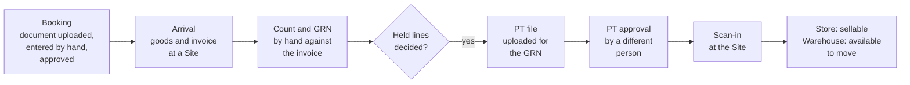

# Goods-in, first version

> **Rank 3 of 4: design.** Must not contradict the PRD or the KDPS policies. See [README.md](../../README.md).

Status: **Draft**, 21 Oct 2026, written section by section for the product owner's approval. Sections 1 and 2 approved by the product owner on 21 Oct 2026; section 3 drafted; the others outlined only. If this document disagrees with [prd.md](../../prd.md) or [kdps-policies.md](../../kdps-policies.md), they win. Raise the clash; do not guess.

Implements, for the first version of stage 2 ([phases.md](../../phases.md) stage 2): from Booking and buying, recording and approving bookings; from Receiving and price tickets, the Arrival, the count, the GRN, the PT made by uploading the fixed PT template, its approval and the scan-in at the Site; from Damage, quarantine and disposal, damage reported at or after receipt; from Stock and warehouse control, stock search. It details the stage 2 modules `booking`, `receiving` and `merchandise` · PT, and the damage reports of `stock` · documents, of [module-map.md](../architecture/module-map.md) section 5. Its open questions are GI-n.

- PRD IDs: `PRD-BKG-001`–`PRD-BKG-011`, `PRD-BKG-013`, `PRD-BKG-014`, `PRD-BKG-015` (manual entry; its AI reading later); `PRD-REC-001`–`PRD-REC-009`, `PRD-REC-012`, `PRD-REC-013`, `PRD-REC-016`–`PRD-REC-018`, `PRD-REC-019` (reversal before scan-in), `PRD-REC-021`, `PRD-REC-022`; `PRD-PTW-008`–`PRD-PTW-012` (the meaning of the template's columns); `PRD-MER-005`–`PRD-MER-007`, `PRD-MER-009`, `PRD-MER-013`, `PRD-MER-014`; `PRD-IMP-002`, `PRD-IMP-006`, `PRD-IMP-008`, `PRD-IMP-011`, `PRD-IMP-012`; `PRD-STK-001`, `PRD-STK-003`, `PRD-STK-006`, `PRD-STK-017`; `PRD-DMG-001`–`PRD-DMG-006`, `PRD-DMG-010`; `PRD-PRO-001`; `PRD-UXP-005`; `PRD-LIF-001`, `PRD-LIF-002`; `PRD-ACP-001`, `PRD-ACP-003`, `PRD-ACP-005`.
- Policies: 1 (`POL-01.02`–`POL-01.04`, `POL-01.08`, `POL-01.14`), 2 (`POL-02.07`, `POL-02.09`, `POL-02.12`), 3 (`POL-03.02`–`POL-03.04`), 5 (`POL-05.01`–`POL-05.10`), 10 (`POL-10.08`), 17 (`POL-17.02`, `POL-17.03`, `POL-17.11`).
- Decisions: DEC-105, DEC-128 to DEC-139.

Depends on: [module-map.md](../architecture/module-map.md) (section 5: the stage 2 modules; 6.2 flows A, B, C and E), [domain-model.md](../architecture/domain-model.md) (section 2: the stage 2 records; section 5: approval boundaries), [stock-ledger.md](../stock/stock-ledger.md) (2.3 movement kinds, 6 holds and sellable stock, 13 the interface), [books-and-posting.md](../finance/books-and-posting.md) (posting a valued movement), [structure-and-masters.md](../masters/structure-and-masters.md) (products, external codes, vocabularies, agreements), [access-and-approvals.md](../access/access-and-approvals.md) (approvals, My work, exceptions), [numbering-and-audit.md](../platform/numbering-and-audit.md) (document numbers), [imports-and-opening-data.md](../platform/imports-and-opening-data.md) (stored files and the import pipeline).

Inputs, not ranked: the grill notes [stage-2-grill-notes.md](../../plan/stage-2-grill-notes.md); [pt-file-layouts.md](../../data-notes/pt-file-layouts.md) section 1 (KDPS's PT template) and [item-master-vocabulary.md](../../data-notes/item-master-vocabulary.md) (its master sheet); [grn-standard-fields.md](../../research/grn-standard-fields.md); the earlier RetailsOps system document [system-dumb.md](../../history/system-dumb.md) (sections 4 to 6, 13 to 15, 17.5, 18.3 to 18.6, 20.4, 20.5) and the earlier RetailsOps goods plan (`change-prd-goods-to-store-acceptance.md`, kept outside this repository).

---

## 1. What this document fixes

The first version of goods-in is the operational path from a booking to stock that can be sold at a Store, all entered by hand (`DEC-134`, `DEC-136`):

1. **Booking.** The booking document is uploaded and the booking is entered by hand. It is approved against open-to-buy (section 3).
2. **Arrival.** Goods reach a Store or a warehouse with their supplier invoice (section 4).
3. **Count and GRN.** The goods are counted by hand against the invoice; documents and photos are uploaded; the GRN is issued (section 4).
4. **PT file.** Whoever is assigned makes the PT file by hand in the Organisation's fixed PT template and uploads it for the GRN (section 5).
5. **PT approval.** A different person approves it; the stock becomes official and valued (section 6).
6. **Scan-in.** The goods are scanned in at the Site; at a Store they become sellable (section 7).

Damage reported at or after receipt (section 8) and stock search with the stage 2 reports (section 9) complete it.

**After the first version**, still to be placed (RR-546): the PT workbench and costing profiles per brand; readers for vendor PT files in XLS, XLSB and CSV and their layouts; all AI reading, of booking documents and PT files; barcodes and labels for goods that arrive without a brand barcode; piece-tracked products and piece IDs; supplemental PTs and clean lines going ahead while others are disputed; PT corrections after scan-in; inbound ownership, goods owned before they arrive (`DEC-139`). Each keeps its PRD ID; nothing here removes it.

**Moved out of stage 2:** supplier invoice matching goes to stage 5, with supplier payments (`DEC-137`). The side-by-side test imports of the earlier POS stay parked.

**Not in stage 2:** transfers between Sites, supplier returns, write-off, disposal and counts (stage 3); payment runs (stage 5); buying suggestions (stage 6).

**Already built in stage 1 and used here, not redesigned:** Sites, Stores, business units and locations; products, external codes, vocabularies, brands, suppliers and agreements; roles, approvals, My work and exceptions; number series; stored files; the stock ledger's movements, holds, coverage, acceptance and valuation; books, posting maps and journals; Site readiness per activity.

**What every section keeps:**

- Only the count creates custody. A booking, an invoice or a PT never creates stock (`PRD-REC-008`, `PRD-ACP-001`).
- The GRN holds quantities, never values (grill round 1).
- Every approval is by a different authorised person from the preparer, and binds to the exact version approved (`POL-02.07`, `PRD-ACS-007`).
- An unknown value stays Unknown, never zero (`PRD-MOD-015`).
- An approved record is never edited; a correction is a linked record (`PRD-REC-019`).
- Receiving is available at a Site or business unit only after its receiving readiness is approved (`PRD-LIF-001`, `PRD-LIF-002`).

## 2. The flow end to end

| Step | Who (persona) | What happens | Record | Stock and money effect |
| --- | --- | --- | --- | --- |
| 1. Booking entered | Booking (P-BKG) | Uploads the booking document (photo or PDF); enters supplier, brand, season and destination, and lines of style code and quantity, with colour and size where given and an indicative cost and MRP each (`DEC-130`, `DEC-136`) | Booking, Draft (`booking`) | None |
| 2. Booking approved | An approver with the booking limit, not the preparer | Checks the booking against the open-to-buy budget of its brand and season, on its value at cost; the booking takes its brand's Agreement version in force at that moment (`PRD-BKG-004`, `DEC-132`) | Booking, Approved; then Issued and Confirmed as the supplier is told and accepts (`POL-05.01`) | None. Open-to-buy is reserved (`POL-05.02`) |
| 3. Arrival recorded | Whoever receives at the Site: Warehouse (P-WHS) or the Store's staff (P-STM) | Records the supplier, the brand and each invoice's number and date, and uploads the invoice; the invoice comes first (`DEC-133`) | Arrival (`receiving`) | None |
| 4. Count and GRN | The receiver | Counts by hand against the invoice, by style, colour as the invoice names it, and size (`DEC-138`); records shortage, excess, wrong, unidentified and damage apart; uploads the other documents and photos; issues the GRN, with no approval. Each GRN line links to its booking line or goes to Booking for review (`DEC-130`) | GRN (`receiving`) | Custody at the Site from the count, cost Unknown, not accepted (stock ledger: receipt count). Damage at once under a damage hold; wrong and unidentified goods in quarantine; excess under an excess hold (stock ledger 6.1) |
| 5. Held lines decided | Damage: a different person, followed up by Operations (P-OPS). Excess, wrong, unidentified: a Booking approver | Confirms or rejects each damage report; takes each excess, wrong or unidentified line in, or records it as not received (grill round 1) | Damage report (`stock` · documents); the discrepancy's decision (`receiving`) | Rejection clears only that damage hold (`PRD-DMG-003`); confirmed damage stays held (`PRD-DMG-006`) |
| 6. PT file uploaded | Whoever is assigned to make PTs | Uploads one PT file for the GRN, in the fixed template, once every held line is decided (`DEC-137`). The upload is refused whole when a value is off its list or the rows do not match the GRN per style and size with the same quantity (`DEC-134`, `DEC-135`, `DEC-138`) | PT, a draft revision (`merchandise` · PT) | None |
| 7. PT approved | A different person with PT approval authority | Approves the PT on its total proposed acquisition cost (P RATE times quantity) and confirms any new products the upload proposed (`DEC-135`; module-map 6.2 flow C) | PT, official and frozen | Coverage recorded; cost established; the stock value and its balanced journal, including what is owed to the supplier, posted under the posting map (grill round 1, `PRD-STG-002`) |
| 8. Scan-in | At a Store, its staff; at a warehouse, Warehouse | Scans each item's barcode against the approved PT and puts it on the floor or in the backstore, or in a warehouse bin; a repeated brand barcode asks which product it is (`DEC-135`) | Acceptance (`receiving`) | Acceptance and a location move (stock ledger). At a Store the goods become sellable (stock ledger 6.3); at a warehouse, available to move |

- **Before the scan-in**, a wrong PT is reversed and a corrected file uploaded and approved again by a different person (`DEC-137`).
- **Confirmed-damaged pieces** take no PT and stay held (`DEC-137`).
- **Follow-up owners:** Booking for shortage, excess, wrong and unidentified goods and for GRN lines that do not match a booking; Operations for damage (grill notes, 19 Oct 2026). Each reaches its owner in My work as an exception or a task.
- **Nothing is sent** to suppliers or anyone else from the app before stage 5 (`DEC-099`): a booking is marked Issued and Confirmed by the person who did it outside the app.

## 3. Booking

A booking records what has been ordered from a supplier for a brand and a season, to arrive at one destination. It is intent only: it creates no stock and no money effect (`PRD-REC-008`, `PRD-BKG-003`). It lives in `booking` (module-map section 5).

### 3.1 Recording a booking

- **The document first.** Booking (P-BKG) uploads the booking document the brand gave, as a photo or PDF, one file or more, kept as a stored file attached to the booking (`PRD-IMP-002`; the stage 1 stored-file rules: PDF, JPEG or PNG). At least one document is attached before the booking is submitted for approval. **Design choice.**
- **Then the entry, by hand** (`DEC-136`). Nothing is read from the document in the first version; its AI reading follows later (`PRD-BKG-015`, RR-546).
- **Header** (`PRD-BKG-001`, `PRD-BKG-014`):

| Field | Rule |
| --- | --- |
| Supplier | A party holding the supplier role, linked to the brand by a brand–supplier link in force on the booking's date (`PRD-MER-021`); otherwise the booking is refused, naming the missing link |
| Brand | A brand in force |
| Season | A value of the Organisation's season vocabulary (structure-and-masters 4.2) |
| Destination | One Site, a Store or a warehouse. Different destinations are different bookings. The business unit is chosen when the goods arrive (section 4) |
| Delivery window | A start and an end date (`POL-05.05`) |
| Booking document | The stored files above |
| Terms | Shown from the brand's Agreement, read-only (3.2) |

- **Lines** (`DEC-130`):

| Field | Rule |
| --- | --- |
| Style code | Required. As the document writes it; it need not be a style already set up |
| Colour | Optional. As the document writes it |
| Size | Optional, for an order placed at style level. A missing size stays missing; it is never Free Size (`PRD-MER-005`) |
| Quantity | Required. Whole pieces, more than zero |
| Indicative cost | Required. Integer paise, per piece. Used only for the booking's totals and the open-to-buy check; it never becomes the receipt cost (`PRD-BKG-003`) |
| MRP | Required. Integer paise, per piece |
| Delivery date | Optional, for a line arriving apart from the rest (`POL-05.05`) |

- **The size-colour grid** enters one style's lines at once: colours down, sizes across, quantities in the cells, one indicative cost and MRP for the style that each line can then change (`PRD-BKG-001`). A line without colour or size is entered on its own.
- **Totals** shown: pieces, indicative cost and MRP value, for the booking and per style (`PRD-BKG-003`).
- **Number.** A draft carries an internal reference. Approval gives the booking its number from its own number series (numbering-and-audit); with no series set up, approval is refused, naming the missing series. **Design choice.**

### 3.2 Terms

- A booking takes its terms from its brand's Agreement: commercial model, ownership-transfer event, return rights and conditions, payment and money terms (`PRD-BKG-002`, `POL-01.02`, `POL-01.08`, `POL-01.14`, `DEC-129`). It records none of its own and cannot change them.
- The terms are fixed at approval: the booking keeps the Agreement version in force at that moment, and takes a later version only when it is approved again (`POL-01.04`, `DEC-132`).
- A brand with no Agreement in force cannot have a booking approved; the refusal names the brand. A term the Agreement holds as Unknown stays Unknown on the booking (`POL-01.11`). **Design choice.**

### 3.3 Open-to-buy

- An open-to-buy budget is an amount in paise for one brand and one season (`PRD-BKG-004`). Booking prepares it, Accounts records its check, and the Owner approves it; it is used only once approved (`POL-05.09`). A change is a new version through the same three steps. Every amount is OPEN until the product owner sets it (V-17, RR-080).
- **Remaining** open-to-buy is the approved budget less the value reserved by approved bookings of that brand and season.
- A booking's value is the sum of its lines' quantity times indicative cost (domain-model section 5, DM-8).
- Approving a booking needs its value within the remaining open-to-buy; otherwise approval is refused with the shortfall shown, and the budget must be raised first. With no approved budget for the brand and season, approval is refused (`PRD-SEC-017`). **Design choice.**
- Approval reserves the booking's value (`POL-05.02`). Cancelling a balance, or an approved change that lowers the value, releases the difference; received goods keep their share reserved.

### 3.4 Lifecycle and approval

- States, from `POL-05.01`: **Draft** (editable), **Approved** (internal authorisation), **Issued** (sent to the supplier), **Confirmed** (the supplier accepted that version).
- **Submit and approve.** Booking submits the Draft; an approval request binds to that exact version (module-map 6.2 flow A). An approver, a different person from the preparer, whose booking limit covers the booking's value, approves or rejects with a reason (`POL-02.07`, `POL-02.09`). In one transaction the approval checks open-to-buy and reserves it, fixes the Agreement version, gives the number and makes the booking Approved. A rejection returns it to Draft.
- **Issued and Confirmed** are recorded by Booking, with the date, because nothing is sent from the app before stage 5 (`DEC-099`). Confirmed attaches the supplier's confirmation as a stored file. **First version, for the product owner's approval:** the line-by-line comparison of the supplier's confirmation with the booking (`PRD-BKG-010`) needs the confirmation's lines, which the first version does not capture; it follows with the AI reading of documents (RR-546). Until then a difference the supplier states is entered as a change to the booking (3.5).
- A booking is **received against** only once it is Approved, Issued or Confirmed.

### 3.5 Changes and cancellation

- A Draft is edited freely.
- After approval, any change is a new version that needs approval again before it takes effect, and it takes the Agreement version then in force (`POL-05.03`, `POL-05.10`, `PRD-ACS-007`, `DEC-132`). After issue, record the supplier's communication with the change (`POL-05.04`).
- Cancelling the undelivered balance of a line or of the whole booking is proposed by Booking and approved by a different authorised person (`POL-05.07`, `POL-05.10`). Cancellation never erases quantities already received (`PRD-BKG-013`, `POL-05.04`).
- Extending the delivery window follows the same approval (`POL-05.07`).

### 3.6 Quantities

For each line, kept apart from the invoice discrepancies of section 4 (`PRD-BKG-005`):

- **Ordered:** the quantity of the approved version.
- **Delivered:** the counted quantity of the GRN lines linked to it, in any condition, taken from those links and never typed (`PRD-BKG-006`). Excess or wrong goods recorded as not received are not delivered.
- **Cancelled:** the approved cancellations.
- **Outstanding:** ordered less delivered less cancelled, never below zero. Delivered beyond ordered is shown as over-delivered.

Example (`PRD-BKG-005`): sizes S, M and L booked at 10 each; deliveries of 5, 3 and 2 a size leave 15, 6 and 0 outstanding.

### 3.7 Receiving against a booking

- The Arrival names a booking when the goods come against one ("Receive against booking"), or none ("Goods arrived"), in the same guided workflow (`PRD-REC-002`, section 4).
- **At GRN issue** each counted GRN line links to the one line of that booking whose style code matches, and whose colour and size match where the booking line gives them. Text is compared ignoring case and spaces at the ends. Any other line goes to Booking for review (`PRD-BKG-007`, `DEC-130`). **Design choice** for the comparison.
- A GRN at a Site that is not the booking's destination goes to Booking for review. **Design choice.**
- **Later linking.** Booking may link a GRN line received without a booking, or one sent for review, to a booking line afterwards (`PRD-BKG-008`). The link is a dated record with who made it; it never changes the GRN.
- One booking can be delivered over several Arrivals; each partial delivery lowers outstanding, and a shortage stays visible (`POL-05.05`).

### 3.8 Late deliveries

- When a line's delivery date or the booking's window passes with quantity outstanding, the balance is marked overdue and a follow-up exception reaches Booking in My work (`PRD-BKG-009`, `POL-05.06`, `DEC-099`). Expiry never cancels the balance.
- Booking then extends the window or cancels the balance, each with its approval (3.5).
- The transporter and lorry receipt are recorded on the Arrival (section 4), not on the booking.

## 4. Arrival, count and GRN

To draft.

## 5. The PT file upload

To draft.

## 6. PT approval

To draft.

## 7. Scan-in at the Site

To draft.

## 8. Damage at or after receipt

To draft.

## 9. Stock search and the stage 2 reports

To draft.

## 10. Modules, records, interfaces and transactions

To draft.

## 11. Screens by persona

To draft.

## 12. Design tests

To draft.

## 13. Open questions

None yet.
